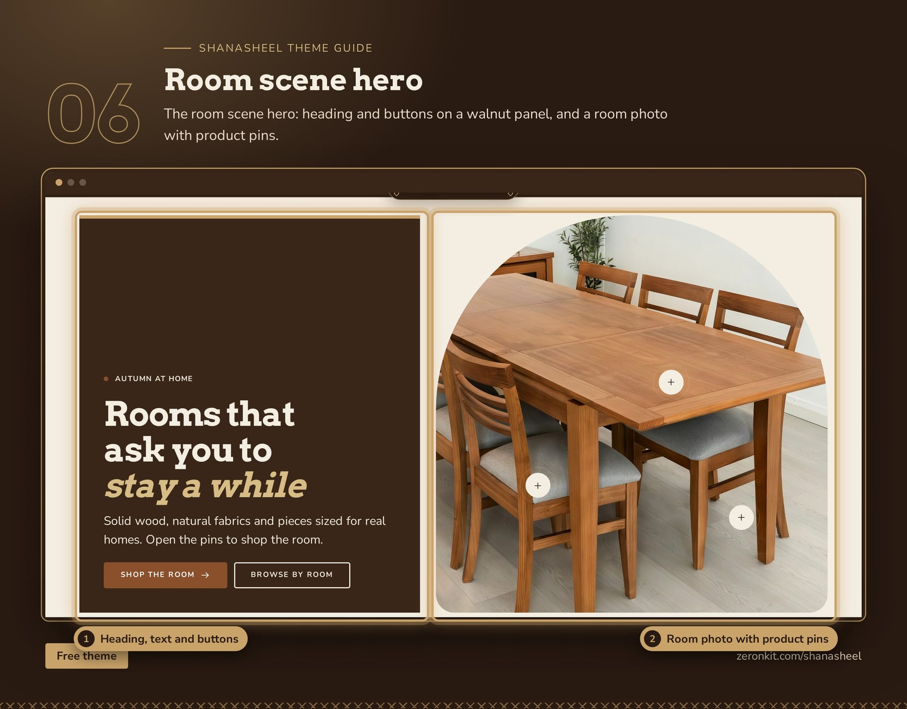
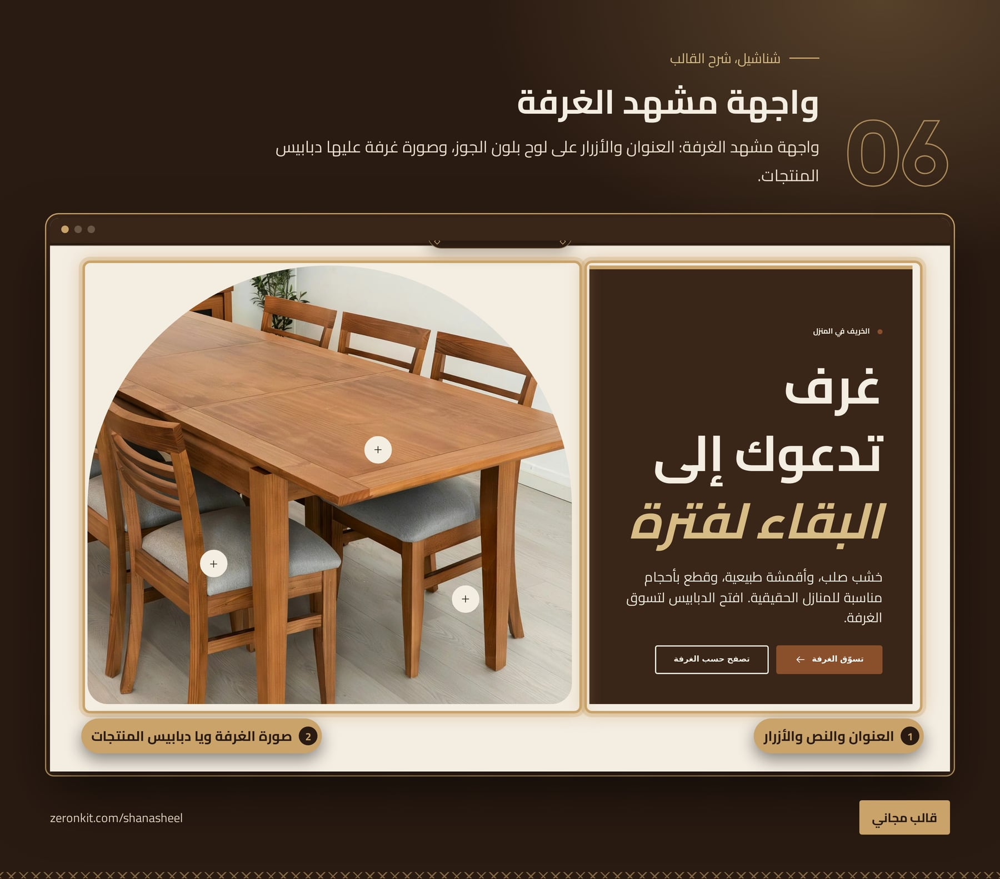

# Shanasheel, a free Shopify theme by ZeronKit

<h2 align="center">The full guide, step by step, with 34 screenshots</h2>

<table><tr><td valign="top" width="50%">

### Guide contents (English)

- [1. What Shanasheel is](docs/guide.md#1-what-shanasheel-is)
- [2. Installing, publishing and updating](docs/guide.md#2-installing-publishing-and-updating)
- [3. Getting your store content ready](docs/guide.md#3-getting-your-store-content-ready)
- [4. Changing colours, fonts and the overall style](docs/guide.md#4-changing-colours-fonts-and-the-overall-style)
- [5. The header](docs/guide.md#5-the-header)
- [6. The home page](docs/guide.md#6-the-home-page)
- [7. Collection and search pages](docs/guide.md#7-collection-and-search-pages)
- [8. The product page](docs/guide.md#8-the-product-page)
- [9. Cart](docs/guide.md#9-cart)
- [10. Contact page and other pages](docs/guide.md#10-contact-page-and-other-pages)
- [11. The footer](docs/guide.md#11-the-footer)
- [12. Editing any page](docs/guide.md#12-editing-any-page)
- [13. Arabic and other languages](docs/guide.md#13-arabic-and-other-languages)
- [14. On phones](docs/guide.md#14-on-phones)
- [15. Troubleshooting](docs/guide.md#15-troubleshooting)
- [17. Changelog](docs/guide.md#17-changelog)

</td><td valign="top" width="50%" dir="rtl">

### فهرس الشرح (العربية)

- [1. ما هو شناشيل](docs/guide-ar.md#1-ما-هو-شناشيل)
- [2. التثبيت والنشر والتحديث](docs/guide-ar.md#2-التثبيت-والنشر-والتحديث)
- [3. تجهيز محتوى المتجر](docs/guide-ar.md#3-تجهيز-محتوى-المتجر)
- [4. تغيير الألوان والخطوط والشكل العام](docs/guide-ar.md#4-تغيير-الألوان-والخطوط-والشكل-العام)
- [5. الترويسة](docs/guide-ar.md#5-الترويسة)
- [6. الصفحة الرئيسية](docs/guide-ar.md#6-الصفحة-الرئيسية)
- [7. صفحات المجموعات والبحث](docs/guide-ar.md#7-صفحات-المجموعات-والبحث)
- [8. صفحة المنتج](docs/guide-ar.md#8-صفحة-المنتج)
- [9. السلة](docs/guide-ar.md#9-السلة)
- [10. صفحة التواصل والصفحات الأخرى](docs/guide-ar.md#10-صفحة-التواصل-والصفحات-الأخرى)
- [11. التذييل](docs/guide-ar.md#11-التذييل)
- [12. تعديل أي صفحة](docs/guide-ar.md#12-تعديل-أي-صفحة)
- [13. العربية واللغات الأخرى](docs/guide-ar.md#13-العربية-واللغات-الأخرى)
- [14. على الهاتف](docs/guide-ar.md#14-على-الهاتف)
- [15. حل المشاكل](docs/guide-ar.md#15-حل-المشاكل)
- [17. سجل التغييرات](docs/guide-ar.md#17-سجل-التغييرات)

</td></tr></table>

The same guide is on the website: [zeronkit.com/shanasheel-guide](https://zeronkit.com/shanasheel-guide/) and [zeronkit.com/shanasheel-guide-ar](https://zeronkit.com/shanasheel-guide-ar/).

Shanasheel is a free Shopify theme for furniture, lighting, textiles and home decor stores, in English and Arabic. Made by [ZeronKit](https://zeronkit.com).

Version 1.1.0. See the [changelog](CHANGELOG.md) for what changed and what to do after updating.

The name comes from the carved wooden bay windows of old Baghdad and Basra houses. The theme borrows their walnut wood, brass fittings, arches and lattice.

**Source-available, free, not for resale.** This repository is not open source and is not under the GPL. You may use and change Shanasheel on stores you own or run. You may not resell, redistribute, sublicense or upload it to theme marketplaces. See [LICENSE](LICENSE).

## Download

- Latest version: [shanasheel-1.1.0.zip](https://zeronkit.com/downloads/shanasheel-1.1.0.zip) from zeronkit.com, or the same file attached to the [v1.1.0 release](https://github.com/zeronkit/shanasheel-shopify-theme/releases/tag/v1.1.0) on GitHub ([direct link](https://github.com/zeronkit/shanasheel-shopify-theme/releases/latest/download/shanasheel-1.1.0.zip)).
- Guide: [zeronkit.com/shanasheel-guide](https://zeronkit.com/shanasheel-guide/) (English) and [zeronkit.com/shanasheel-guide-ar](https://zeronkit.com/shanasheel-guide-ar/) (Arabic).
- What changed: [CHANGELOG.md](CHANGELOG.md) (English and Arabic).
- In Shopify admin: `Online Store` > `Themes` > `Add theme` > `Upload zip file`.

## Features

- Shop the room: numbered product pins on a room photo, on the home page and on every product page, with the same products listed beside the photo.
- Furniture details from metafields: dimensions as large figures and a table, a cm and inch switch, materials, care and assembly.
- Fabrics and finishes with swatch photos and notes. Clicking a finish picks that variant.
- Estimated delivery dates from stock and lead times.
- Free delivery amount in the announcement bar and a free delivery progress bar in the cart.
- Made for phones: an Add to cart bar that follows the shopper down the product page, and 44 pixel tap targets.
- Showroom collection page with a room index, a photo collage and a story tile between products.
- Magazine style journal, a workshop door contact page and a search desk.
- Six header layouts. The default hangs the logo in its own tab between the menu links.
- Ready-made style settings: palettes, font pairings, corners, buttons, card styles, spacing and animations.
- English and Arabic with full right to left support. The Cairo font loads only on Arabic pages.
- No app dependencies, no build step, no frameworks, no tracking.

## Requirements

- A Shopify store that allows custom themes.
- Search & Discovery (free Shopify app) for filters.
- Translate & Adapt (free Shopify app) for more languages.

## Updating

Uploaded themes do not update by themselves. Duplicate your theme first, then upload the new zip, copy your settings and check every page before you publish it. The steps are in [section 2.3 of the guide](docs/guide.md#23-updating-later), and [CHANGELOG.md](CHANGELOG.md) lists what to do for each version.

## Support

Free, provided as is, with no warranty. Support is best effort, by email at info@zeronkit.com. Updates are released when needed, with no schedule.

## Licence

Copyright (c) 2026 ZeronKit. ZeronKit Free Theme Licence. Source-available, free, not for resale or redistribution. The copyright and author notices must stay in the files.
