

# دليل قالب شناشيل

الإصدار 1.1.2، بتاريخ 26 نوفمبر 2026. من إعداد ZeronKit ‏(https://zeronkit.com).

يشرح هذا الدليل قالب شناشيل كله: ما هو، وكيف تثبّته، وكيف تغيّر ألوانه وخطوطه وأقسامه، وكيف تعدّل أي صفحة، وكيف تحدّثه لاحقًا. التسميات المكتوبة بهذا الشكل `code style` هي التسميات الإنجليزية كما تظهر في محرر القالب في Shopify. إذا كانت لوحة Shopify لديك بالعربية فقد تظهر التسمية مترجمة، لكن مكانها لا يتغير.

## 1. ما هو شناشيل

شناشيل قالب Shopify مجاني لمتاجر الأثاث والإضاءة والمنسوجات وديكور البيت. يعمل بالعربية والإنجليزية، وتنقلب الصفحة كلها من اليمين إلى اليسار عندما يختار الزبون العربية.

[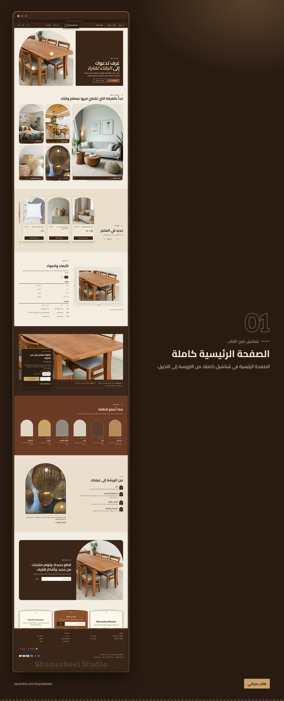](images/home-overview-ar.jpg)

### سبب التسمية

الشناشيل هي الشبابيك الخشبية البارزة المطلة على الأزقة في بيوت بغداد والبصرة القديمة. تُصنع من خشب داكن عليه مشبّك خشبي، فيرى أهل البيت الشارع ويدخل الضوء هادئًا.

أخذ القالب شكله من هذه الشبابيك:

- ألواح بلون خشب الجوز وخلفيات بلون الرمل، مثل الخشب القديم على جدار من الجص.
- خطوط ودبابيس بلون النحاس، مثل القطع المعدنية في الشبابيك.
- إطارات صور مقوّسة من الأعلى، مثل أقواس الشبابيك.
- نقش مشبّك في التذييل وفي صفحة التواصل.
- الشعار معلّق تحت شريط الترويسة في لوحة خاصة، كما يتدلّى الشنشول من الجدار.

### ما الذي يميّزه

- تسوّق الغرفة: دبابيس المنتجات فوق صورة غرفة، في الصفحة الرئيسية وفي كل صفحة منتج، والمنتجات نفسها في قائمة بجانب الصورة.
- تفاصيل أثاث حقيقية: الأبعاد بأرقام كبيرة وفي جدول، وزر للتبديل بين السنتيمتر والإنش، والخامات، والعناية والتركيب، وكلها تُقرأ من حقول المنتج الإضافية.
- الأقمشة والتشطيبات: لكل تشطيب صورة عيّنة وملاحظة قصيرة، والضغط عليه يختار ذلك الخيار.
- مواعيد التوصيل: صفحة المنتج تحسب مدة توصيل تقريبية من المخزون ومدة التجهيز.
- التوصيل المجاني أمام الزبون: شريط الإعلانات وصفحة المنتج والسلة تقرأ كلها مبلغ التوصيل المجاني نفسه، والسلة تعرض المبلغ الباقي للوصول إليه.
- قائمة تسوّق من مداخل مقوّسة، لكل مجموعة باب، وبحث يُفتح كأنه غرفة جانبية.
- سلة ترتفع من أسفل الشاشة وكل قطعة فيها على بطاقة مقوّسة، وصفحة سلة تخبر الزبون متى تصل كل قطعة إلى غرفته.
- صفحة مجموعة على شكل صالة عرض، فيها فهرس مرقّم للغرف ومجموعة صور ومربع قصة بين المنتجات.
- مدوّنة بشكل مجلة، وصفحة تواصل على شكل باب ورشة، وصفحة "من نحن" تتجوّل بالزائر في البيت، وصفحة أسئلة بأسئلة المشغل.
- العربية جاهزة، مع خط Cairo الذي يُحمَّل للصفحات العربية فقط.

### الترخيص

- يمكنك استخدام شناشيل وتعديله مجانًا على المتاجر التي تملكها أو تديرها.
- القالب ليس للبيع ولا لإعادة التوزيع. لا تبعه، ولا تشارك ملفاته، ولا ترفعه إلى أسواق القوالب، ولا تقدّمه على أنه من عملك.
- يجب أن تبقى ملاحظات حقوق النشر والمؤلف في الملفات.
- يُقدَّم القالب كما هو، دون أي ضمان. النص الكامل في ملف `LICENSE` داخل الملف المضغوط.

### ما تحتاجه

1. متجر Shopify على أي خطة تسمح بالقوالب المخصصة.
2. منتجات لها صور.
3. لعوامل التصفية في صفحات المجموعات والبحث: تطبيق Search & Discovery المجاني من Shopify.
4. للغة ثانية: تطبيق Translate & Adapt المجاني من Shopify.

لا يحتاج القالب إلى أي تطبيق آخر.

## 2. التثبيت والنشر والتحديث

### 2.1 رفع القالب

1. حمّل ملف شناشيل المضغوط من https://zeronkit.com/themes/. لا تفك ضغطه.
2. في لوحة Shopify افتح `Online Store` ثم `Themes`.
3. اضغط `Add theme` (في بعض المتاجر اسمه `Import`) واختر `Upload zip file`.
4. اختر ملف شناشيل. بعد ثوانٍ يظهر في مكتبة القوالب.

### 2.2 المعاينة والنشر

1. في مكتبة القوالب اضغط `Customize` بجانب شناشيل، فيُفتح محرر القالب.
2. راجع الصفحة الرئيسية ومجموعة ومنتجًا والسلة. استخدم قائمة الصفحات في أعلى المحرر للتنقل بينها.
3. عندما يصبح كل شيء كما تريد، ارجع إلى `Themes`، وافتح قائمة `...` بجانب شناشيل واضغط `Publish`.

### 2.3 التحديث لاحقًا

القالب المرفوع من ملف مضغوط لا يتحدّث وحده. عند صدور نسخة جديدة:

1. في `Themes` افتح قائمة `...` لنسختك الحالية واضغط `Duplicate`. هذه النسخة هي احتياطك.
2. ارفع الملف الجديد كما في 2.1، فيظهر قالبًا جديدًا في المكتبة.
3. انقل إعداداتك. إعداداتك القديمة محفوظة في القالب القديم. اضبط القالب الجديد في المحرر، أو انقل الملفات: في القالب القديم افتح `Edit code` وانسخ محتوى `config/settings_data.json` و`sections/header-group.json` و`sections/footer-group.json` وكل ملف غيّرته داخل `templates`، والصقه في الملفات نفسها في القالب الجديد.
4. راجع الصفحات: الترويسة، والصفحة الرئيسية، والألوان، ومجموعة، ومنتجًا (على الهاتف أيضًا)، والسلة وفيها منتج، وبحثًا، ومقالًا، وصفحة عادية، بكل اللغات التي تبيع بها.
5. انشر القالب الجديد فقط عندما تصبح كل الصفحات صحيحة، واحتفظ بالنسخة القديمة فترة.

يذكر القسم 17 ما تغيّر في كل إصدار، وما عليك فعله بعد التحديث.

إذا كنت تستخدم GitHub يمكنك أيضًا ربط نسخة من القالب عن طريق `Add theme` ثم `Connect from GitHub`، فيسحب Shopify كل تعديل ترفعه إلى ذلك الفرع.

## 3. تجهيز محتوى المتجر

يملأ القالب نفسه بمنتجاتك ومجموعاتك الحقيقية، فيظهر مرتبًا من أول دقيقة. وكلما كان المحتوى أفضل كان الشكل أفضل.

### 3.1 المجموعات هي الغرف

يتعامل شناشيل مع المتجر كغرف. أنشئ مجموعة لكل غرفة أو نوع منتج، مثل غرفة المعيشة وغرفة النوم وغرفة الطعام والإضاءة والديكور والمنسوجات. وضع صورة لكل مجموعة، فهي التي تظهر في مربعات الغرف وقائمة التسوق وأزرار الغرف ومجموعة صور صفحة المجموعة.

### 3.2 المنتجات

- استخدم ثلاث صور على الأقل لكل منتج. الأولى هي الصورة الرئيسية، والثانية تظهر عندما يمرّر الزبون المؤشر فوق البطاقة.
- اكتب نصًا بديلًا (alt) لكل صورة. إذا كان للمنتج ألوان فاختم النص البديل بكلمة in ثم اللون، مثل "Lounge chair in green"، فيعرض المعرض صور اللون المختار فقط.
- سمِّ خيار اللون `Colour` أو `Color`. وسمِّ خيارات القماش أو الخشب `Fabric` أو `Finish` أو `Material` أو `Upholstery` أو `Wood` أو `Leather`، ليعرضها القالب كتشطيبات.

### 3.3 حقول المنتج الإضافية

الحقول الإضافية (metafields) حقول زائدة للمنتج، تضيفها من `Settings` ثم `Custom data` ثم `Products`. يقرأ شناشيل هذه الحقول، وكلها في مساحة الاسم `shanasheel`:

| الحقل | النوع | أين يظهر |
|---|---|---|
| `shanasheel.width`، `depth`، `height`، `seat_height`، `diameter`، `length` | بُعد (Dimension) | الأرقام الكبيرة وجدول الأبعاد |
| `shanasheel.weight` | وزن | جدول الأبعاد |
| `shanasheel.dimensions` | نص متعدد الأسطر، سطر "الاسم: القيمة" لكل صف | صفوف إضافية في الجدول |
| `shanasheel.materials`، `shanasheel.finish` | نص | عنصر الأبعاد وتبويب الخامات |
| `shanasheel.care`، `shanasheel.assembly` | نص متعدد الأسطر | عنصر العناية والتركيب |
| `shanasheel.assembly_level` | نص: ready أو easy أو required | شارة التركيب |
| `shanasheel.assembly_guide` | ملف أو رابط | رابط دليل التركيب |
| `shanasheel.lead_time` | نص، على المنتج أو على الخيار | مربع التوصيل |
| `shanasheel.finishes` | قائمة كائنات فيها الاسم والصورة واللون والملاحظة | عنصر الأقمشة والتشطيبات |
| `shanasheel.room_image` | ملف صورة | صورة تسوّق الغرفة |
| `shanasheel.room_products` | قائمة منتجات | دبابيس تسوّق الغرفة والقائمة |

لا تحتاج إليها كلها. كل عنصر يخفي الأجزاء التي ليس لها بيانات، وبعضها يأخذ المعلومات من عناوين داخل وصف المنتج، مثل عنوان "Dimensions" أو "Care".

### 3.4 القوائم

من `Online Store` ثم `Navigation`:

- `Main menu` يتحكم بروابط الترويسة وقائمة التسوق. في قائمة التسوق يصير كل رابط رئيسي تحته روابط لسانًا، مثل "Shop by room" و"Lighting and decor". والروابط التي تحته وتوصل إلى مجموعات تصير أبوابًا مقوّسة فيها صورة المجموعة وعدد قطعها. أما الروابط الرئيسية التي ليس تحتها روابط، مثل "من نحن" و"التواصل"، فتذهب إلى صف الصفحات تحت الأبواب.
- `Footer menu` يملأ أعمدة التذييل.

### 3.5 الصفحات

أنشئ هذه الصفحات من `Online Store` ثم `Pages` حتى يكون لكل رابط في القالب مكان يصل إليه:

- صفحة `Contact` بقالب `page.contact`.
- صفحة "من نحن" بقالب `page.about` (انظر 10.4).
- صفحة الأسئلة الشائعة بقالب `page.faq` (انظر 10.5).
- صفحة الشحن والإرجاع، وإذا كنت تبيع أثاثًا له مقاسات فصفحة دليل القياس (الرابط المختصر `measuring-guide`، وتُفتح في درج جانبي من صفحة المنتج). هاتان تستخدمان قالب `page` العادي.

لتختار قالب الصفحة افتحها من `Online Store` ثم `Pages` واختره من `Theme template`.

### 3.6 المدوّنة

أنشئ مدوّنة باسم `Journal` وفيها بضعة مقالات. ضع صورة لكل مقال ووسمًا أو وسمين، فالوسوم تصبح روابط المواضيع في أعلى صفحة المدوّنة.

ينتهي كل مقال بصف منتجات بعنوان "تسوّق القطع" (انظر 10.2). لتختار هذه المنتجات بنفسك أضف تعريف حقل للمقالات من `Settings` ثم `Custom data`، بمساحة الاسم والمفتاح `shanasheel.products` ونوع قائمة منتجات، ثم املأه في كل مقال.

## 4. تغيير الألوان والخطوط والشكل العام

افتح محرر القالب واضغط أيقونة الفرشاة على اليسار (`Theme settings`).

### 4.1 الأنماط الجاهزة

في `Style` خيارات تغيّر المتجر كله مرة واحدة:

- `Palette`: لوحات ألوان جاهزة: Linen وWalnut (داكن) وClay وMoss وStone وHigh contrast وOchre وSlate (داكن). اختر `Custom (use the colour schemes)` لتضبط كل لون بنفسك.
- `Background style`: لون واحد، أو تدرّج خفيف، أو أقسام بلونين، أو الوضع الداكن.
- `Font pairing`: أزواج جاهزة من خط العناوين وخط النص، أو `Custom` لاستخدام قوائم الخطوط.
- `Heading scale` و`Corners` و`Button style` و`Product card style` و`Spacing`.
- `Animations`: بلا حركة، أو حركة خفيفة، أو حركة واضحة. الزبون الذي يطلب من جهازه تقليل الحركة لا يرى أي حركة.

### 4.2 كيف تغيّر الألوان

يستخدم القالب ست مجموعات ألوان (color schemes). كل قسم يختار واحدة منها، فإذا غيّرت مجموعة تغيّرت كل الأقسام التي تستخدمها.

1. في `Theme settings` افتح `Colors`.
2. اضغط على مجموعة، مثل `Scheme 1`.
3. غيّر ألوان `Background` و`Text` و`Button` و`Button label`. المعاينة تتغيّر مباشرة.
4. اضغط `Save` في أعلى اليمين.

لتعطي قسمًا واحدًا شكلًا مختلفًا، اضغط على القسم في المحرر وغيّر إعداد `Color scheme` فيه. مثلًا، قسم خطوات التوصيل يستخدم المجموعة 4.

`Page color scheme` يحدد لون الصفحة خلف الأقسام، و`Drawer and pop-up color scheme` يحدد لون درج السلة والقوائم.

اجعل الفرق بين لون النص ولون الخلفية واضحًا حتى يقرأ الجميع متجرك.

### 4.3 الخطوط

من `Typography` اختر `Heading font` و`Body font` من مكتبة خطوط Shopify، وغيّر حجمهما بالشريطين.

العربية مضبوطة مسبقًا. عندما يتصفح الزبون المتجر بالعربية يحمّل القالب خط Cairo للحروف العربية فقط، فتبقى الكلمات الإنجليزية بخطك المختار ويبقى النص العربي واضحًا.

### 4.4 إعدادات أخرى

- `Layout`: عرض الصفحة واستدارة الزوايا.
- `Product cards`: شكل الصورة، والصورة الثانية عند المرور، والمقاسات المتوفرة، وعيّنات الألوان، واسم المورّد. ويحدد `Show New badge for` عدد الأيام التي يحمل فيها المنتج الجديد شارة "جديد" (30 يومًا في البداية). وإذا جعلته 0 فلن تظهر الشارة إلا على المنتجات التي تحمل الوسم "new".
- `Cart`: درج جانبي أو صفحة سلة كاملة، وملاحظة الطلب، ورموز العملات، و`Free delivery threshold` (انظر 5.1 و9).
- `Search`: الاقتراحات الفورية و`Popular searches` (افصل بينها بفواصل).
- `Brand assets`: أيقونة المتصفح، والشعار المستخدم في المشاركة وبطاقات الهدايا، والحقل `Store contact email`. هذا الحقل فارغ في البداية، وما دام فارغًا لا يظهر أي بريد في القالب. اكتب فيه العنوان الذي تريد أن يراسلك عليه الزبائن، فيظهر في نافذة التواصل في التذييل وفي صفحة التواصل (انظر 10.1 و11).
- `Social media`: روابط أيقونات التذييل.
- `Theme credit`: يُظهر أو يخفي رابط "Theme by ZeronKit" الصغير في التذييل.

## 5. الترويسة

مجموعة الترويسة فيها شريط الإعلانات والترويسة.

### 5.1 شريط الإعلانات

اضغط `Announcement bar` في القائمة اليسرى. أضف عنصر `Message` لكل رسالة، ولكل رسالة نصها (`Text`) ورابطها وأيقونتها. `Display` يكون ثابتًا، أو رسائل تتبدّل، أو شريطًا متحركًا. الرسائل المتحركة فيها دائمًا زر إيقاف.

لتعرض مبلغ التوصيل المجاني اكتب `[threshold]` في الرسالة، مثل "توصيل مجاني من [threshold]". يضع القالب مكانها المبلغ المحدد في `Theme settings` ثم `Cart` ثم `Free delivery threshold` مع العملة، مثل "$70 USD". وإذا تركت نص رسالة أيقونة الشاحنة فارغًا يعرض القالب رسالة توصيل جاهزة بالعربية أو الإنجليزية. اجعل الحد مساويًا لمبلغ الشحن المجاني في `Settings` ثم `Shipping and delivery`.

على الهاتف تختفي الأيقونات لتبقى كل رسالة في سطر واحد، فاجعل رسائلك قصيرة.

### 5.2 الشعار

1. اضغط `Header`.
2. تحت `Logo` اضغط `Select image` وارفع شعارك. صورة PNG بخلفية شفافة أو ملف SVG هو الأفضل.
3. اضبط `Logo width on desktop` و`Logo width on mobile`.

بدون صورة شعار تعرض الترويسة `Text logo`، أو اسم المتجر إذا كان فارغًا.

### 5.3 شكل الترويسة ومكان الشعار

`Layout` يغيّر شكل الترويسة كلها:

- `Logo left, menu inline`
- `Logo centred, menu below`
- `Logo centred, menu split`: الشكل الافتراضي، الروابط على جانبي لوحة الشعار المعلّقة.
- `Minimal, menu button only`
- `Editorial masthead`
- `Side bar (desktop)`

`Logo position` ينقل الشعار إلى البداية أو الوسط أو النهاية في الأشكال inline وcentred وminimal.

### 5.4 القائمة وقائمة التسوق والبحث

- `Menu` يحدد القائمة التي تظهر روابطها في الترويسة.
- `Show the Shop navigator button` يضيف زر "تسوق". وفي الهاتف هذا الزر هو القائمة دائمًا. ويغيّر `Navigator button label` كلمة الزر.
- `Menu panel` يحدد شكل قائمة التسوق. الشكل الافتراضي `Doorways: a row of arched collection doors`: لوحة تتدلى من الترويسة بعرض الصفحة، في أعلاها ألسنة من قائمتك. اللسان المختار يملأ اللوحة بأبواب مقوّسة طويلة، لكل باب إطار من الجوز وصورة المجموعة واسمها وعدد قطعها، وفي آخر الصف باب داكن "عرض الكل". وإذا كانت الأبواب أكثر من المساحة ظهرت أسهم لتمرير الصف. وتحت خط نحاسي صف واحد فيه صفحاتك واختيار اللغة والبلد. أما `List with image tiles` فيعيد القائمة القديمة مع مربعات الصور بجانبها.

[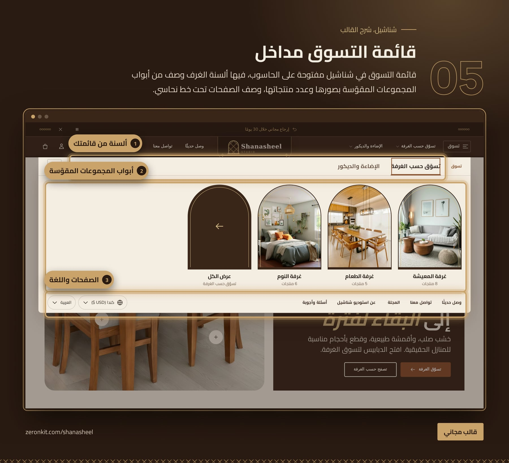](images/navigator-ar.jpg)

- `Show search` يضيف أيقونة البحث. يُفتح البحث درجًا طويلًا بلون الرمل من جانب الشاشة، كأن الزبون يدخل غرفة جانبية. الحقل ثابت في الأعلى. وكلما كتب الزبون ظهرت اقتراحات الكلمات، ثم المنتجات في شبكة من عمودين بصور مقوّسة صغيرة مع الاسم والسعر، ثم المجموعات والصفحات، ثم شريط بعرض الدرج "عرض كل النتائج". وقبل أن يكتب شيئًا تنتظر عمليات البحث الأخيرة والشائعة في الأسفل.

[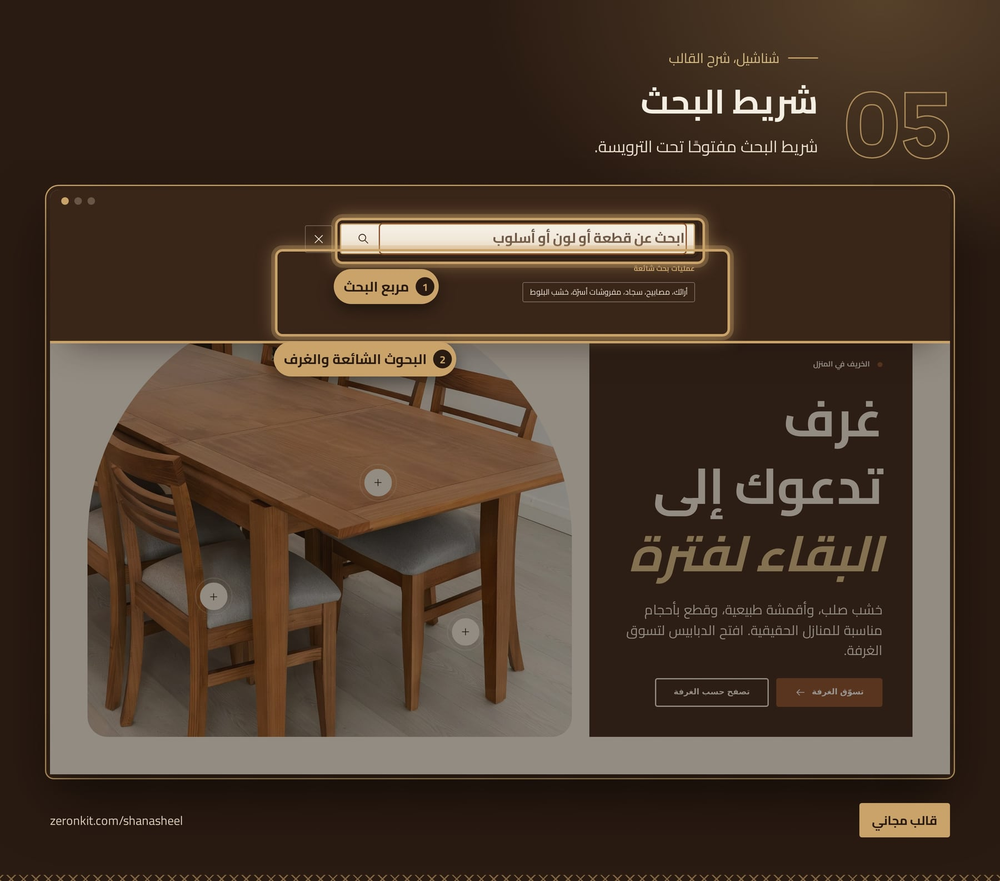](images/search-overlay-ar.jpg)

لا يقدّم Shopify اقتراحات فورية باللغة العربية. لذلك يعرض الدرج في المتجر العربي شريط "عرض كل النتائج" للكلمات المكتوبة، وهو يفتح صفحة البحث الكاملة التي تجد المنتجات فعلًا.

- `Sticky header`: غير ثابتة، أو ظاهرة دائمًا، أو تظهر عند التمرير للأعلى.
- `Transparent over the first section on the home page` يجعل الترويسة شفافة فوق صورة الواجهة حتى يبدأ الزبون بالتمرير.
- `Color scheme` و`Menu and search color scheme` يحددان ألوان الترويسة.

## 6. الصفحة الرئيسية

كل جزء من الصفحة الرئيسية قسم مستقل. في محرر القالب:

- اضغط على القسم في القائمة اليسرى لتفتح إعداداته.
- اسحب المقبض ذا النقاط الست لتنقله للأعلى أو للأسفل.
- اضغط أيقونة العين لتخفيه دون حذفه.
- اضغط `Add section` لتضيف قسمًا جديدًا، مثل صورة مع نص أو رف منتجات أو تطبيق.
- داخل القسم، `Add block` يضيف عناصر مثل الدبابيس أو الخطوات أو الخامات.

يأتي شناشيل بثمانية أقسام للصفحة الرئيسية.

### 6.1 واجهة مشهد الغرفة

[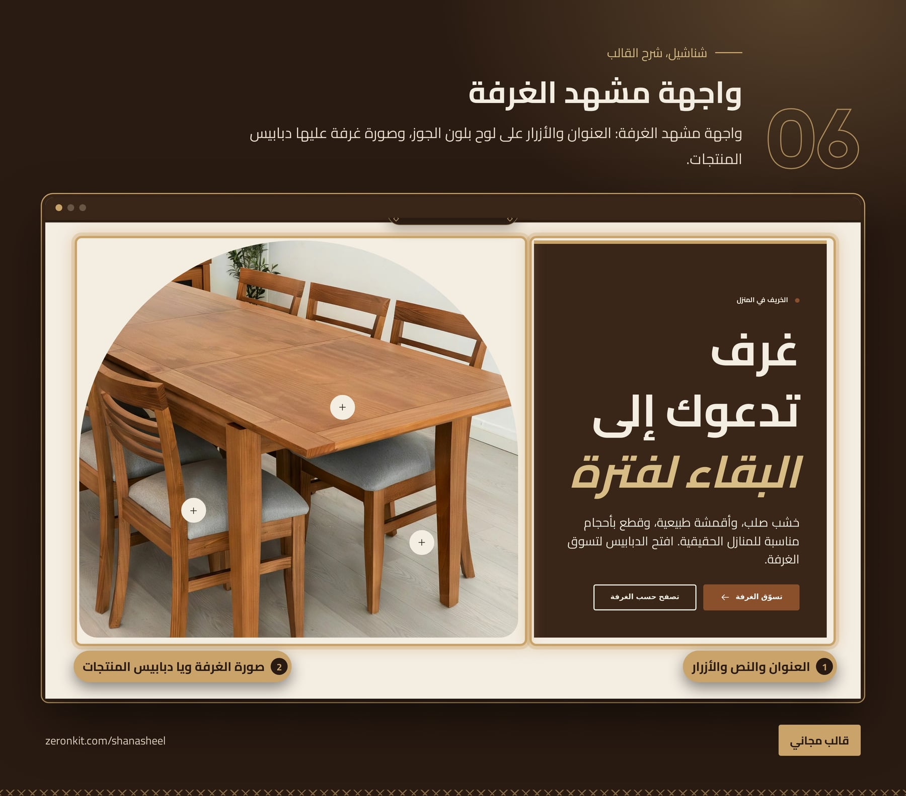](images/home-hero-ar.jpg)

- `Image` يحدد صورة الغرفة. بدونها يأخذ `Use image from collection` صورة مجموعة.
- `Room label` و`Eyebrow text` و`Heading` و`Text` تحدد الكلمات. إذا جعلت كلمة في العنوان مائلة فإنها تظهر بلون النحاس.
- زران، لكل منهما نص ورابط.
- `Image side` و`Height`.
- اجعل العنوان قصيرًا. على الحاسوب المحمول يأخذ نحو ثلاثة أسطر ويظهر الزران في الشاشة الأولى. وعلى الجهاز اللوحي تكون الصورة أقصر ليبقى العنوان والزران في الشاشة الأولى أيضًا.
- كل عنصر `Product pin` يضع منتجًا على الصورة بإعدادَي `Horizontal position` و`Vertical position`. يضغط الزبون على الدبوس فيرى المنتج وسعره.

### 6.2 تسوّق حسب الغرفة

أضف عنصر `Room` لكل مجموعة. يأخذ المربع صورة المجموعة ما لم تختر صورة أخرى. `Layout` يكون فسيفساء أو صفًا أفقيًا.

الصورة العريضة داخل مربع طويل تقترب من موضوعها. لتختار الجزء الذي يظهر حدّد نقطة التركيز في الصورة نفسها داخل Shopify (افتحها من `Content` ثم `Files` أو من المجموعة).

### 6.3 رف المنتجات

اختر `Collection` وعدد المنتجات. في البطاقات زر إضافة سريعة، فيشتري الزبون دون أن يترك الصفحة الرئيسية. المنتج الذي له خيار واحد يأخذ زر "أضف إلى السلة"، والمنتج الذي له خيارات يأخذ زر "عرض التفاصيل كاملة". وللزر الحجم نفسه والمكان نفسه في كل بطاقات القالب.

ولا تحمل البطاقة أكثر من شارة واحدة. "نفدت الكمية" أولًا، ثم "تخفيض"، ثم "جديد"، فالقطعة الجديدة المخفّضة تظهر عليها شارة التخفيض. وتتبع شارة "جديد" الإعداد `Theme settings` ثم `Product cards` ثم `Show New badge for` (انظر 4.4).

### 6.4 الأبعاد والخامات

[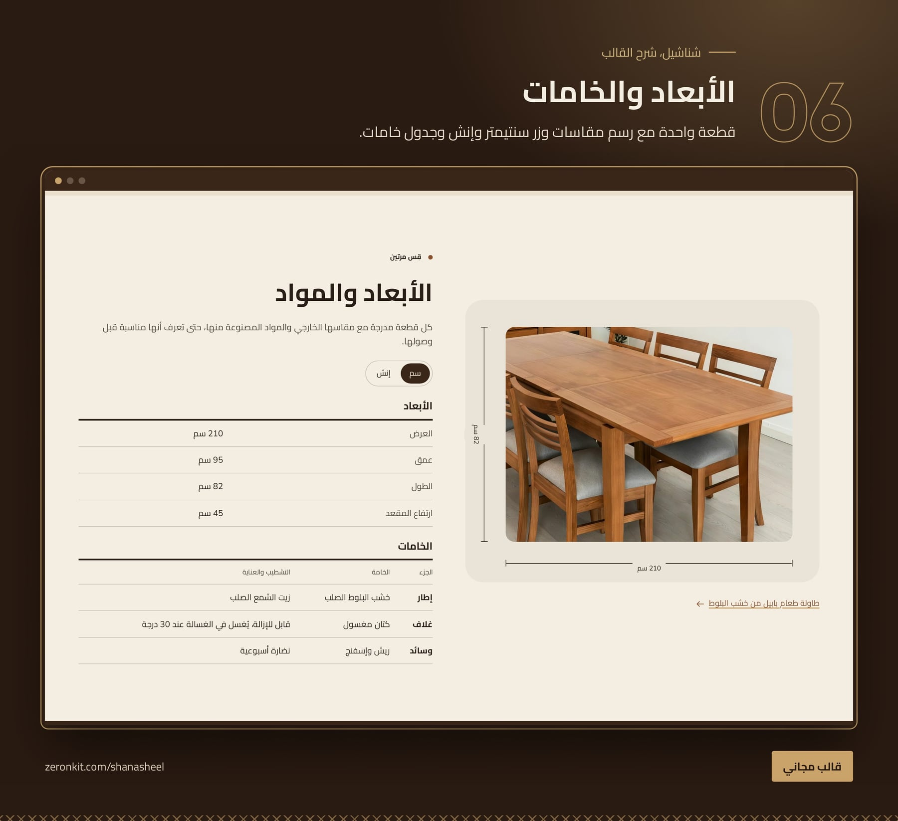](images/home-dimensions-ar.jpg)

اختر `Product`. عناصر `Measurement` تضيف صفوفًا مثل العرض والارتفاع، ويمكنها رسم خط على الصورة. وعناصر `Material row` تذكر كل جزء وخامته وتشطيبه.

### 6.5 قطعة تحت الضوء

يعرض هذا القسم قطعة واحدة كما تبدو في غرفة. صورة غرفة عريضة تمتد بعرض الصفحة، وفوق زاويتها السفلى بطاقة بارزة من الجوز حافتها العليا نحاسية. في البطاقة الاسم والسعر والخيارات والكمية وزر الإضافة إلى السلة ورابط التفاصيل الكاملة، فيشتري الزبون القطعة دون أن يغادر الصفحة الرئيسية.

- `Product` يحدد القطعة.
- `Room photo` يحدد الصورة العريضة. إذا تركته فارغًا تُستخدم أول صورة للمنتج، لكن صورة غرفة حقيقية تناسب هذا القسم أكثر.
- `Buy card corner` يضع البطاقة في جهة البداية أو جهة النهاية من الصورة. اختر الجهة التي فيها جدار أو أرضية هادئة، حتى لا تغطي البطاقة القطعة نفسها.
- `Show collection description` يعرض الأسطر الأولى من وصف المنتج في البطاقة.
- كل عنصر `Fact` يضيف معلومة قصيرة، مثل مدة التجهيز أو التركيب أو العناية. وتصطف المعلومات على سطر واحد بين خطين نحاسيين تحت الصورة.

على الهاتف تأتي الصورة أولًا، وتتداخل البطاقة مع أسفلها، ثم تأتي المعلومات في قائمة.

### 6.6 مكتبة الخامات

لكل عنصر `Material` لون عيّنة أو صورة، واسم، ونوع، ونص قصير، ورابط. `Swatch shape` يكون قوسًا أو دائرة أو مربعًا.

### 6.7 خطوات التوصيل

يشرح هذا القسم للزبون ما يحدث بين الطلب ووصول القطعة إلى غرفته. تنزل الخطوات في الصفحة كأنها طريق يصلها خط نحاسي منقّط، وكل رقم داخل قوس صغير من الجوز. وبجانبها صورة طويلة مقوّسة، تحتها ملاحظة التوصيل ورابط.

- `Eyebrow text` و`Heading` فوق الخطوات، و`Text` هو ملاحظة التوصيل تحت الصورة.
- `Image` يحدد الصورة الطويلة. بدونها يستخدم القسم صورة مجموعة. وأفضل صورة هنا صورة قطعة تُحمل إلى البيت أو تُركَّب فيه.
- `Button label` و`Link` يحددان الرابط تحت الصورة، مثل صفحة التوصيل.
- أضف عنصر `Step` لكل خطوة، ولكل عنصر `Icon` و`Heading` و`Text`. أربع خطوات عدد مناسب.

على الهاتف تأتي الصورة أولًا ثم الطريق.

### 6.8 بطاقة النشرة البريدية

[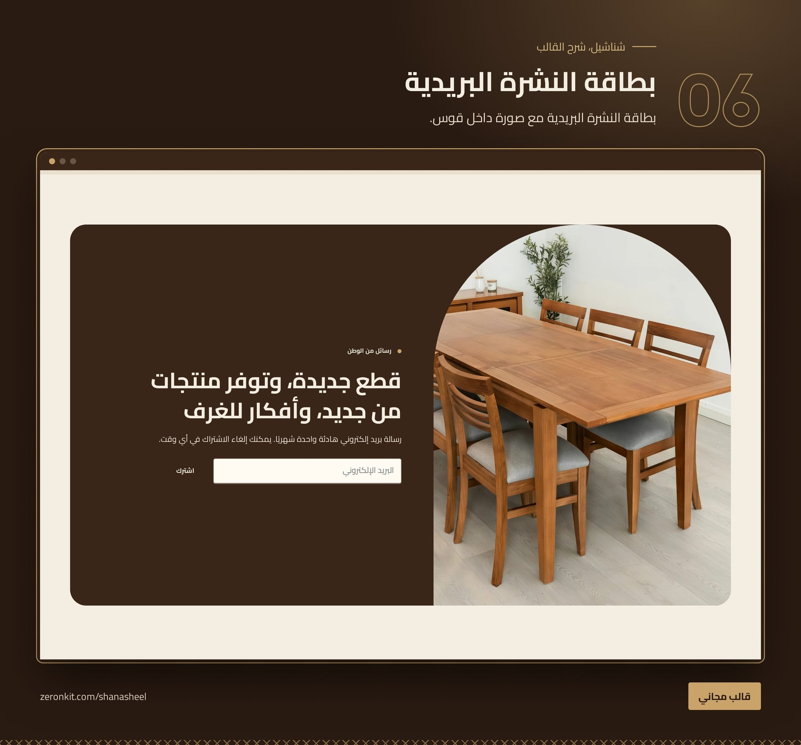](images/home-newsletter-ar.jpg)

المشتركون يُضافون إلى قائمة عملائك مع وسم newsletter.

## 7. صفحات المجموعات والبحث

### 7.1 صفحة المجموعة

[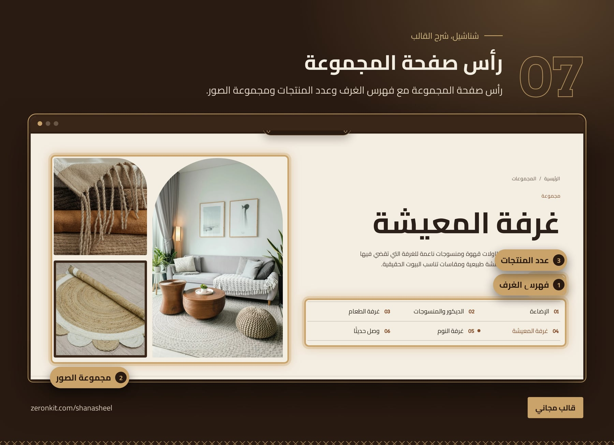](images/collection-head-ar.jpg)

[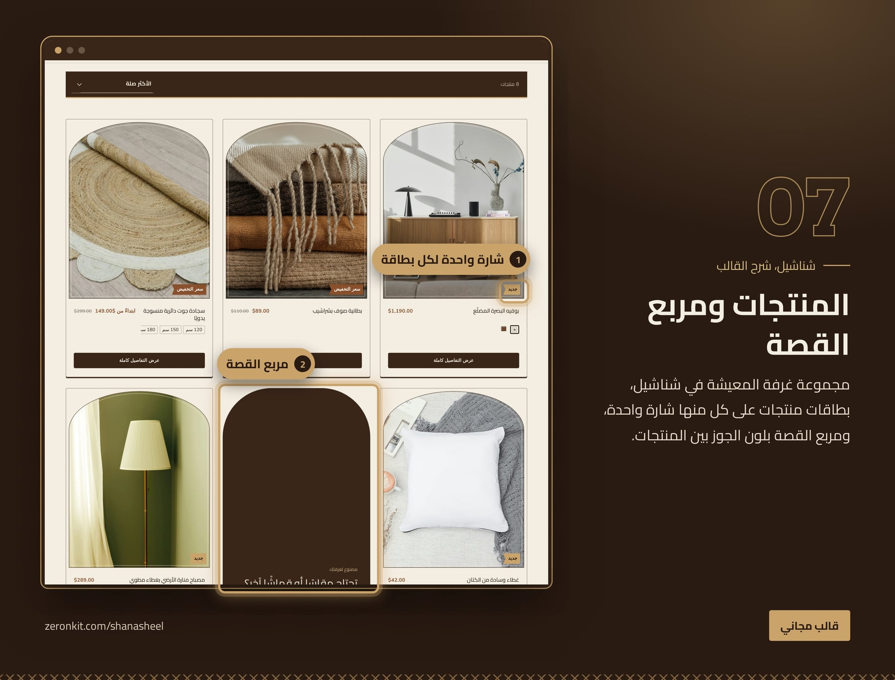](images/collection-grid-ar.jpg)

افتح أي مجموعة في المحرر (من قائمة الصفحات اختر `Collections`) واضغط `Collection: showroom`:

- `Show collection description` و`Show collection image` و`Show breadcrumb` و`Show room chips`.
- `Room chips menu`: اختر قائمة لتحدد الغرف التي تظهر في الفهرس. اتركها فارغة لتظهر مجموعاتك.
- `Products per page` و`Pagination` (صفحات مرقّمة، أو زر "عرض المزيد"، أو تحميل مستمر) و`Columns on desktop` و`Columns on mobile`.
- `Let shoppers choose how many products to show` يضيف اختيار عدد المنتجات في الصفحة.
- `Enable filtering` و`Enable sorting`. عوامل التصفية تأتي من تطبيق Search & Discovery.
- `Show a story tile between products` يضيف مربعًا بلون الجوز بين المنتجات، له `Eyebrow` و`Title` و`Text` و`Button label` و`Link`. و`Place it after product` يحدد مكانه.

في المجموعة التي فيها أقل من 12 قطعة يختفي زر التصفية واختيار عدد المنتجات مهما كانت الإعدادات، لأن القائمة القصيرة تُقرأ بنظرة ولا تحتاج إلى تصفية. ويبقى الترتيب. وفي المجموعات الأكبر تُخفى مجموعة التصفية التي ليس فيها إلا خيار واحد (مثل التوفر عندما لا يوجد إلا "متوفر").

### 7.2 صفحة البحث

بعد البحث تظهر النتائج تحت شريط قصير بلون الجوز، فيه العنوان في جانب وحقل البحث في الجانب الآخر، فتظهر النتائج الأولى في الشاشة الأولى. أما مكتب البحث قبل البحث فيبقى كما هو. وأزرار البحوث الشائعة كبيرة بما يكفي للضغط عليها بسهولة على الهاتف.

لصفحة البحث شريط التصفية والترتيب نفسه الموجود في المجموعات، وتتبع القاعدة نفسها: إذا كانت النتائج أقل من 12 فلا زر تصفية ولا اختيار لعدد المنتجات. `Suggested collection when nothing is found` يحدد ما يظهر عندما لا يجد البحث نتائج. البحوث الشائعة تأتي من `Theme settings` ثم `Search`.

## 8. صفحة المنتج

افتح منتجًا في المحرر واضغط `Product information`. في هذا القسم:

- `Gallery layout`: فسيفساء أو عمود واحد.
- `Gallery position on desktop` و`Image shape`.
- `Buy panel style`: لوحة بارزة أو بسيطة.
- `Keep product details in view while scrolling`. على الحاسوب تبدأ لوحة الشراء على مستوى الصورة الأولى، ويبقى العمود الأقصر (المعرض أو لوحة الشراء) ظاهرًا بجانب العمود الأطول، فلا يظهر عمود فارغ. ويحدث هذا في كل صفحات المنتجات.
- `Show only the selected colour's images` (انظر 3.2).

لكل صور المعرض الإطار نفسه، وفي زاوية كل صورة ملصق واحد فيه رقمها ووصفها، مثل "01 / 03 | Cream cover in daylight".

لوحة الشراء مكوّنة من عناصر. اسحبها لتغيّر ترتيبها، أو احذف ما لا تحتاجه:

- `Title` و`Price` و`Variant picker` (أزرار أو قائمة منسدلة) و`Text`. عندما يكون للخيار سعر قبل التخفيض يعرض عنصر `Price` بجانب السعر شارة مثل "وفّر 13٪"، بشكل شارة التخفيض نفسه في البطاقات: ملصق بلون الصدأ بطرف مثلوم.
- تحت السعر سطر توصيل واحد، مثل "توصيل مجاني داخل أمريكا من $70 USD. التوصيل والإرجاع". يقرأ هذا السطر قيمة `Free delivery threshold` نفسها التي يقرؤها شريط الإعلانات والسلة، ورابطه يفتح سياسة الشحن في متجرك. اكتب هذه السياسة من `Settings` ثم `Policies`. وإذا جعلت الحد 0 يختفي السطر.
- `Fabrics and finishes`: عيّنات التشطيب مع ملاحظاتها، ويمكن ربطها بصفحة لطلب عيّنات مجانية. وعندما يعرض `Variant picker` التشطيبات كعيّنات، يعرض هذا العنصر عنوانه وملاحظة التشطيب المختار فقط، وتتغيّر الملاحظة مع اختيار الزبون.
- `Delivery and lead time`: المربع الذي يقول إن القطعة متوفرة ومتى تصل تقريبًا. حدّد أيام التوصيل للقطع المتوفرة والقطع المصنوعة حسب الطلب، أو استخدم الحقل `shanasheel.lead_time`.
- `Buy buttons`: الكمية، والإضافة إلى السلة، وزر "شراء الآن"، وتوفر الاستلام من المتجر. زر الإضافة إلى السلة هو الزر النحاسي الممتلئ الوحيد، وزر "شراء الآن" بجانبه بإطار فقط، فتذهب عين الزبون إلى الإضافة أولًا. ويخفي `Show accelerated checkout buttons` زر "شراء الآن".
- `Description` و`Collapsible tab` و`Complementary products` و`Custom Liquid`. تبويب `Delivery and returns` يذكر تفاصيل التوصيل مرة واحدة، ولا يكرر مربع التوصيل.

ومنتجات بطاقات الهدايا لا يظهر فيها ما لا يخصها: لا سطر توصيل، ولا مربع توصيل، ولا سطر استلام، ولا زر "شراء الآن".

على الهاتف، بعد أن يختفي الزر الرئيسي من الشاشة، يظهر في الأسفل شريط فيه اسم المنتج وسعره وزر "أضف إلى السلة". يضيف الخيار الذي اختاره الزبون، ويكتب "نفدت الكمية" إذا لم يكن الخيار متوفرًا، ويختفي من جديد قرب التذييل. لا تحتاج إلى ضبط شيء.

### 8.1 شريط التفاصيل

تحت الصور شريط للتفاصيل الطويلة. عنصرا `Dimensions and materials` و`Care and assembly` موجودان فيه افتراضيًا، ولكل منهما إعداد `Placement` لنقله إلى لوحة الشراء.

### 8.2 تسوّق الغرفة

عنصر `Shop the room` يعرض صورة غرفة عليها حتى أربعة دبابيس مرقّمة، وقائمة بالمنتجات نفسها. يأخذ الصورة والمنتجات من إعدادات العنصر أولًا، ثم من الحقلين `shanasheel.room_image` و`shanasheel.room_products`. وإذا ملأت الحقلين صار لكل منتج غرفته الخاصة دون أن تفتح المحرر.

### 8.3 منتجات مشابهة

[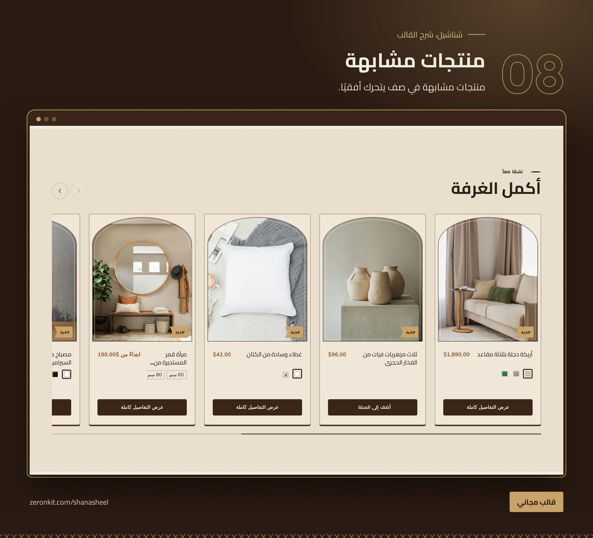](images/product-related-ar.jpg)

يختار Shopify هذه المنتجات، ويمكنك تغييرها في تطبيق Search & Discovery. `Fallback collection` يملأ الصف ما دام Shopify لا يملك اقتراحات بعد.

## 9. السلة

`Theme settings` ثم `Cart` ثم `Cart type` يحدد هل السلة درج أم صفحة كاملة. مع الدرج تُفتح السلة كلما أضاف الزبون قطعة، ويوصل رابط "عرض السلة" إلى صفحة السلة.

### 9.1 درج السلة: بطاقة الغرفة

يرتفع الدرج من أسفل الشاشة لوحًا عريضًا بلون الرمل حافته العليا نحاسية. تقف القطع جنبًا إلى جنب على بطاقات مقوّسة: الصورة والاسم والخيارات والسعر والكمية ورابط الإزالة. وإذا كانت القطع أكثر من المساحة يمرّ الصف جانبيًا بالأسهم أو بلوحة المفاتيح. وفي آخر الصف كتلة من الجوز فيها شريط التوصيل المجاني والمجموع الفرعي وملاحظة قصيرة عن الضرائب وزر الدفع و"عرض السلة".

على الهاتف يملأ الدرج الشاشة، وتصير القطع قائمة، ويبقى شريط التوصيل المجاني والمجموع وزر الدفع في شريط ثابت في الأسفل.

### 9.2 صفحة السلة: التوصيل إلى غرفتك

لكل قطعة بطاقة بعرض الصفحة، فيها صورة مقوّسة كبيرة وخياراتها وسطر توصيل بجانب شاحنة صغيرة. سطر التوصيل هو الحقل `shanasheel.lead_time` في الخيار أو في المنتج، مثل "Made by hand to order: ships in 4 to 6 weeks". وإذا لم يوجد تقول القطعة المتوفرة "متوفرة وجاهزة للإرسال". املأ مدة التجهيز في القطع المصنوعة حسب الطلب، ليعرفها الزبون قبل أن يدفع.

وتحت البطاقات شريط من الجوز فيه شريط التوصيل المجاني والمجموع الفرعي وزر الدفع وثلاثة وعود للتوصيل. يبقى هذا الشريط في أسفل النافذة أثناء التمرير. وعلى الهاتف يصير شريطًا نحيفًا، وزر "التفاصيل" يفتح الوعود وملاحظة الطلب.

في قسم `Cart` في صفحة السلة:

- `Show delivery notes` و`Delivery note 1` و`Delivery note 2` و`Delivery note 3` تحدد الوعود الثلاثة. اتركها فارغة لتظهر النصوص المدمجة بالعربية والإنجليزية.
- تحت `Empty cart` يحدد `Heading` و`Text` ما تقوله السلة الفارغة، واتركهما فارغين لتظهر النصوص المدمجة. و`Show rooms` يعرض مربعات الغرف، و`Show products` مع `Collection` يضيف صفًا من المنتجات.

لا تظهر ملاحظة الطلب في الشريط إلا عندما يكون `Theme settings` ثم `Cart` ثم `Enable order note` مفعّلًا.

### 9.3 شريط التوصيل المجاني

يعرض الدرج والصفحة كلاهما شريط التوصيل المجاني، مثل "باقٍ $31.00 على التوصيل المجاني داخل أمريكا"، ثم "حصلت على التوصيل المجاني داخل أمريكا" عندما يبلغ الطلب الحد. يقرأ الشريط قيمة `Theme settings` ثم `Cart` ثم `Free delivery threshold`، وهي المبلغ نفسه الذي يظهر في شريط الإعلانات وتحت سعر المنتج. اجعلها مساوية لمبلغ الشحن المجاني في `Settings` ثم `Shipping and delivery`، أو 0 لإخفاء الشريط. ويبقى مخفيًا أيضًا عندما تكون السلة فارغة أو عندما يدفع الزبون بعملة أخرى.

النصوص المدمجة تذكر أمريكا. فإذا كان توصيلك المجاني لبلد آخر فغيّرها من `Themes` ثم `...` ثم `Edit default theme content` (ابحث عن "free US delivery").

السطر تحت الشريط يتحدث عن الضرائب فقط، أما تكلفة الشحن فتظهر عند الدفع كالمعتاد في Shopify.

يظهر سعر كل سطر مرة واحدة. وعندما تكون الكمية أكثر من 1 يظهر سعر القطعة الواحدة تحت الاسم، مثل "$39.00 للقطعة".

## 10. صفحة التواصل والصفحات الأخرى

### 10.1 التواصل

تستخدم صفحة التواصل القالب `page.contact` والقسم `Contact: workshop door`:

- شريط داكن فيه العنوان ووعد بالرد وطرق التواصل: الكتابة، والبريد، والزيارة.
- نموذج رسالة فيه أزرار المواضيع والاسم والبريد ورقم الطلب والرسالة.
- بطاقة معرض مقوّسة فيها العنوان وأوقات الدوام والبريد والروابط السريعة. أضف عنصر `Quick link` لكل رابط.

لكل نص قيمة افتراضية بالعربية والإنجليزية. اكتب نصك في الحقل فقط إذا أردت أن تستبدل النص الافتراضي.

لا تظهر طريقة البريد ولا سطر البريد في البطاقة إلا عندما يوجد عنوان. تأخذه الصفحة من الحقل `Email address` في القسم، وإلا فمن `Theme settings` ثم `Brand assets` ثم `Store contact email`. وإذا كان الحقلان فارغين تعرض الصفحة طريقتين برقمي 01 و02، ويبقى النموذج يعمل.

تصل رسائل النموذج إلى بريد المتجر المحدد في `Settings` ثم `General`. ويطبع Shopify هذا العنوان أيضًا في سياسة الخصوصية التلقائية، فاختر عنوانًا لا مانع عندك من ظهوره.

### 10.2 المدوّنة والمقالات

[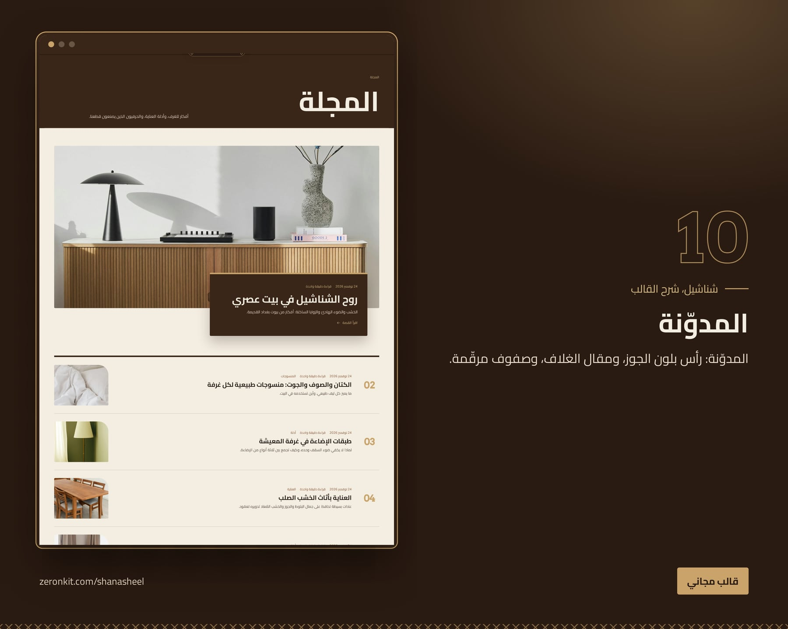](images/journal-ar.jpg)

تعرض صفحة المدوّنة أحدث مقال كمقال غلاف، والبقية كصفوف مرقّمة. وصفحة المقال يمكن أن تعرض الكاتب ومدة القراءة وحرفًا أول كبيرًا وروابط المقال السابق والتالي.

لا يستطيع Shopify ترجمة الوسوم. لذلك يحمل القالب أسماء عربية للوسوم الشائعة في المدوّنة، مثل Guides (أدلة) وCare وWood وLighting وTextiles وIdeas وLiving room، ويعرضها في الصفحات العربية. أما الوسوم الأخرى فتظهر كما كتبتها.

ينتهي كل مقال بتوقيع، مثل "كتبه Shanasheel Studio Team، 24 نوفمبر 2026"، ثم صف منتجات بعنوان "تسوّق القطع". في قسم `Blog post` يُظهر `Show "Shop the pieces"` الصف أو يخفيه، و`Heading` يغيّر عنوانه، و`Products to show` يحدد عدد المنتجات (من 2 إلى 6). تأتي المنتجات من حقل المقال `shanasheel.products` (انظر 3.6)، ثم من المنتجات التي تطابق وسومها وسوم المقال، ثم من المنتجات التي تحمل الوسم "bestseller". وإذا لم يطابق شيء يبقى الصف مخفيًا.

### 10.3 الصفحات العادية

[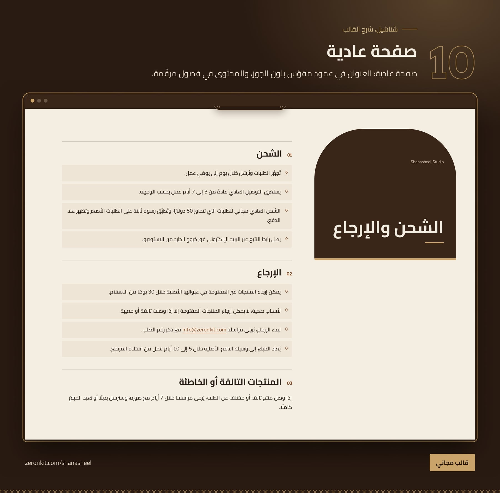](images/page-ar.jpg)

الصفحات مثل الشحن والإرجاع تستخدم القسم `Page`. يظهر العنوان داخل قوس فاتح بلون الرمل تحته خط نحاسي، ويبقى ظاهرًا على الحاسوب أثناء تمرير الفصول. كل عنوان داخل نص الصفحة يصبح فصلًا مرقّمًا.

### 10.4 من نحن: جولة في البيت

[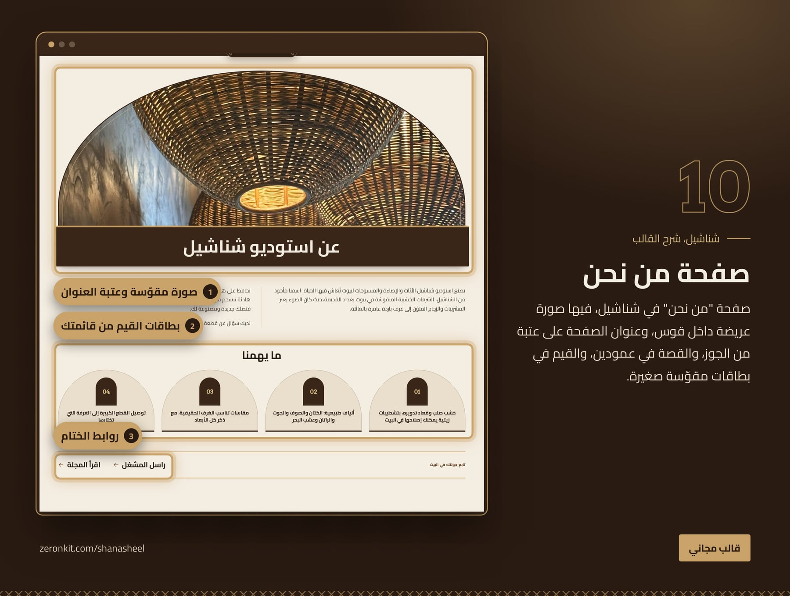](images/about-ar.jpg)

اجعل قالب صفحة "من نحن" هو `page.about` (انظر 3.5). يبدأ القسم `About: the house` بصورة عريضة داخل قوس، وتحتها عنوان الصفحة على عتبة من خشب الجوز. ثم يأتي نص صفحتك في عمودين على الحاسوب كما في المجلات، ثم بطاقات مقوّسة صغيرة لما تهتم به، وفي النهاية رابطان إلى التواصل والمجلة.

تكتب هذا كله في الصفحة نفسها، من `Online Store` ثم `Pages`:

- اكتب قصتك نصًا عاديًا بعناوين.
- تحت أحد العناوين، مثل "ما نهتم به"، اكتب قائمة قصيرة. وإذا كان `Values from the page text` مفعّلًا يحوّل القالب أول قائمة كهذه إلى بطاقات القيم المقوّسة ويحذفها من النص، فلا يظهر شيء مرتين.

ويمكنك في القسم أيضًا ضبط `Image` (بدونها تُستخدم صورة مجموعة)، و`Eyebrow text`، و`Values heading`، و`Show links to Contact and the Journal`. وإذا فضّلت كتابة البطاقات في المحرر فأضف عناصر `Value`، لكل منها `Heading` و`Text` و`Image`، فتحل العناصر محل القائمة.

### 10.5 الأسئلة: أسئلة المشغل

[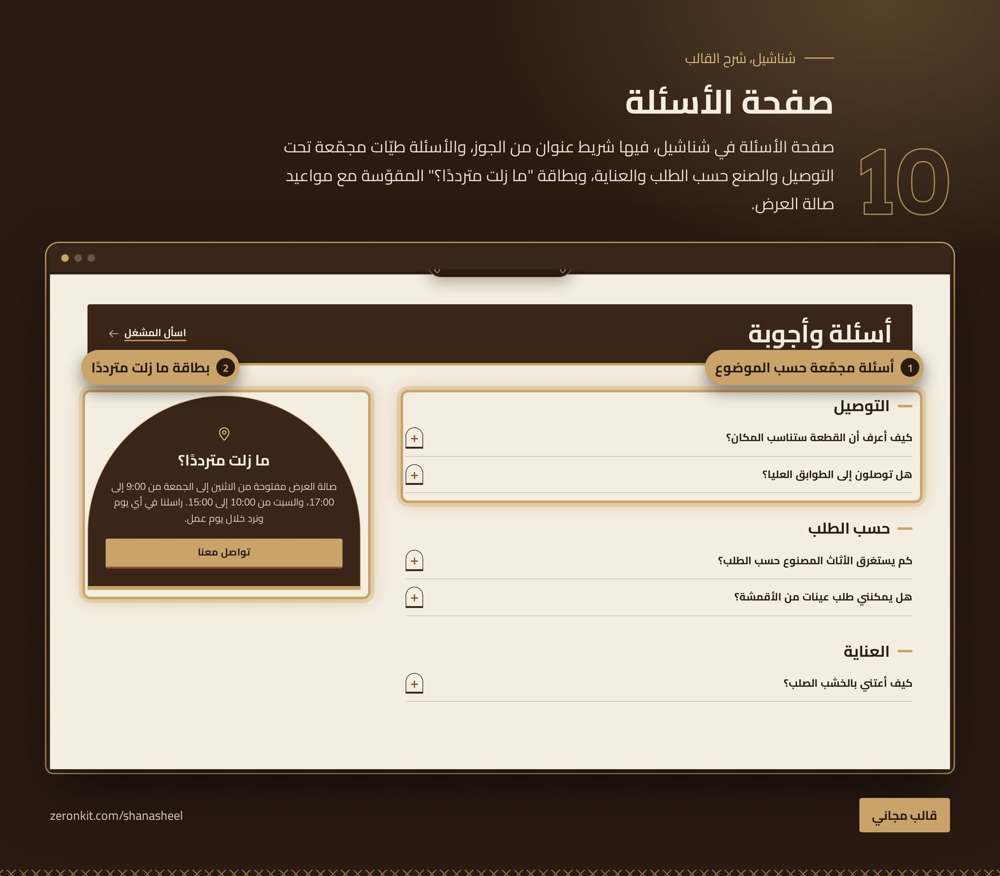](images/faq-ar.jpg)

اجعل قالب صفحة الأسئلة هو `page.faq`. في القسم `Questions: workshop` شريط عنوان من الجوز، وفي آخره رابط ("اسأل المشغل"، تضبطه بـ`Button label` و`Link`). وتحته الأسئلة طيّات تُفتح وتُغلق، مجمّعة حسب الموضوع. وبجانبها بطاقة مقوّسة "ما زلت مترددًا؟" تبقى ظاهرة، فيها مواعيد صالة العرض وزر للتواصل.

- أضف عنصر `Question` لكل سؤال، فيه `Topic` و`Question` و`Answer`. الأسئلة التي لها الموضوع نفسه تُجمع تحت عنوانه، بترتيب العناصر.
- تحت `Still unsure card` اضبط `Heading` و`Text` و`Button label` للبطاقة.

إذا لم يوجد أي عنصر `Question` تعرض الصفحة نصها كما هو. والأسئلة التي تكتبها في المحرر تُترجم في Translate & Adapt تحت `Theme`.

### 10.6 قائمة المجموعات وصفحة 404 وصفحة كلمة المرور

تعرض صفحة 404 غرفة فارغة: نافذة مقوّسة بمشبّك، وإطار صورة معلّق بميل عليه "404"، وخزانة ومصباح. ويقف العنوان ونص قصير وحقل البحث وزر "تابع التسوق" على أرضية الجوز. وتحت الرسم تظهر مجموعاتك مداخلَ مقوّسة صغيرة. يحدد `Room chips menu` المجموعات التي تظهر، و`Heading` يستبدل العنوان.

أما صفحة كلمة المرور، التي يراها الزبائن والمتجر مغلق، فتبدو كباب المشغل. صورة طويلة مقوّسة تملأ نصف الشاشة، وفي النصف الآخر لوحة اسم المتجر ورسالتك وحقل كلمة المرور وحقل النشرة البريدية. في المحرر افتح قائمة الصفحات واختر `Password`، ثم اضبط `Image` و`Show newsletter sign-up`. وعلى الهاتف تصير الصورة شريطًا في الأعلى.

## 11. التذييل

[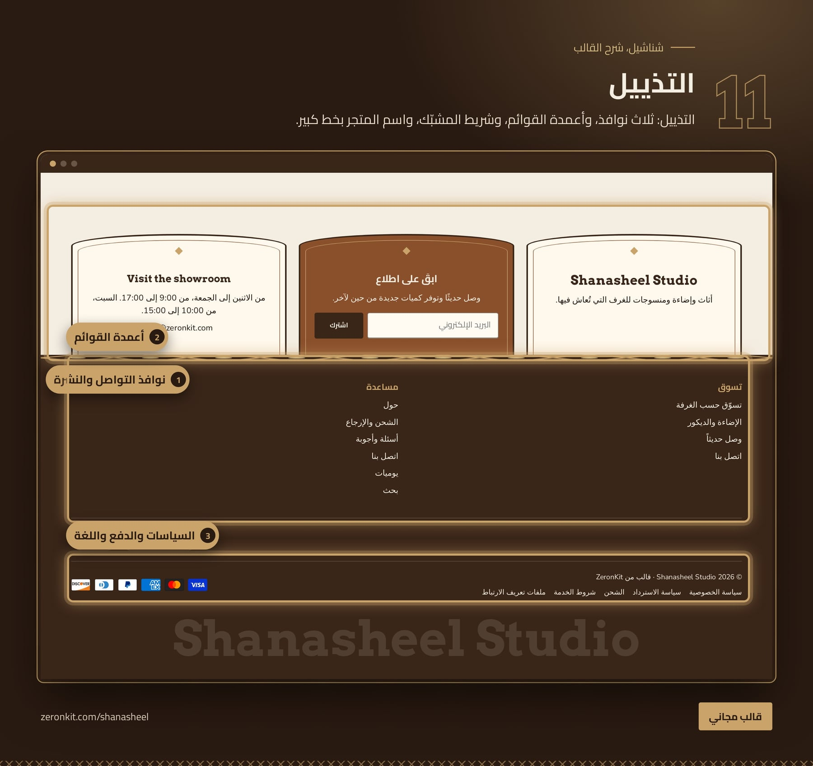](images/footer-ar.jpg)

اضغط `Footer` في القائمة اليسرى:

- `Layout`: أعمدة، أو العلامة مع أعمدة، أو في الوسط.
- `Contact window heading` و`Contact window text`. ضع هنا مواعيد صالة العرض أو عنوانها، ولا تكتب عنوان بريد في هذا النص. فعندما يكون `Theme settings` ثم `Brand assets` ثم `Store contact email` مملوءًا تضيف النافذة وحدها سطر "راسلنا" مع ذلك العنوان.
- العناصر: `Menu` و`Text` و`Newsletter`.
- مفاتيح لأيقونات التواصل الاجتماعي، وزر المتابعة على Shop، واختيار البلد واللغة، وأيقونات الدفع، وروابط السياسات، واسم المتجر الكبير.

على الحاسوب تمتد أعمدة القوائم على العرض كله، وعلى الهاتف تصبح عمودًا واحدًا.

## 12. تعديل أي صفحة

قائمة الصفحات في أعلى محرر القالب تضم كل أنواع الصفحات: الرئيسية، والمنتجات، والمجموعات، والصفحات، والمدوّنات، والسلة، والبحث، وصفحة كلمة المرور، وصفحة 404.

1. اختر نوع الصفحة.
2. اختر عنصرًا حقيقيًا، مثل منتج معيّن.
3. غيّر الأقسام والعناصر على اليسار. التغيير هنا يشمل كل الصفحات التي تستخدم القالب نفسه، مثل كل المنتجات.

لتعطي بعض المنتجات أو الصفحات شكلًا مختلفًا:

1. من قائمة الصفحات افتح القالب واختر `Create template`.
2. سمِّه، مثل `product.sofa`، واضبطه.
3. في صفحة المنتج في لوحة التحكم، اجعل `Theme template` هو القالب الجديد.

للتعديلات التي لا يستطيعها المحرر استخدم `Themes` ثم `...` ثم `Edit code`. أنشئ نسخة من القالب قبل ذلك، لأن تعديل الشيفرة لا يمكن التراجع عنه بعد الحفظ.

ومن القائمة نفسها، `Edit default theme content` يتيح تغيير أي نص مدمج في القالب، مثل نصوص الأزرار، بكل اللغات.

## 13. العربية واللغات الأخرى

1. من `Settings` ثم `Languages` أضف العربية وانشرها.
2. من `Settings` ثم `Markets` فعّل اللغة في أسواقك.

ينقلب القالب من اليمين إلى اليسار وحده ويحمّل الخط العربي. نصوص القالب مثل الأزرار والتسميات ونصوص الأقسام الافتراضية موجودة بالعربية والإنجليزية.

أما محتواك (أسماء المنتجات وأوصافها والمجموعات والصفحات والمقالات) فيُترجم في تطبيق Translate & Adapt. والنصوص التي تكتبها بنفسك في إعدادات الأقسام، مثل أسئلة صفحة الأسئلة، تُترجم هناك أيضًا، تحت `Theme`.

ويضع Shopify هنا حدّين. وسوم المدوّنة لا تُترجم، لذلك يعرض القالب أسماء عربية للشائع منها (انظر 10.2). والاقتراحات الفورية في البحث غير متاحة بالعربية، لذلك يوصل درج البحث العربي إلى صفحة البحث الكاملة (انظر 5.4).

## 14. على الهاتف

[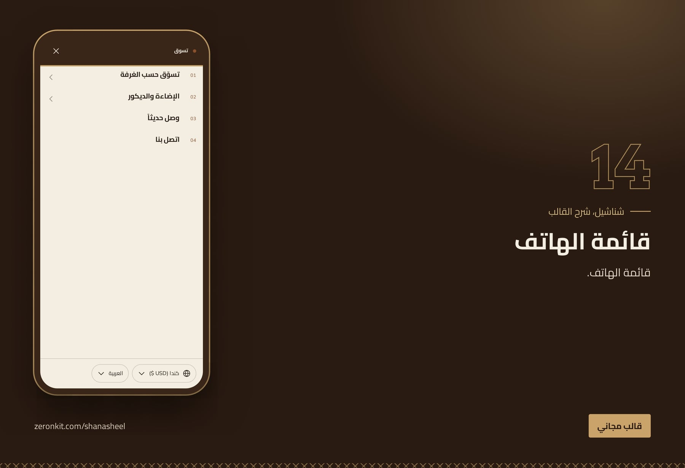](images/m-menu-ar.jpg)

[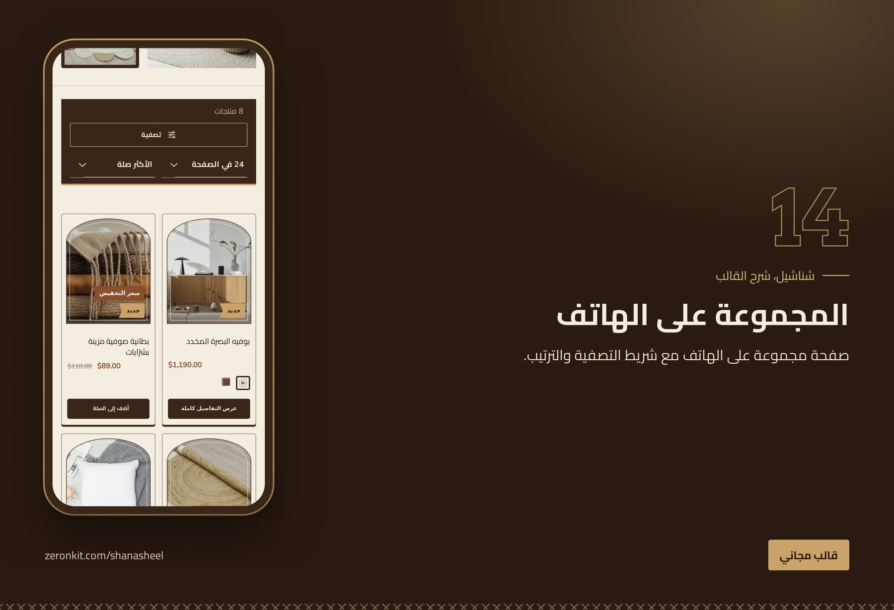](images/m-collection-ar.jpg)

[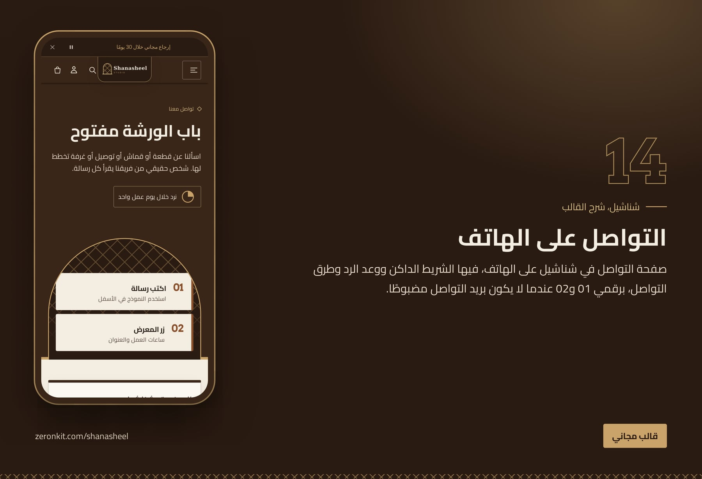](images/m-contact-ar.jpg)

لكل قسم شكل خاص على الهاتف، ولا تحتاج إلى ضبط شيء. بعض الأقسام فيها إعداد منفصل للهاتف، مثل `Columns on mobile` و`Logo width on mobile`.

على الهاتف لا يقل أي زر أو رابط عن 44 بكسل ليسهل الضغط عليه، ومنها أسماء البطاقات والروابط داخل نص الصفحات، ولا يقل أي نص عن 12 بكسل. وتصير قائمة التسوق لوحًا يملأ الشاشة والأبواب فيه في عمودين، وتملأ السلة الشاشة وزر الدفع دائمًا في الأسفل. وفي صفحات المنتجات يبقى المعرض داخل هامش الصفحة وتظهر الصورة التالية جزئيًا، ويظهر شريط "أضف إلى السلة" في الأسفل بعد أن يختفي الزر الرئيسي (انظر 8).

## 15. حل المشاكل

**المنتجات تظهر "نفدت الكمية" لزبائن بعض الدول.** راجع `Settings` ثم `Markets`. إذا كانت الدولة في سوق منفصل ليس له كتالوج منتجات أو شحن خاص به، يعرض Shopify المنتجات هناك كأنها غير متوفرة. الحل أن تضيف هذه الدول إلى سوقك الرئيسي، مع سعر شحن لها في `Settings` ثم `Shipping and delivery`.

**المنتجات تقول "نفدت الكمية" مع أن عندك مخزونًا.** تأكد أن المخزون في موقع يشحن الطلبات الإلكترونية، من `Settings` ثم `Locations`.

**يظهر نص إنجليزي في المتجر العربي.** إذا كتبت نصًا إنجليزيًا في إعداد قسم، يظهر هذا النص بكل اللغات حتى تترجمه في Translate & Adapt. امسح الحقل لتعود إلى النص المدمج بالعربية والإنجليزية.

**لا توجد عوامل تصفية في صفحة المجموعة.** ثبّت تطبيق Search & Discovery وأضف عوامل التصفية من داخله.

**عنصر الأقمشة والتشطيبات فارغ.** تأكد أن اسم الخيار واحد من الأسماء في إعداد `Option names shown as finishes` داخل العنصر.

**تسوّق الغرفة لا يعرض دبابيس.** املأ الحقل `shanasheel.room_products` أو اختر المنتجات في العنصر.

**شريط التوصيل المجاني لا يظهر في السلة.** تأكد أن قيمة `Theme settings` ثم `Cart` ثم `Free delivery threshold` أكبر من 0، وأن في السلة منتجات، وأن الزبون يدفع بعملة متجرك.

**السلة تذكر التوصيل المجاني داخل أمريكا وتوصيلك المجاني لمكان آخر.** غيّر النصوص من `Themes` ثم `...` ثم `Edit default theme content` (ابحث عن "free US delivery")، أو اجعل `Free delivery threshold` يساوي 0 لإخفاء الشريط.

**"تسوّق القطع" يعرض منتجات غير مناسبة أو لا يعرض شيئًا.** أعطِ المقال وسومًا تطابق وسوم منتجاتك، أو ضع الوسم "bestseller" على بعض المنتجات، أو املأ حقل المقال `shanasheel.products` (انظر 3.6).

**كل البطاقات عليها "جديد".** تظهر شارة "جديد" على المنتجات التي أُنشئت خلال عدد الأيام في `Theme settings` ثم `Product cards` ثم `Show New badge for`. فالمتجر الذي أضاف منتجاته كلها مرة واحدة يرى "جديد" في كل مكان مدة شهر. قلّل الأيام، أو اجعلها 0 وضع الوسم "new" على قطعك الجديدة فعلًا.

**زر التصفية غير موجود في إحدى المجموعات.** المجموعات ونتائج البحث التي فيها أقل من 12 منتجًا تخفي زر التصفية واختيار عدد المنتجات عن قصد. ويعودان عندما تصل القائمة إلى 12 منتجًا أو أكثر.

**لا يظهر أي بريد في التذييل أو في صفحة التواصل.** اكتب العنوان في `Theme settings` ثم `Brand assets` ثم `Store contact email`.

**درج البحث العربي لا يعرض منتجات أثناء الكتابة.** لا يقدّم Shopify اقتراحات فورية بالعربية. شريط "عرض كل النتائج" يفتح صفحة البحث الكاملة، وهي تجد المنتجات.

**صفحة "من نحن" أو الأسئلة تبدو صفحة عادية.** افتح الصفحة من `Online Store` ثم `Pages` واجعل `Theme template` هو `about` أو `faq`.

**نموذج التواصل لا يرسل شيئًا.** راجع بريد المتجر في `Settings` ثم `General`، وافحص مجلد الرسائل غير المرغوب فيها.

## 16. الدعم

راسلنا على info@zeronkit.com. نساعد قدر المستطاع.

## 17. سجل التغييرات

الأحدث أولًا. للتحديث من إصدار سابق اتبع الخطوات في 2.3.

### 1.1.2 (26 نوفمبر 2026)

تحديث صغير فيه إصلاح واحد، لم يُضَف فيه شيء ولم يُحذف شيء ولم يتغيّر اسم أي إعداد.

**تغيّر**

- صار زرّا `سم` و`إنش` في قسم `Dimensions and materials` بالصفحة الرئيسية أكبر على الهاتف، فارتفاعهما الآن 44 بكسل بدل 36، ليسهل لمسهما بالإصبع. أما على الأجهزة اللوحية والحاسوب فلم يتغيّر شيء.

**التحديث من 1.1.1**

1. من `Online Store` ثم `Themes` افتح قائمة `...` لنسختك الحالية من شناشيل واختر `Duplicate`، لتبقى النسخة احتياطًا لك.
2. حمّل شناشيل 1.1.2 من صفحة القالب، وارفع الملف المضغوط من `Add theme` ثم `Upload zip file`.
3. انقل إعداداتك: افتح `Edit code` في القالب القديم، وانسخ محتوى `config/settings_data.json` و`sections/header-group.json` و`sections/footer-group.json` وأي ملف عدّلته داخل `templates` إلى الملفات نفسها في القالب الجديد.
4. افتح الصفحة الرئيسية على هاتفك وتأكّد أن كل شيء في مكانه، ثم انشر القالب الجديد واحتفظ بالنسخة القديمة فترة.

إن كنت تحدّث من 1.1.0 أو 1.0.0 فاتبع خطوات 1.1.1 و1.1.0 أدناه أيضًا.

### 1.1.1 (26 نوفمبر 2026)

تحديث صغير، لم يتغيّر فيه اسم أي إعداد ولم يُحذف شيء.

**أُضيف**

- صار إعداد `Favicon` في `Theme settings` ثم `Brand assets` يحدّد أيضًا الأيقونة التي تظهر حين يحفظ المتسوّق متجرك على الشاشة الرئيسية لهاتفه. استخدم صورة مربعة لا تقل عن 180 × 180 بكسل.
- إعداد جديد باسم `Default share image` في `Brand assets`، وهو الصورة التي تظهر عند مشاركة رابط صفحة ليست لها صورة خاصة بها، مثل الرئيسية ومن نحن والتواصل والأسئلة والسياسات والمجلة والبحث والسلة. المقاس المناسب 1200 × 630 بكسل.
- بيانات أوضح لمحركات البحث في صفحات المجموعات والمجلة والمقالات.

**تغيّر**

- في الصفحة الرئيسية صار عنوان الواجهة هو العنوان الرئيسي للصفحة (h1) بدلًا من الشعار. أبقِ الواجهة أول قسم في الصفحة، أو ضع عنوانًا لقسمك الأول.
- اختفت النقطة الذهبية الصغيرة فوق لوحة الشراء في صفحة المنتج.

**التحديث من 1.1.0**

1. من `Online Store` ثم `Themes` افتح قائمة `...` لنسختك الحالية من شناشيل واختر `Duplicate`، لتبقى النسخة احتياطًا لك.
2. حمّل شناشيل 1.1.1 من صفحة القالب، وارفع الملف المضغوط من `Add theme` ثم `Upload zip file`.
3. انقل إعداداتك: افتح `Edit code` في القالب القديم، وانسخ محتوى `config/settings_data.json` و`sections/header-group.json` و`sections/footer-group.json` وأي ملف عدّلته داخل `templates` إلى الملفات نفسها في القالب الجديد.
4. ارفع أيقونتك في `Favicon` وصورة المشاركة في `Default share image`، وتصفّح بعض الصفحات، ثم انشر القالب الجديد.

إن كنت تحدّث من 1.0.0 فاتبع خطوات 1.1.0 أدناه أيضًا.

### 1.1.0 (25 نوفمبر 2026)

جاء هذا الإصدار بعد مراجعة كاملة للقالب على الحاسوب والجهاز اللوحي والهاتف، بالعربية والإنجليزية. لم يتغيّر اسم أي إعداد، فيبقى محتواك واختياراتك في المحرر كما هي. وحُذف إعدادان: `Photos to show` في قسم `Piece in focus` في الرئيسية، و`Show products` في صفحة 404 (انظر "التحديث من 1.0.0").

**أُضيف**

- **حدّ التوصيل المجاني.** إعداد جديد في `Theme settings` ثم `Cart` ثم `Free delivery threshold` (القيمة الافتراضية 70 بعملة متجرك). يمكن أن تحتوي أي رسالة في شريط الإعلانات على `[threshold]`، فيظهر مكانها هذا المبلغ مع عملته، مثل "توصيل مجاني داخل أمريكا من $70 USD". وإذا تركت رسالة أيقونة الشاحنة فارغة يكتب القالب رسالة توصيل مترجمة.

  السبب: رسالة 1.0.0 كانت "Free standard delivery over 100" بلا عملة، فلم يفهم الزبون المقصود (الوضوح والاتساق).

  ما عليك فعله: اجعل الحد مساويًا لمبلغ الشحن المجاني في `Settings` ثم `Shipping and delivery`، أو 0 إذا لم يكن لديك توصيل مجاني، وضع `[threshold]` في رسالة التوصيل.
- **شريط التقدم نحو التوصيل المجاني في السلة.** يعرض درج السلة وصفحة السلة المبلغ الباقي للتوصيل المجاني، مثل "باقٍ $31.00 على التوصيل المجاني داخل أمريكا"، ثم "حصلت على التوصيل المجاني داخل أمريكا" عندما يبلغ الطلب الحد. ويستخدم الإعداد نفسه `Free delivery threshold`.

  السبب: يرى الزبون مباشرة كم بقي له ليحصل على التوصيل المجاني (مسار الشراء).

  ما عليك فعله: يكفي ضبط الحد، واجعله 0 لإخفاء الشريط. النصوص المدمجة تذكر أمريكا، فإذا كان توصيلك المجاني لبلد آخر فغيّرها من `Themes` ثم `...` ثم `Edit default theme content` (ابحث عن "free US delivery" و"free delivery").
- **شريط الإضافة إلى السلة على الهاتف.** في صفحة المنتج على الهاتف يظهر أسفل الشاشة شريط فيه اسم المنتج وسعره وزر `Add to cart` بعد أن يختفي الزر الرئيسي من الشاشة. يضيف الخيار الذي اختاره الزبون، ويكتب "نفدت الكمية" إذا لم يكن الخيار متوفرًا.

  السبب: في صفحات المنتجات الطويلة كان زر الشراء يختفي بعد الشاشة الأولى (الاستخدام على الهاتف ومسار الشراء).

  ما عليك فعله: لا شيء، فهو يعمل في كل صفحات المنتجات.
- **شارة التخفيض في صفحة المنتج.** عندما يكون للخيار سعر قبل التخفيض تظهر بجانب السعر شارة مثل "وفّر 13٪"، ويعرض شريط الهاتف سعر التخفيض مع السعر الأصلي مشطوبًا.

  السبب: كان التخفيض لا يلفت النظر في صفحة المنتج (مسار الشراء).

  ما عليك فعله: لا شيء، املأ `Compare-at price` في المنتج كالمعتاد.
- **توقيع المقال وقسم "تسوّق القطع".** ينتهي كل مقال في المدوّنة بعبارة "كتبه" مع اسم الكاتب والتاريخ، ثم صف من المنتجات. تأتي المنتجات من حقل المقال `shanasheel.products` إن وُجد، وإلا فمن المنتجات التي تطابق وسومها وسوم المقال، وإلا فمن المنتجات التي تحمل الوسم "bestseller". وإذا لم يطابق أي منتج يبقى الصف مخفيًا. وفي قسم `Blog post` الإعدادات `Show "Shop the pieces"` و`Heading` و`Products to show`.

  السبب: القارئ الذي أعجبته القصة يشتري قطعها دون أن يبحث عنها (مسار الشراء).

  ما عليك فعله: هذا اختياري. ضع الوسم "bestseller" على بعض المنتجات، أو أعطِ مقالاتك وسومًا تطابق وسوم منتجاتك. ولتختار المنتجات بنفسك أنشئ تعريف حقل للمقالات من `Settings` ثم `Custom data`، بمساحة الاسم والمفتاح `shanasheel.products` ونوع قائمة منتجات، ثم املأه في كل مقال. وأطفئ `Show "Shop the pieces"` إذا لم ترده.

- **بريد التواصل مع المتجر.** إعداد جديد في `Theme settings` ثم `Brand assets` ثم `Store contact email`، فارغ في البداية. عندما تكتب فيه عنوانك يظهر في نافذة التواصل في التذييل تحت "راسلنا" وفي صفحة التواصل. وإذا بقي فارغًا لا يظهر أي بريد ويبقى نموذج التواصل.

  السبب: كان المحتوى التجريبي في 1.0.0 يعرض عنوان صانع القالب كأنه عنوان المتجر (الثقة).

  ما عليك فعله: اكتب عنوان بريد متجرك في الإعداد. وإذا كان نص التواصل في التذييل أو صفحاتك تذكر عنوانًا آخر فغيّره.
- **وصف لكل صفحة في محركات البحث.** صار لكل صفحة وصف: نص SEO الذي كتبته أولًا، ثم نص الصفحة نفسها (المنتج أو المجموعة أو المقال أو الصفحة)، ثم وصف المتجر، ثم سطر قصير من القالب للرئيسية وقائمة المجموعات والمجلة والبحث والسلة والسياسات وصفحة 404. وتحصل صفحات المنتجات أيضًا على بيانات BreadcrumbList لمحركات البحث.

  السبب: لم يكن للرئيسية وقائمة المجموعات والمجلة والبحث والسلة والسياسات وصفحة 404 أي وصف (محركات البحث).

  ما عليك فعله: اختياري. اكتب وصفًا في `Online Store` ثم `Preferences` وفي قسم SEO لمنتجاتك ومجموعاتك، والقالب يملأ ما ينقص.
- **وسوم المجلة بلغات أخرى.** الوسوم الشائعة في المجلة (أدلة، العناية، الخشب، الإضاءة، المنسوجات، أفكار، غرفة المعيشة وغيرها) تظهر الآن بالعربية في الصفحات العربية، وغيرها يظهر كما كُتب.

  السبب: لا يستطيع Shopify ترجمة الوسوم، فكانت الوسوم الإنجليزية تظهر في الصفحات العربية (العربية).

  ما عليك فعله: لتغيير اسم وسم استخدم `Themes` ثم `...` ثم `Edit default theme content` وابحث عن اسمه.

- **قالبا صفحتي "من نحن" والأسئلة.** قالبان جديدان للصفحات لكل منهما قسمه. يبدأ `page.about` (القسم `About: the house`) بصورة عريضة داخل قوس وعنوان الصفحة على عتبة من خشب الجوز، ويعرض نص الصفحة في عمودين كالمجلات على الحاسوب، ويحوّل أول قائمة بعد عنوان إلى صف من بطاقات قيم مقوّسة صغيرة، وينتهي برابطين إلى التواصل والمجلة. أما `page.faq` (القسم `Questions: workshop`) ففيه شريط عنوان من الجوز مع رابط "اسأل المشغل"، والأسئلة طيّات مجمّعة حسب الموضوع، وبطاقة مقوّسة ثابتة "ما زلت مترددًا؟" فيها مواعيد صالة العرض وزر للتواصل.

  السبب: كانت صفحتا "من نحن" والأسئلة بالتصميم العادي نفسه، وكانت الأسئلة تُقرأ نصًا طويلًا واحدًا (سهولة القراءة).

  ما عليك فعله: من `Online Store` ثم `Pages` افتح صفحة "من نحن" واختر القالب `about`، ثم افتح صفحة الأسئلة واختر `faq`. أضف أسئلتك كتلًا في قسم الأسئلة (الموضوع والسؤال والجواب) واكتب مواعيدك في نص البطاقة. بدون كتل الأسئلة تعرض الصفحة نصها كما هو.

**تغيّر**

- **معرض صور المنتج.** لكل الصور الآن الإطار نفسه، ورقم الصورة ووصفها معًا في ملصق واحد ("01 / 03 | Cream cover in daylight") في الزاوية نفسها من كل صورة.

  السبب: في 1.0.0 كان إطار الصورة الأولى مختلفًا عن البقية، وكان الرقم والوصف ملصقين منفصلين (الاتساق).

  ما عليك فعله: لا شيء.
- **أعمدة صفحة المنتج.** تبدأ لوحة الشراء الآن على مستوى الصورة الأولى. وعلى الحاسوب يتحرك العمود الأقصر (المعرض أو اللوحة) مع الصفحة ثم يبقى ظاهرًا بجانب العمود الأطول، فلا يظهر عمود فارغ أبدًا.

  السبب: كانت اللوحة تبدأ أدنى من المعرض، وكانت الصفحات الطويلة تترك فراغًا كبيرًا (الوضوح ومسار الشراء).

  ما عليك فعله: لا شيء. يحدث هذا الآن في كل صفحات المنتجات مهما كانت قيمة `Keep product details in view while scrolling`.
- **الأقمشة والتشطيبات.** عندما تعرض أزرار الخيارات التشطيبات كعيّنات، يعرض عنصر `Fabrics and finishes` عنوانه وملاحظة التشطيب المختار فقط، وتتغيّر الملاحظة مع اختيار الزبون.

  السبب: كانت الخيارات نفسها تظهر مرتين، واحدة فوق الأخرى (الاتساق والوضوح).

  ما عليك فعله: لا شيء.
- **المعرض على الهاتف والجهاز اللوحي.** صار المعرض داخل هامش الصفحة، وتظهر الصورة التالية جزئيًا من الجانب.

  السبب: كانت الصورة الأولى تلامس حافة الشاشة، ولم يكن الزبون يعرف أن هناك صورًا أخرى (الاستخدام على الهاتف).

  ما عليك فعله: لا شيء.
- **واجهة الصفحة الرئيسية.** صار العنوان أصغر ولوحة النص أعرض، فيأخذ العنوان أسطرًا أقل ويظهر الزران في الشاشة الأولى على الحاسوب المحمول. وعلى الجهاز اللوحي صارت الصورة أقصر ليظهر العنوان والزران في الشاشة الأولى.

  السبب: كان الزران تحت الشاشة الأولى في المقاسات الشائعة للحواسيب المحمولة والأجهزة اللوحية (الوضوح ومسار الشراء).

  ما عليك فعله: لا شيء، وإذا كتبت عنوانًا طويلًا فراجعه في المحرر.
- **المسافات.** صارت المسافة بين الواجهة والقسم الذي يليها، والمسافة فوق التذييل، مثل المسافة بين أي قسمين آخرين. ولم يعد في أسفل البطاقات المقوّسة فراغ زائد.

  السبب: كانت بعض المسافات ضعف غيرها (الاتساق).

  ما عليك فعله: لا شيء.
- **التذييل.** صارت أعمدة القوائم تمتد على العرض كله في الحاسوب (أربعة أعمدة)، ويبقى عمود واحد على الهاتف.

  السبب: كانت الروابط مزدحمة في عمودين بجانبهما فراغ (الوضوح).

  ما عليك فعله: لا شيء.
- **مربعات الغرف.** الصورة العريضة داخل مربع غرفة طويل تقترب الآن من موضوعها بدل أن يظهر الجدار غالبًا.

  السبب: كانت الصور الأفقية تبدو فارغة داخل المربعات المقوّسة (الوضوح).

  ما عليك فعله: إذا لم يُظهر المربع الجزء الصحيح من الصورة فحدّد نقطة التركيز في الصورة نفسها داخل Shopify (افتح الصورة من `Content` ثم `Files` أو من المجموعة واختر نقطة التركيز).
- **أزرار بطاقات المنتجات.** صار لكل أزرار البطاقات الارتفاع نفسه وحجم النص نفسه والمسافة نفسها عن حواف البطاقة في كل الصفحات.

  السبب: كانت الأزرار بأحجام مختلفة، وأحدها يلامس حافة البطاقة (الاتساق والاستخدام على الهاتف).

  ما عليك فعله: لا شيء.
- **نتائج البحث.** عندما توجد نتائج تبدأ الصفحة بشريط قصير فيه العنوان وحقل البحث في سطر واحد، فتظهر النتائج الأولى في الشاشة الأولى. أما صفحة البحث الفارغة فلم تتغيّر.

  السبب: كانت النتيجة الأولى تحت الشاشة الأولى على الحاسوب والهاتف (مسار الشراء).

  ما عليك فعله: لا شيء.
- **أزرار البحوث الشائعة.** صار ارتفاعها 44 بكسل على الهاتف ونصها أصغر قليلًا.

  السبب: كان الضغط عليها صعبًا (الاستخدام على الهاتف).

  ما عليك فعله: لا شيء.
- **عنوان الصفحات العادية.** صار عنوان الصفحة داخل قوس فاتح بلون الرمل بدل القوس الداكن بلون الجوز. وهو أقصر، ويبدأ العنوان قرب أعلاه، ويبقى ظاهرًا على الحاسوب أثناء التمرير.

  السبب: كان القوس الداكن طويلًا ويترك فراغًا فوق العنوان (الوضوح).

  ما عليك فعله: لا شيء.
- **أحجام النصوص ومساحات اللمس.** على الهاتف صار كل نص ظاهر 12 بكسل على الأقل، وكل زر أو رابط 44 بكسل على الأقل طولًا أو عرضًا. وعلى الحاسوب صارت التسميات الصغيرة (روابط الترويسة، والعناوين الصغيرة فوق الأقسام، والأعداد، وتسميات الحقول، ورؤوس الجداول، ومسار التنقل) 13 بكسل على الأقل، ونص التذييل 14 بكسل.

  السبب: كانت بعض التسميات صغيرة يصعب قراءتها، وبعض الروابط صغيرة يصعب الضغط عليها (الوضوح والاستخدام على الهاتف).

  ما عليك فعله: لا شيء.
- **شريط الإعلانات على الهاتف.** صار النص في سطر واحد، واختفت الأيقونات على الهاتف، وكبر زرّا الإيقاف والإغلاق.

  السبب: كانت رسالة التوصيل تنقسم على سطرين وتدفع الصفحة إلى الأسفل (الاستخدام على الهاتف).

  ما عليك فعله: اجعل كل رسالة قصيرة.
- **أسطر السلة.** صار سعر السطر يظهر مرة واحدة في الجانب. وتحت اسم المنتج يظهر سعر القطعة الواحدة ("$39.00 للقطعة") فقط عندما تكون الكمية أكثر من 1.

  السبب: كان السعر نفسه يظهر مرتين في كل سطر (الوضوح).

  ما عليك فعله: لا شيء.
- **الصور وقارئات الشاشة.** النسخ الزخرفية من الصور (صور المرور على البطاقات، والصور المصغّرة، وإطارات مجموعة الصور) صار نصها البديل فارغًا، والصور الحقيقية تحتفظ بوصفها. وتُحمَّل الصورة الثانية للبطاقة بمجرد أن يصل إليها المؤشر أو اللمس أو لوحة المفاتيح.

  السبب: كانت قارئات الشاشة تقرأ كل صورة مرتين، وكانت بعض صور المرور فارغة في أول مرور (الاتساق).

  ما عليك فعله: استمر في كتابة نص بديل لصور منتجاتك.

- **زر الشراء الفوري.** صار زر `Buy it now` زرًا بإطار فقط في لوحة المنتج، والزر الممتلئ الوحيد هو الإضافة إلى السلة.

  السبب: كان زرّان ممتلئان يتنافسان على الانتباه (مسار الشراء).

  ما عليك فعله: لا شيء.
- **رسالة توصيل واحدة في صفحة المنتج.** السطر تحت السعر يقول الآن "توصيل مجاني داخل أمريكا من $70 USD" من إعداد `Free delivery threshold` نفسه الذي يستخدمه شريط الإعلانات وشريط السلة، مع رابط إلى سياسة التوصيل والإرجاع. اختفى سطر "تُحسب تكلفة الشحن عند الدفع"، ولم يعد قسم `Delivery and returns` يكرر صندوق التوصيل. وفي السلة صار السطر تحت الشريط يتحدث عن الضرائب فقط. ولا يظهر في بطاقات الهدايا سطر توصيل ولا صندوق توصيل ولا زر الشراء الفوري.

  السبب: كانت الصفحة تقول "تُحسب تكلفة الشحن عند الدفع" بجانب عرض التوصيل المجاني، وكانت معلومات التوصيل نفسها تظهر ثلاث مرات (الاتساق، الثقة).

  ما عليك فعله: اجعل الحد مساويًا لسعر الشحن المجاني الحقيقي عندك، أو اجعله 0 إذا لم تقدّم توصيلًا مجانيًا فيعود السطر القديم.
- **الشارات.** تعرض بطاقة المنتج شارة واحدة: نفدت الكمية، ثم التخفيض، ثم جديد. تظهر شارة جديد للمنتجات التي تحمل الوسم "new"، أو التي أُنشئت خلال عدد الأيام المحدد في `Theme settings` ثم `Product cards` (صار الافتراضي 30، والصفر يعني الوسم فقط). وصارت شارة "وفّر" في صفحة المنتج بشكل شارة البطاقة نفسه.

  السبب: كانت البطاقة تعرض شارتي التخفيض وجديد معًا (الاتساق).

  ما عليك فعله: أضف الوسم "new" إذا أردت الشارة على قطع أقدم.
- **القوائم الصغيرة.** المجموعات ونتائج البحث التي فيها أقل من 12 منتجًا لم تعد تعرض زر التصفية ولا اختيار عدد المنتجات في الصفحة، وتُخفى مجموعة التصفية التي فيها خيار واحد فقط.

  السبب: كانت التصفية في قائمة من خمسة منتجات تضيف نقرات بلا فائدة (سهولة القراءة).

  ما عليك فعله: لا شيء.
- **صور السلة.** صارت صور المنتجات في صفحة السلة ودرج السلة بعرض 120 بكسل على كل الشاشات.

  السبب: كان التعرّف على القطع صعبًا بعرض 78 بكسل على الهاتف (مسار الشراء).

  ما عليك فعله: لا شيء.
- **الهاتف.** صارت أسماء البطاقات وروابط الحقوق في التذييل والروابط تحت السعر وفي قسم التوصيل ورابط الحذف في السلة وحقول صفحة التواصل بارتفاع 44 بكسل. وصار النص داخل حقل البحث أقصر ("ابحث عن قطعة أو لون") ليتسع على الهاتف بالعربية والإنجليزية.

  السبب: كانت روابط كثيرة على الهاتف أصغر من 44 بكسل، وكان النص داخل حقل البحث مقطوعًا (استخدام الهاتف).

  ما عليك فعله: لا شيء.
- **وصف الصور.** الصورة الحقيقية التي ليس لها نص بديل تستخدم الآن اسم المنتج أو المجموعة أو المقال (أو عنوان الواجهة)، وتبقى النسخ الزخرفية بنص بديل فارغ.

  السبب: لم تكن قارئات الشاشة تقول شيئًا عن هذه الصور (سهولة الوصول).

  ما عليك فعله: النص البديل الذي تكتبه بنفسك له الأولوية دائمًا.

- **قائمة التسوق: المداخل.** صارت القائمة تتدلى من الترويسة بعرض الصفحة. العناصر العليا التي لها قوائم فرعية صارت ألسنة، ومجموعاتها تقف في صف واحد من مداخل مقوّسة طويلة فيها الصورة والاسم وعدد المنتجات، مع باب "عرض الكل". وتحت خط نحاسي صف واحد لصفحاتك (وصل حديثًا، المجلة، من نحن، الأسئلة، التواصل) ولاختيار اللغة والعملة. على الهاتف تملأ الشاشة، والألسنة في الأعلى والأبواب في عمودين. مفاتيح الأسهم تنقل بين الألسنة. ويعيدها `Header` ثم `Menu panel` إلى القائمة مع الصور المصغّرة.

  السبب: كل صفحة تبدأ من هنا، ويجب أن تشبه القائمة هذا المتجر (الاتساق).

  ما عليك فعله: لا شيء. تظهر المجموعة بابًا عندما يشير رابط القائمة إلى مجموعة فيها منتجات.
- **البحث: غرفة جانبية.** يفتح البحث درجًا طويلًا من جانب الشاشة. الحقل في الأعلى، والنتائج المباشرة تعرض الاقتراحات، والمنتجات في شبكة من عمودين بصور مقوّسة صغيرة مع الاسم والسعر، والمجموعات والصفحات روابط، وشريطًا بعرض كامل "عرض كل النتائج". وتنتظر عمليات البحث الأخيرة والشائعة في الأسفل قبل أن يكتب المتسوق.

  السبب: كانت لوحة البحث تغطي أعلى الصفحة كله والمنتجات صفوفًا صغيرة (سهولة القراءة).

  ما عليك فعله: لا شيء.
- **درج السلة: بطاقة الغرفة.** صارت السلة ترتفع من أسفل الشاشة لوحًا عريضًا. تقف القطع جنبًا إلى جنب بطاقاتٍ مقوّسة (الصورة والاسم والخيارات والكمية والسعر والإزالة) في صف يمرّر جانبيًا بالأسهم أو بلوحة المفاتيح، وفي آخره كتلة من الجوز فيها شريط التوصيل المجاني والمجموع الفرعي وزر الدفع و"عرض السلة". على الهاتف تملأ الشاشة، والقطع قائمة، والمجموع وزر الدفع في شريط ثابت في الأسفل.

  السبب: كان الدرج الجانبي يخفي معظم الصفحة ويعرض قطعة واحدة في الشاشات القصيرة (مسار الشراء).

  ما عليك فعله: لا شيء.
- **صفحة السلة: التوصيل إلى غرفتك.** كل قطعة بطاقة بعرض كامل فيها صورة مقوّسة كبيرة وخياراتها وسطر التوصيل (مدة التجهيز من المنتج، أو "متوفرة وجاهزة للإرسال")، والكمية والسعر في آخرها. والملخص شريط من الجوز تحت القطع يبقى أسفل النافذة أثناء التمرير: شريط التوصيل المجاني والمجموع الفرعي وزر الدفع ووعود التوصيل الثلاثة. على الهاتف يصير شريطًا نحيفًا، و"التفاصيل" تفتح ملاحظة الطلب والوعود. والسلة الفارغة تعرض مربعات الغرف من الصفحة الرئيسية.

  السبب: كان من السهل أن يضيع صندوق الملخص بجانب القطع في السلال الطويلة (مسار الشراء).

  ما عليك فعله: سطر التوصيل يقرأ حقل المنتج `shanasheel.lead_time` (الحقل نفسه الذي تستخدمه صفحة المنتج).
- **صفحة 404: الغرفة الفارغة.** رسم واحد عريض لغرفة (نافذة مقوّسة بمشربية، وإطار مائل عليه 404، وخزانة ومصباح)، والعنوان والنص وحقل البحث واقفة على أرضية الجوز. وتحته مجموعاتك مداخلَ مقوّسة صغيرة. وأُزيل صف المنتجات.

  السبب: المتسوق التائه يحتاج البحث والغرف أولًا (مسار الشراء).

  ما عليك فعله: لا شيء. ما زال `Rooms menu` يحدد المجموعات.
- **صفحة كلمة المرور: باب المشغل.** شاشة مقسومة: صورة طويلة داخل قوس في جهة، ولوحة اسم المتجر ورسالتك وطيّة كلمة المرور وحقل النشرة في الجهة الأخرى. وصارت الصفحة تستخدم الخط العربي للقالب. على الهاتف تصير الصورة شريطًا في الأعلى.

  السبب: كان العمود الضيق في الوسط يبدو نموذجًا عاديًا (سهولة القراءة).

  ما عليك فعله: اختياري. اختر صورة في قسم `Password`، وبدونها تُستخدم صورة إحدى المجموعات.
- **الرئيسية: قطعة محددة التركيز.** صورة غرفة واحدة عريضة للقطعة بعرض الصفحة، وفوق زاويتها السفلى بطاقة شراء بارزة (الاسم والسعر والخيارات والكمية وأضف إلى السلة وعرض التفاصيل كاملة). والمعلومات القصيرة على سطر بين خطين نحاسيين تحت الصورة. على الهاتف تتداخل البطاقة مع أسفل الصورة وتليها المعلومات قائمة. إعدادات جديدة: `Room photo` و`Buy card corner`.

  السبب: كانت الصورة وصندوق الشراء جنبًا إلى جنب يشبهان كل كتلة منتج أخرى (الاتساق).

  ما عليك فعله: اختياري. اختر صورة غرفة عريضة في القسم، وبدونها تُستخدم أول صورة للمنتج. وأُزيل الإعداد القديم `Photos to show`.
- **الرئيسية: من المشغل إلى البيت.** صارت خطوات التوصيل تنزل في الصفحة طريقًا يربطها خط نحاسي منقّط، وكل رقم داخل قوس صغير، بجانب صورة طويلة مقوّسة تحتها ملاحظة التوصيل والرابط. على الهاتف تأتي الصورة أولًا. إعداد جديد: `Image`.

  السبب: كانت الأعمدة الأربعة المتساوية تجعل الخطوات صعبة المتابعة على الجهاز اللوحي (سهولة القراءة).

  ما عليك فعله: اختياري. اختر صورة، مثل غرفة يجري تجهيزها، وبدونها تُستخدم صورة إحدى المجموعات.

**أُصلح**

- مسار التنقل في صفحات المجموعات على الهاتف: صارت الشرطة المائلة على مستوى الروابط.
- شبكة المنتجات على الجهاز اللوحي: أُخفيت أزرار المقاسات تحت عرض 990 بكسل (كما على الهاتف)، وصار الاسم فوق السعر، فلم تعد أسماء المنتجات مقطوعة إلى بضعة أحرف.
- صفحة السلة الفارغة بالعربية كانت تعرض "Your cart is empty" بالإنجليزية. صار النصان يأتيان من ملفات لغة القالب.

  ما عليك فعله: إذا نقلت إعداداتك من 1.0.0 وبقي في قسم `Cart` بصفحة السلة العنوان والنص الإنجليزيان القديمان، فامسح الحقلين لتظهر النصوص المترجمة.
- في صفحات المنتجات كانت لوحة الشراء منزاحة نحو 90 بكسل إلى الأسفل بسبب إزاحة متبقية، وصارت تبدأ على مستوى المعرض.

- بالعربية لا يقدّم Shopify اقتراحات البحث المباشرة، فكانت لوحة البحث تبقى فارغة. صارت تعرض رابط "عرض كل النتائج" للكلمات المكتوبة، فيفتح صفحة البحث الكاملة.

**التحديث من 1.0.0**

القالب المرفوع من ملف مضغوط لا يتحدّث وحده، ومتجرك على 1.0.0 يبقى يعمل. حدّثه عندما تكون مستعدًا:

1. من `Online Store` ثم `Themes` افتح قائمة `...` لنسختك الحالية من شناشيل واضغط `Duplicate`. هذه النسخة هي احتياطك.
2. حمّل شناشيل 1.1.0 وارفع الملف المضغوط من `Add theme` ثم `Upload zip file`، فيظهر قالبًا جديدًا غير منشور.
3. انقل إعداداتك. يمكنك ضبط القالب الجديد في المحرر كما ضبطت القديم، أو نقل الملفات: في القالب القديم افتح `Edit code` وانسخ محتوى `config/settings_data.json` و`sections/header-group.json` و`sections/footer-group.json` وكل ملف غيّرته داخل `templates`، والصقه في الملفات نفسها في القالب الجديد. لم يتغيّر اسم أي إعداد في 1.1.0، فهذه الملفات تناسبه. وأُزيل إعدادان: `Photos to show` في قسم `Piece in focus` بالرئيسية و`Show products` في قسم 404. إذا لصقت ملف `templates/index.json` أو `templates/404.json` قديمًا واعترض المحرر، فاحذف سطري `"media_limit"` و`"show_products"`.
4. في القالب الجديد اضبط `Theme settings` ثم `Cart` ثم `Free delivery threshold`، وعدّل رسالة التوصيل في `Announcement bar` لتستخدم `[threshold]`. واكتب بريد متجرك في `Theme settings` ثم `Brand assets` ثم `Store contact email`، واحذف أي عنوان آخر من نص التواصل في التذييل.
5. من `Online Store` ثم `Pages` أعطِ صفحة "من نحن" القالب `about` وصفحة الأسئلة القالب `faq`، وأضف أسئلتك إلى قسم الأسئلة.
6. راجع الصفحات: الرئيسية، والقائمة، ولوحة البحث، ومجموعة، ومنتجًا (على الهاتف أيضًا)، ودرج السلة وصفحة السلة وفيهما منتجات، وبحثًا، ومقالًا، و"من نحن" والأسئلة وصفحة 404، بكل اللغات التي تبيع بها.
7. انشر القالب الجديد فقط عندما تصبح كل الصفحات صحيحة، واحتفظ بالنسخة القديمة فترة.

ملاحظة: معلومات القالب في ملف 1.0.0 كانت تذكر الرقم 1.1.0 خطأً. لتميّز بين النسختين استخدم اسمي القالبين في مكتبتك، أو ابحث عن إعداد `Free delivery threshold` الموجود في 1.1.0 فقط.

### 1.0.0 (25 نوفمبر 2026)

الإصدار الأول.

