

# دليل قالب شناشيل

الإصدار 1.0.0. من إعداد ZeronKit ‏(https://zeronkit.com).

يشرح هذا الدليل قالب شناشيل كله: ما هو، وكيف تثبّته، وكيف تغيّر ألوانه وخطوطه وأقسامه، وكيف تعدّل أي صفحة، وكيف تحدّثه لاحقًا. التسميات المكتوبة بهذا الشكل `code style` هي التسميات الإنجليزية كما تظهر في محرر القالب في Shopify. إذا كانت لوحة Shopify لديك بالعربية فقد تظهر التسمية مترجمة، لكن مكانها لا يتغير.

## 1. ما هو شناشيل

شناشيل قالب Shopify مجاني لمتاجر الأثاث والإضاءة والمنسوجات وديكور البيت. يعمل بالعربية والإنجليزية، وتنقلب الصفحة كلها من اليمين إلى اليسار عندما يختار الزبون العربية.

### سبب التسمية

الشناشيل هي الشبابيك الخشبية البارزة المطلة على الأزقة في بيوت بغداد والبصرة القديمة. تُصنع من خشب داكن عليه مشبّك خشبي، فيرى أهل البيت الشارع ويدخل الضوء هادئًا.

أخذ القالب شكله من هذه الشبابيك:

- ألواح بلون خشب الجوز وخلفيات بلون الرمل، مثل الخشب القديم على جدار من الجص.
- خطوط ودبابيس بلون النحاس، مثل القطع المعدنية في الشبابيك.
- إطارات صور مقوّسة من الأعلى، مثل أقواس الشبابيك.
- نقش مشبّك في التذييل وفي صفحة التواصل.
- الشعار معلّق تحت شريط الترويسة في لوحة خاصة، كما يتدلّى الشنشول من الجدار.

### ما الذي يميّزه

- تسوّق الغرفة: دبابيس المنتجات فوق صورة غرفة، في الصفحة الرئيسية وفي كل صفحة منتج، والمنتجات نفسها في قائمة بجانب الصورة.
- تفاصيل أثاث حقيقية: الأبعاد بأرقام كبيرة وفي جدول، وزر للتبديل بين السنتيمتر والإنش، والخامات، والعناية والتركيب، وكلها تُقرأ من حقول المنتج الإضافية.
- الأقمشة والتشطيبات: لكل تشطيب صورة عيّنة وملاحظة قصيرة، والضغط عليه يختار ذلك الخيار.
- مواعيد التوصيل: صفحة المنتج تحسب مدة توصيل تقريبية من المخزون ومدة التجهيز.
- صفحة مجموعة على شكل صالة عرض، فيها فهرس مرقّم للغرف ومجموعة صور ومربع قصة بين المنتجات.
- مدوّنة بشكل مجلة، وصفحة تواصل على شكل باب ورشة، وصفحة بحث على شكل مكتب.
- العربية جاهزة، مع خط Cairo الذي يُحمَّل للصفحات العربية فقط.

### الترخيص

- يمكنك استخدام شناشيل وتعديله مجانًا على المتاجر التي تملكها أو تديرها.
- القالب ليس للبيع ولا لإعادة التوزيع. لا تبعه، ولا تشارك ملفاته، ولا ترفعه إلى أسواق القوالب، ولا تقدّمه على أنه من عملك.
- يجب أن تبقى ملاحظات حقوق النشر والمؤلف في الملفات.
- يُقدَّم القالب كما هو، دون أي ضمان. النص الكامل في ملف `LICENSE` داخل الملف المضغوط.

### ما تحتاجه

1. متجر Shopify على أي خطة تسمح بالقوالب المخصصة.
2. منتجات لها صور.
3. لعوامل التصفية في صفحات المجموعات والبحث: تطبيق Search & Discovery المجاني من Shopify.
4. للغة ثانية: تطبيق Translate & Adapt المجاني من Shopify.

لا يحتاج القالب إلى أي تطبيق آخر.

## 2. التثبيت والنشر والتحديث

### 2.1 رفع القالب

1. حمّل ملف شناشيل المضغوط من https://zeronkit.com/themes/. لا تفك ضغطه.
2. في لوحة Shopify افتح `Online Store` ثم `Themes`.
3. اضغط `Add theme` (في بعض المتاجر اسمه `Import`) واختر `Upload zip file`.
4. اختر ملف شناشيل. بعد ثوانٍ يظهر في مكتبة القوالب.

### 2.2 المعاينة والنشر

1. في مكتبة القوالب اضغط `Customize` بجانب شناشيل، فيُفتح محرر القالب.
2. راجع الصفحة الرئيسية ومجموعة ومنتجًا والسلة. استخدم قائمة الصفحات في أعلى المحرر للتنقل بينها.
3. عندما يصبح كل شيء كما تريد، ارجع إلى `Themes`، وافتح قائمة `...` بجانب شناشيل واضغط `Publish`.

### 2.3 التحديث لاحقًا

القالب المرفوع من ملف مضغوط لا يتحدّث وحده. عند صدور نسخة جديدة:

1. في `Themes` افتح قائمة `...` لنسختك الحالية واضغط `Duplicate`. هذه النسخة هي احتياطك.
2. ارفع الملف الجديد كما في 2.1، فيظهر قالبًا جديدًا في المكتبة.
3. افتح القالب الجديد في المحرر واضبطه. إعداداتك القديمة محفوظة في القالب القديم، فراجع الترويسة والصفحة الرئيسية والألوان.
4. انشر القالب الجديد فقط عندما تصبح كل الصفحات صحيحة، واحتفظ بالنسخة القديمة فترة.

إذا كنت تستخدم GitHub يمكنك أيضًا ربط نسخة من القالب عن طريق `Add theme` ثم `Connect from GitHub`، فيسحب Shopify كل تعديل ترفعه إلى ذلك الفرع.

## 3. تجهيز محتوى المتجر

يملأ القالب نفسه بمنتجاتك ومجموعاتك الحقيقية، فيظهر مرتبًا من أول دقيقة. وكلما كان المحتوى أفضل كان الشكل أفضل.

### 3.1 المجموعات هي الغرف

يتعامل شناشيل مع المتجر كغرف. أنشئ مجموعة لكل غرفة أو نوع منتج، مثل غرفة المعيشة وغرفة النوم وغرفة الطعام والإضاءة والديكور والمنسوجات. وضع صورة لكل مجموعة، فهي التي تظهر في مربعات الغرف وقائمة التسوق وأزرار الغرف ومجموعة صور صفحة المجموعة.

### 3.2 المنتجات

- استخدم ثلاث صور على الأقل لكل منتج. الأولى هي الصورة الرئيسية، والثانية تظهر عندما يمرّر الزبون المؤشر فوق البطاقة.
- اكتب نصًا بديلًا (alt) لكل صورة. إذا كان للمنتج ألوان فاختم النص البديل بكلمة in ثم اللون، مثل "Lounge chair in green"، فيعرض المعرض صور اللون المختار فقط.
- سمِّ خيار اللون `Colour` أو `Color`. وسمِّ خيارات القماش أو الخشب `Fabric` أو `Finish` أو `Material` أو `Upholstery` أو `Wood` أو `Leather`، ليعرضها القالب كتشطيبات.

### 3.3 حقول المنتج الإضافية

الحقول الإضافية (metafields) حقول زائدة للمنتج، تضيفها من `Settings` ثم `Custom data` ثم `Products`. يقرأ شناشيل هذه الحقول، وكلها في مساحة الاسم `shanasheel`:

| الحقل | النوع | أين يظهر |
|---|---|---|
| `shanasheel.width`، `depth`، `height`، `seat_height`، `diameter`، `length` | بُعد (Dimension) | الأرقام الكبيرة وجدول الأبعاد |
| `shanasheel.weight` | وزن | جدول الأبعاد |
| `shanasheel.dimensions` | نص متعدد الأسطر، سطر "الاسم: القيمة" لكل صف | صفوف إضافية في الجدول |
| `shanasheel.materials`، `shanasheel.finish` | نص | عنصر الأبعاد وتبويب الخامات |
| `shanasheel.care`، `shanasheel.assembly` | نص متعدد الأسطر | عنصر العناية والتركيب |
| `shanasheel.assembly_level` | نص: ready أو easy أو required | شارة التركيب |
| `shanasheel.assembly_guide` | ملف أو رابط | رابط دليل التركيب |
| `shanasheel.lead_time` | نص، على المنتج أو على الخيار | مربع التوصيل |
| `shanasheel.finishes` | قائمة كائنات فيها الاسم والصورة واللون والملاحظة | عنصر الأقمشة والتشطيبات |
| `shanasheel.room_image` | ملف صورة | صورة تسوّق الغرفة |
| `shanasheel.room_products` | قائمة منتجات | دبابيس تسوّق الغرفة والقائمة |

لا تحتاج إليها كلها. كل عنصر يخفي الأجزاء التي ليس لها بيانات، وبعضها يأخذ المعلومات من عناوين داخل وصف المنتج، مثل عنوان "Dimensions" أو "Care".

### 3.4 القوائم

من `Online Store` ثم `Navigation`:

- `Main menu` يتحكم بروابط الترويسة وقائمة التسوق. الرابط الذي تحته روابط يُفتح كلوحة، والروابط التي توصل إلى مجموعات تظهر معها صورة المجموعة.
- `Footer menu` يملأ أعمدة التذييل.

### 3.5 الصفحات

أنشئ هذه الصفحات من `Online Store` ثم `Pages` حتى يكون لكل رابط في القالب مكان يصل إليه:

- صفحة `Contact` بقالب `page.contact`.
- صفحة الشحن والإرجاع، وصفحة الأسئلة الشائعة، وإذا كنت تبيع أثاثًا له مقاسات فصفحة دليل القياس (الرابط المختصر `measuring-guide`، وتُفتح في درج جانبي من صفحة المنتج).

### 3.6 المدوّنة

أنشئ مدوّنة باسم `Journal` وفيها بضعة مقالات. ضع صورة لكل مقال ووسمًا أو وسمين، فالوسوم تصبح روابط المواضيع في أعلى صفحة المدوّنة.

## 4. تغيير الألوان والخطوط والشكل العام

افتح محرر القالب واضغط أيقونة الفرشاة على اليسار (`Theme settings`).

### 4.1 الأنماط الجاهزة

في `Style` خيارات تغيّر المتجر كله مرة واحدة:

- `Palette`: لوحات ألوان جاهزة: Linen وWalnut (داكن) وClay وMoss وStone وHigh contrast وOchre وSlate (داكن). اختر `Custom (use the colour schemes)` لتضبط كل لون بنفسك.
- `Background style`: لون واحد، أو تدرّج خفيف، أو أقسام بلونين، أو الوضع الداكن.
- `Font pairing`: أزواج جاهزة من خط العناوين وخط النص، أو `Custom` لاستخدام قوائم الخطوط.
- `Heading scale` و`Corners` و`Button style` و`Product card style` و`Spacing`.
- `Animations`: بلا حركة، أو حركة خفيفة، أو حركة واضحة. الزبون الذي يطلب من جهازه تقليل الحركة لا يرى أي حركة.

### 4.2 كيف تغيّر الألوان

يستخدم القالب ست مجموعات ألوان (color schemes). كل قسم يختار واحدة منها، فإذا غيّرت مجموعة تغيّرت كل الأقسام التي تستخدمها.

1. في `Theme settings` افتح `Colors`.
2. اضغط على مجموعة، مثل `Scheme 1`.
3. غيّر ألوان `Background` و`Text` و`Button` و`Button label`. المعاينة تتغيّر مباشرة.
4. اضغط `Save` في أعلى اليمين.

لتعطي قسمًا واحدًا شكلًا مختلفًا، اضغط على القسم في المحرر وغيّر إعداد `Color scheme` فيه. مثلًا، قسم خطوات التوصيل يستخدم المجموعة 4.

`Page color scheme` يحدد لون الصفحة خلف الأقسام، و`Drawer and pop-up color scheme` يحدد لون درج السلة والقوائم.

اجعل الفرق بين لون النص ولون الخلفية واضحًا حتى يقرأ الجميع متجرك.

### 4.3 الخطوط

من `Typography` اختر `Heading font` و`Body font` من مكتبة خطوط Shopify، وغيّر حجمهما بالشريطين.

العربية مضبوطة مسبقًا. عندما يتصفح الزبون المتجر بالعربية يحمّل القالب خط Cairo للحروف العربية فقط، فتبقى الكلمات الإنجليزية بخطك المختار ويبقى النص العربي واضحًا.

### 4.4 إعدادات أخرى

- `Layout`: عرض الصفحة واستدارة الزوايا.
- `Product cards`: شكل الصورة، والصورة الثانية عند المرور، والمقاسات المتوفرة، وعيّنات الألوان، واسم المورّد، وشارة "جديد".
- `Cart`: درج جانبي أو صفحة سلة كاملة، وملاحظة الطلب، ورموز العملات.
- `Search`: الاقتراحات الفورية و`Popular searches` (افصل بينها بفواصل).
- `Brand assets`: أيقونة المتصفح والشعار المستخدم في المشاركة وبطاقات الهدايا.
- `Social media`: روابط أيقونات التذييل.
- `Theme credit`: يُظهر أو يخفي رابط "Theme by ZeronKit" الصغير في التذييل.

## 5. الترويسة

مجموعة الترويسة فيها شريط الإعلانات والترويسة.

[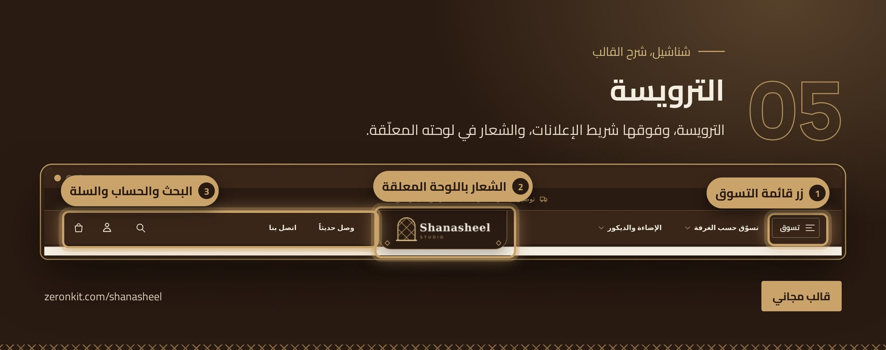](images/header-ar.jpg)

### 5.1 شريط الإعلانات

اضغط `Announcement bar` في القائمة اليسرى. أضف عنصر `Message` لكل رسالة، ولكل رسالة نصها ورابطها وأيقونتها. `Display` يكون ثابتًا، أو رسائل تتبدّل، أو شريطًا متحركًا. الرسائل المتحركة فيها دائمًا زر إيقاف.

### 5.2 الشعار

1. اضغط `Header`.
2. تحت `Logo` اضغط `Select image` وارفع شعارك. صورة PNG بخلفية شفافة أو ملف SVG هو الأفضل.
3. اضبط `Logo width on desktop` و`Logo width on mobile`.

بدون صورة شعار تعرض الترويسة `Text logo`، أو اسم المتجر إذا كان فارغًا.

### 5.3 شكل الترويسة ومكان الشعار

`Layout` يغيّر شكل الترويسة كلها:

- `Logo left, menu inline`
- `Logo centred, menu below`
- `Logo centred, menu split`: الشكل الافتراضي، الروابط على جانبي لوحة الشعار المعلّقة.
- `Minimal, menu button only`
- `Editorial masthead`
- `Side bar (desktop)`

`Logo position` ينقل الشعار إلى البداية أو الوسط أو النهاية في الأشكال inline وcentred وminimal.

### 5.4 القائمة وقائمة التسوق والبحث

- `Menu` يحدد القائمة التي تظهر روابطها في الترويسة.
- `Show the Shop navigator button` يضيف زر "تسوق" الذي يفتح القائمة مع صور المجموعات. في الهاتف هذه هي القائمة دائمًا.

- `Show search` يضيف أيقونة البحث. تفتح شريطًا في أعلى الصفحة فيه مربع بحث كبير والبحوث الشائعة وروابط الغرف.

- `Sticky header`: غير ثابتة، أو ظاهرة دائمًا، أو تظهر عند التمرير للأعلى.
- `Transparent over the first section on the home page` يجعل الترويسة شفافة فوق صورة الواجهة حتى يبدأ الزبون بالتمرير.
- `Color scheme` و`Menu and search color scheme` يحددان ألوان الترويسة.

## 6. الصفحة الرئيسية

كل جزء من الصفحة الرئيسية قسم مستقل. في محرر القالب:

- اضغط على القسم في القائمة اليسرى لتفتح إعداداته.
- اسحب المقبض ذا النقاط الست لتنقله للأعلى أو للأسفل.
- اضغط أيقونة العين لتخفيه دون حذفه.
- اضغط `Add section` لتضيف قسمًا جديدًا، مثل صورة مع نص أو رف منتجات أو تطبيق.
- داخل القسم، `Add block` يضيف عناصر مثل الدبابيس أو الخطوات أو الخامات.

يأتي شناشيل بثمانية أقسام للصفحة الرئيسية.

### 6.1 واجهة مشهد الغرفة

- `Image` يحدد صورة الغرفة. بدونها يأخذ `Use image from collection` صورة مجموعة.
- `Room label` و`Eyebrow text` و`Heading` و`Text` تحدد الكلمات. إذا جعلت كلمة في العنوان مائلة فإنها تظهر بلون النحاس.
- زران، لكل منهما نص ورابط.
- `Image side` و`Height`.
- كل عنصر `Product pin` يضع منتجًا على الصورة بإعدادَي `Horizontal position` و`Vertical position`. يضغط الزبون على الدبوس فيرى المنتج وسعره.

### 6.2 تسوّق حسب الغرفة

[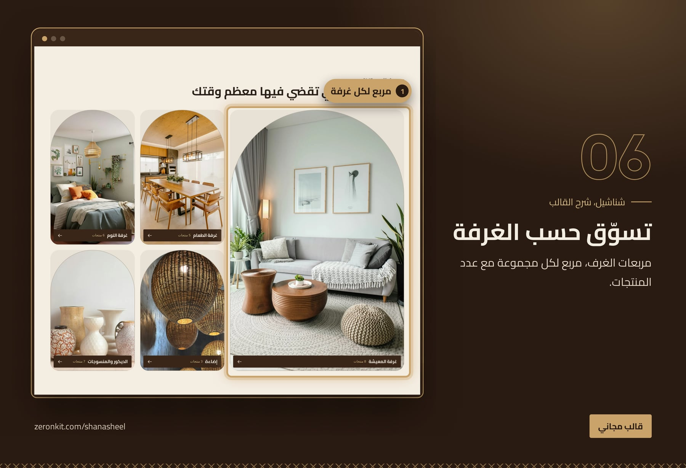](images/home-rooms-ar.jpg)

أضف عنصر `Room` لكل مجموعة. يأخذ المربع صورة المجموعة ما لم تختر صورة أخرى. `Layout` يكون فسيفساء أو صفًا أفقيًا.

### 6.3 رف المنتجات

[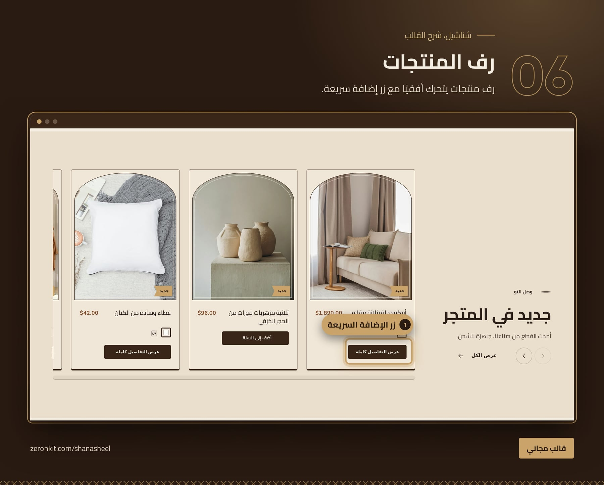](images/home-shelf-ar.jpg)

اختر `Collection` وعدد المنتجات. في البطاقات زر إضافة سريعة، فيشتري الزبون دون أن يترك الصفحة الرئيسية.

### 6.4 الأبعاد والخامات

اختر `Product`. عناصر `Measurement` تضيف صفوفًا مثل العرض والارتفاع، ويمكنها رسم خط على الصورة. وعناصر `Material row` تذكر كل جزء وخامته وتشطيبه.

### 6.5 قطعة تحت الضوء

[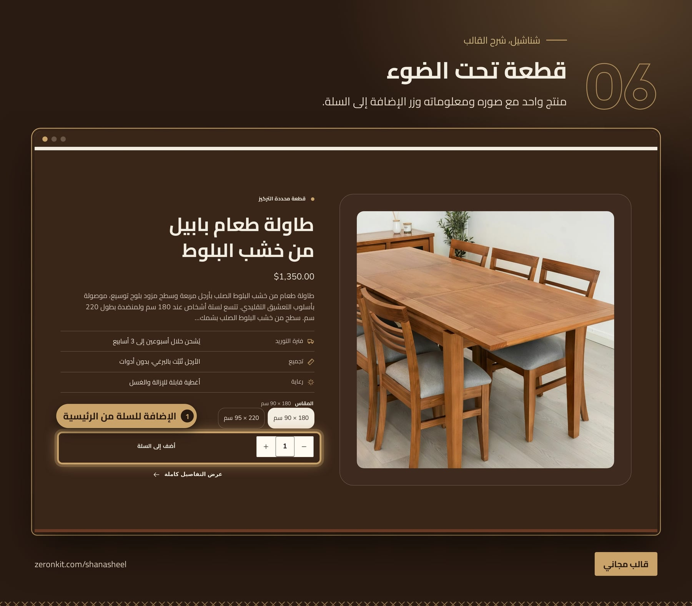](images/home-spotlight-ar.jpg)

يعرض منتجًا واحدًا بصوره وسعره وخياراته وزر الشراء. عناصر `Fact` تضيف أسطرًا قصيرة مثل مدة التجهيز أو التركيب.

### 6.6 مكتبة الخامات

[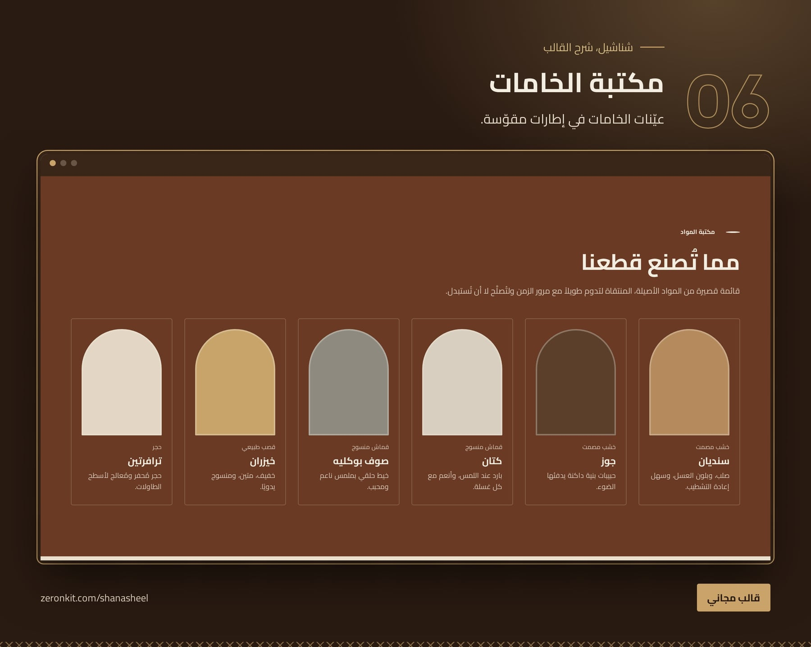](images/home-materials-ar.jpg)

لكل عنصر `Material` لون عيّنة أو صورة، واسم، ونوع، ونص قصير، ورابط. `Swatch shape` يكون قوسًا أو دائرة أو مربعًا.

### 6.7 خطوات التوصيل

[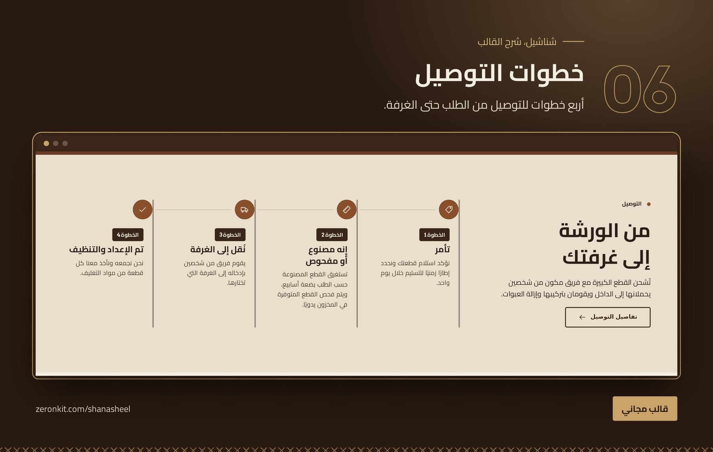](images/home-delivery-ar.jpg)

عنوان ونص وزر، ثم عنصر `Step` لكل خطوة فيه أيقونة وعنوان ونص قصير.

### 6.8 بطاقة النشرة البريدية

المشتركون يُضافون إلى قائمة عملائك مع وسم newsletter.

## 7. صفحات المجموعات والبحث

### 7.1 صفحة المجموعة

افتح أي مجموعة في المحرر (من قائمة الصفحات اختر `Collections`) واضغط `Collection: showroom`:

- `Show collection description` و`Show collection image` و`Show breadcrumb` و`Show room chips`.
- `Room chips menu`: اختر قائمة لتحدد الغرف التي تظهر في الفهرس. اتركها فارغة لتظهر مجموعاتك.
- `Products per page` و`Pagination` (صفحات مرقّمة، أو زر "عرض المزيد"، أو تحميل مستمر) و`Columns on desktop` و`Columns on mobile`.
- `Enable filtering` و`Enable sorting`. عوامل التصفية تأتي من تطبيق Search & Discovery.
- `Story tile`: مربع بلون الجوز بين المنتجات، له نصه وزره ورابطه. `Place it after product` يحدد مكانه.

### 7.2 صفحة البحث

[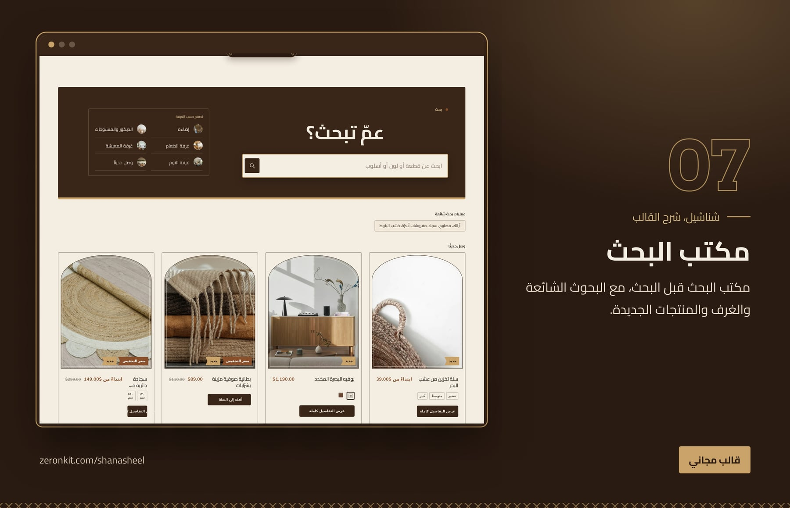](images/search-page-ar.jpg)

[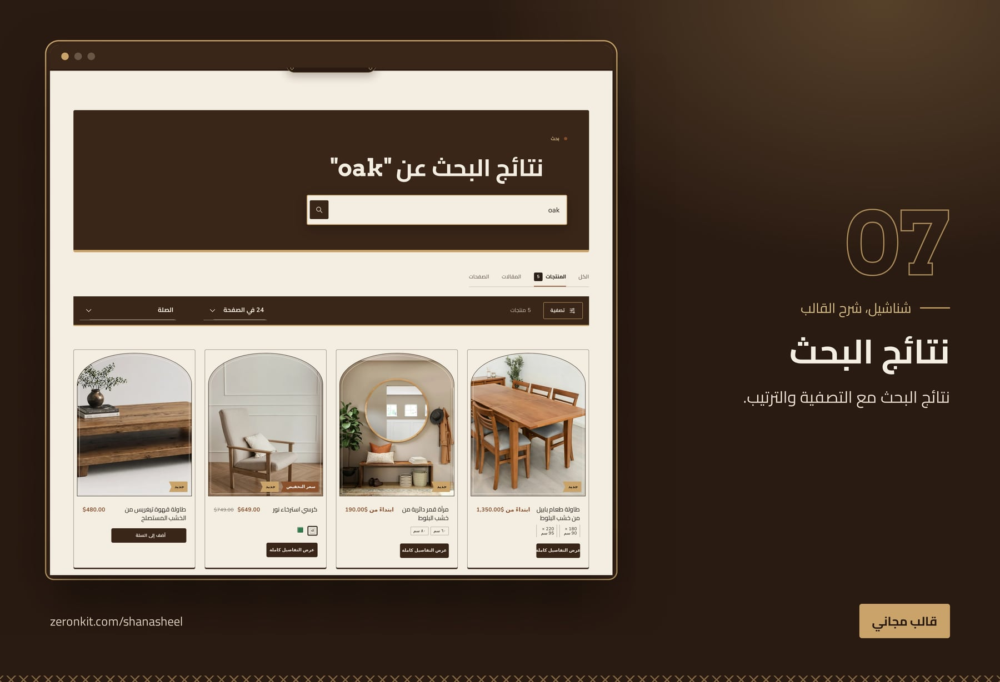](images/search-results-ar.jpg)

لصفحة البحث شريط التصفية والترتيب نفسه الموجود في المجموعات. `Suggested collection when nothing is found` يحدد ما يظهر عندما لا يجد البحث نتائج. البحوث الشائعة تأتي من `Theme settings` ثم `Search`.

## 8. صفحة المنتج

[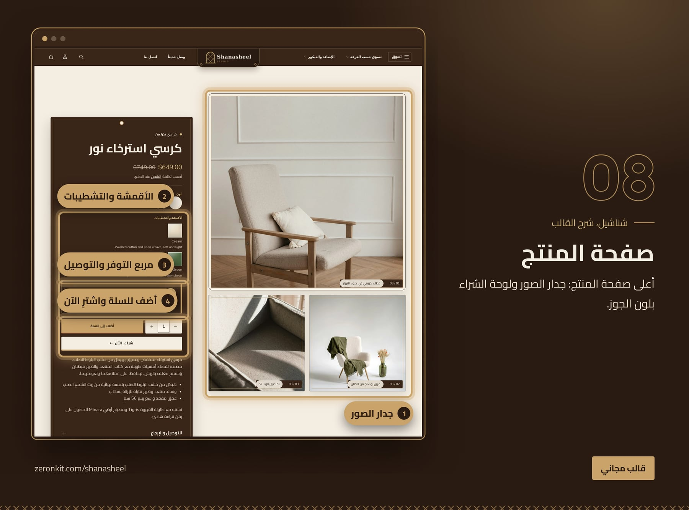](images/product-top-ar.jpg)

افتح منتجًا في المحرر واضغط `Product information`. في هذا القسم:

- `Gallery layout`: فسيفساء أو عمود واحد.
- `Gallery position on desktop` و`Image shape`.
- `Buy panel style`: لوحة بارزة أو بسيطة.
- `Keep product details in view while scrolling`.
- `Show only the selected colour's images` (انظر 3.2).

لوحة الشراء مكوّنة من عناصر. اسحبها لتغيّر ترتيبها، أو احذف ما لا تحتاجه:

- `Title` و`Price` و`Variant picker` (أزرار أو قائمة منسدلة) و`Text`.
- `Fabrics and finishes`: عيّنات التشطيب مع ملاحظاتها، ويمكن ربطها بصفحة لطلب عيّنات مجانية.
- `Delivery and lead time`: المربع الذي يقول إن القطعة متوفرة ومتى تصل تقريبًا. حدّد أيام التوصيل للقطع المتوفرة والقطع المصنوعة حسب الطلب، أو استخدم الحقل `shanasheel.lead_time`.
- `Buy buttons`: الكمية، والإضافة إلى السلة، وزر "شراء الآن"، وتوفر الاستلام من المتجر.
- `Description` و`Collapsible tab` و`Complementary products` و`Custom Liquid`.

### 8.1 شريط التفاصيل

[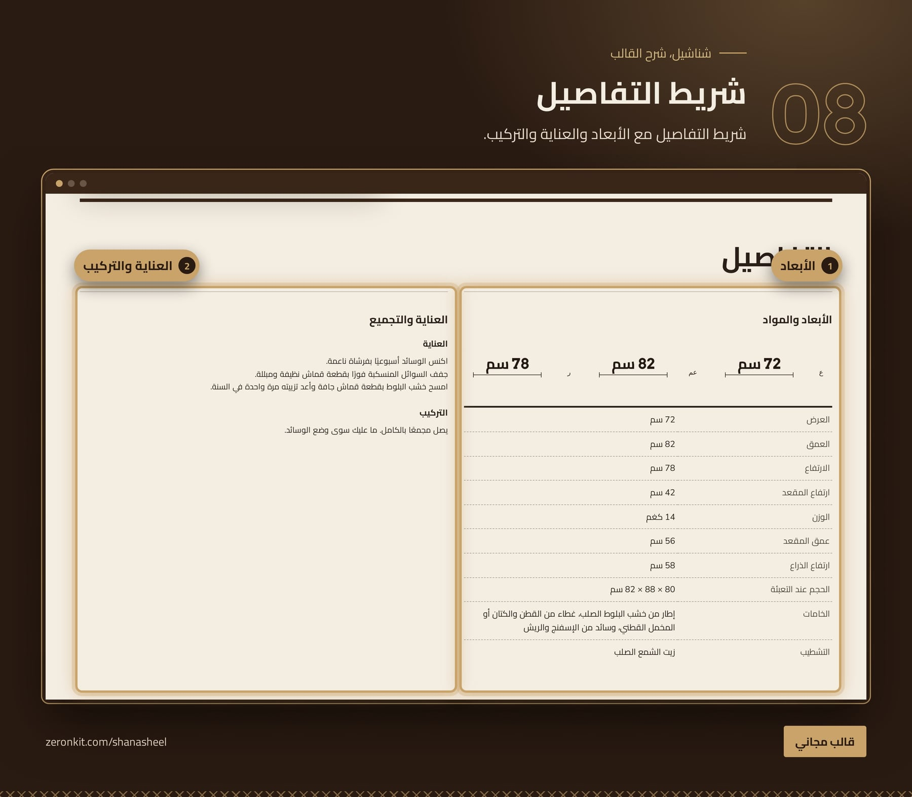](images/product-details-ar.jpg)

تحت الصور شريط للتفاصيل الطويلة. عنصرا `Dimensions and materials` و`Care and assembly` موجودان فيه افتراضيًا، ولكل منهما إعداد `Placement` لنقله إلى لوحة الشراء.

### 8.2 تسوّق الغرفة

[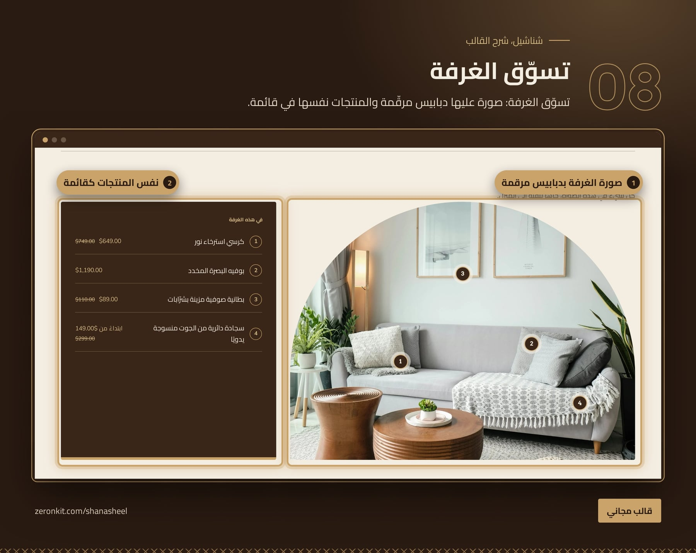](images/product-room-ar.jpg)

عنصر `Shop the room` يعرض صورة غرفة عليها حتى أربعة دبابيس مرقّمة، وقائمة بالمنتجات نفسها. يأخذ الصورة والمنتجات من إعدادات العنصر أولًا، ثم من الحقلين `shanasheel.room_image` و`shanasheel.room_products`. وإذا ملأت الحقلين صار لكل منتج غرفته الخاصة دون أن تفتح المحرر.

### 8.3 منتجات مشابهة

يختار Shopify هذه المنتجات، ويمكنك تغييرها في تطبيق Search & Discovery. `Fallback collection` يملأ الصف ما دام Shopify لا يملك اقتراحات بعد.

## 9. السلة

[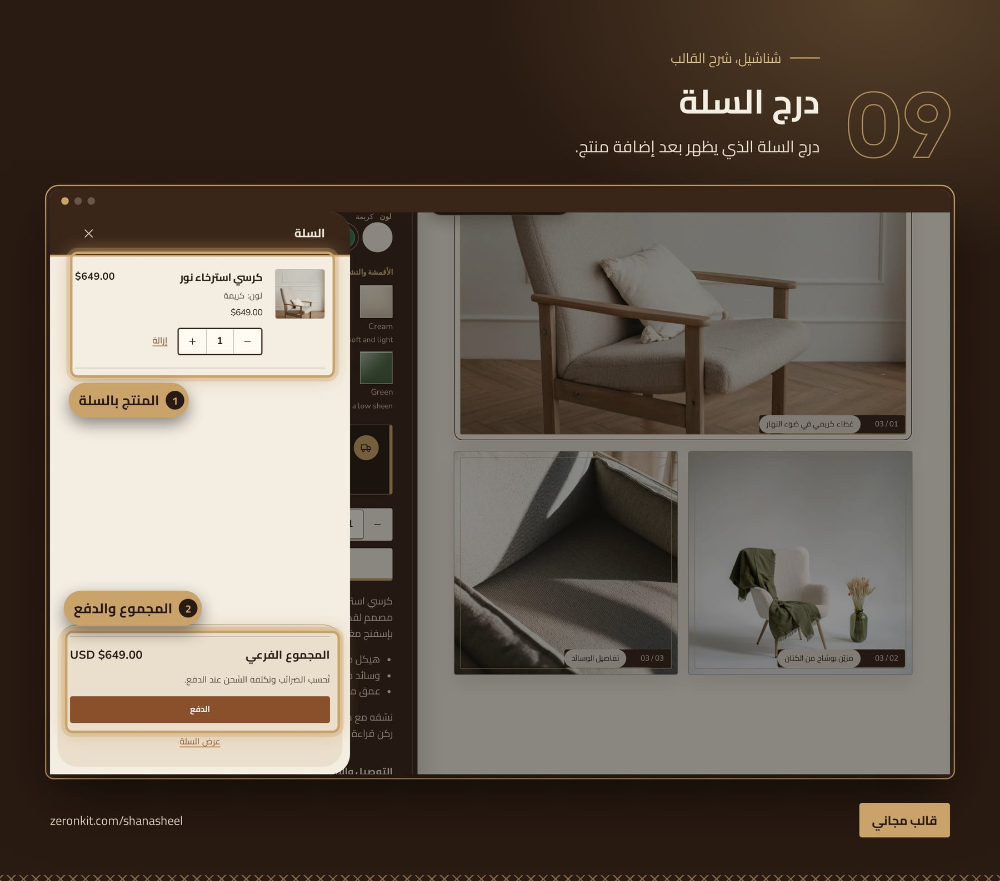](images/cart-drawer-ar.jpg)

[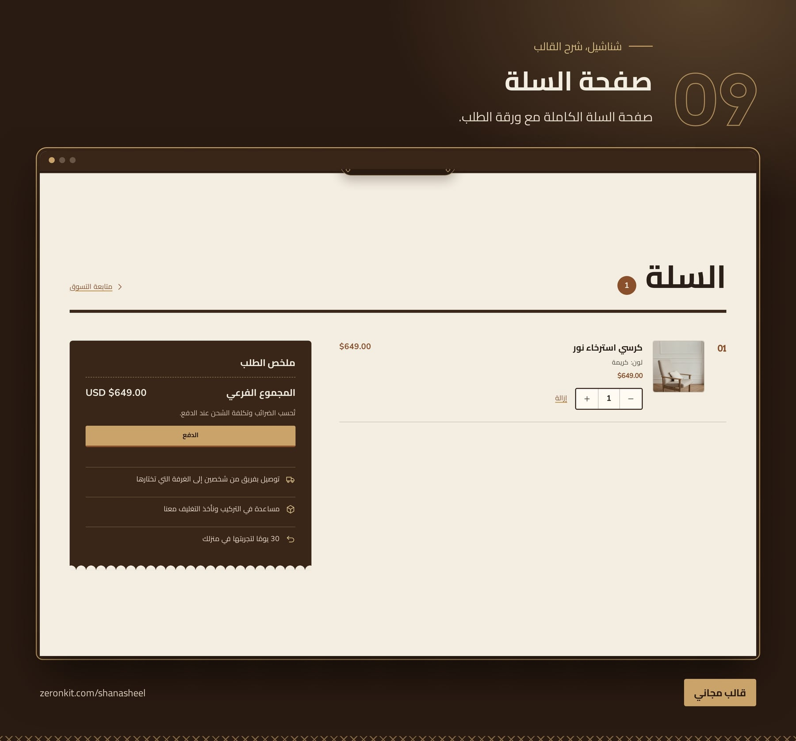](images/cart-page-ar.jpg)

`Theme settings` ثم `Cart` ثم `Cart type` يحدد هل السلة درج جانبي أم صفحة كاملة. في صفحة السلة (قسم `Cart`) يمكنك إظهار ثلاث ملاحظات توصيل تحت المجموع، وتحديد ما يظهر عندما تكون السلة فارغة.

## 10. صفحة التواصل والصفحات الأخرى

### 10.1 التواصل

[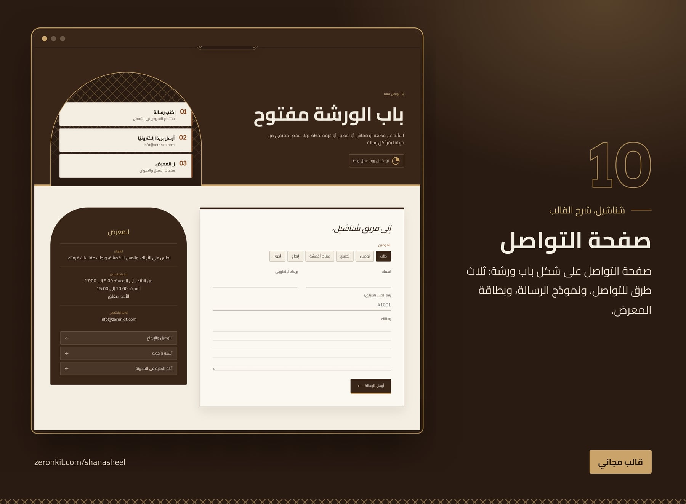](images/contact-ar.jpg)

تستخدم صفحة التواصل القالب `page.contact` والقسم `Contact: workshop door`:

- شريط داكن فيه العنوان ووعد بالرد وثلاث طرق للتواصل: الكتابة، والبريد، والزيارة.
- نموذج رسالة فيه أزرار المواضيع والاسم والبريد ورقم الطلب والرسالة.
- بطاقة معرض مقوّسة فيها العنوان وأوقات الدوام والبريد والروابط السريعة. أضف عنصر `Quick link` لكل رابط.

لكل نص قيمة افتراضية بالعربية والإنجليزية. اكتب نصك في الحقل فقط إذا أردت أن تستبدل النص الافتراضي.

تصل الرسائل إلى بريد المتجر المحدد في `Settings` ثم `General`.

### 10.2 المدوّنة والمقالات

[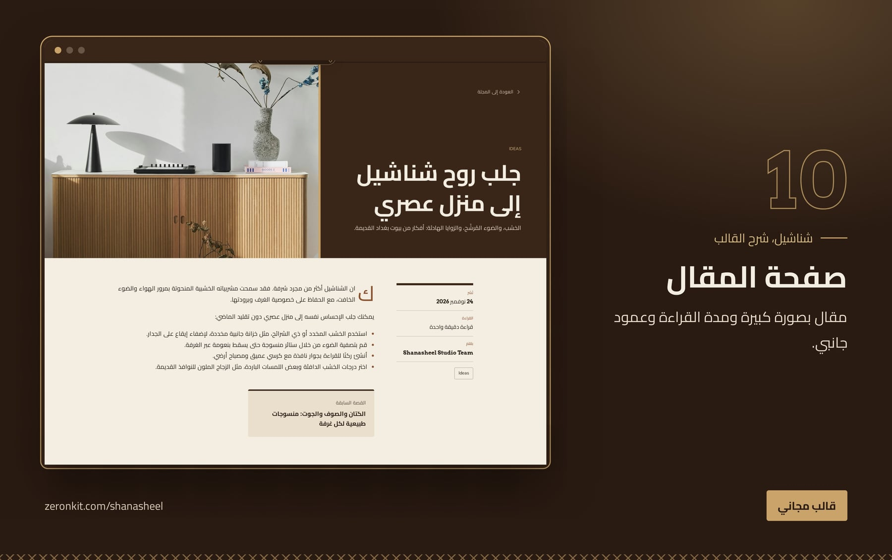](images/article-ar.jpg)

تعرض صفحة المدوّنة أحدث مقال كمقال غلاف، والبقية كصفوف مرقّمة. وصفحة المقال يمكن أن تعرض الكاتب ومدة القراءة وحرفًا أول كبيرًا وروابط المقال السابق والتالي.

### 10.3 الصفحات العادية

الصفحات مثل الشحن والأسئلة الشائعة تستخدم القسم `Page`. كل عنوان داخل نص الصفحة يصبح فصلًا مرقّمًا.

### 10.4 قائمة المجموعات وصفحة 404

[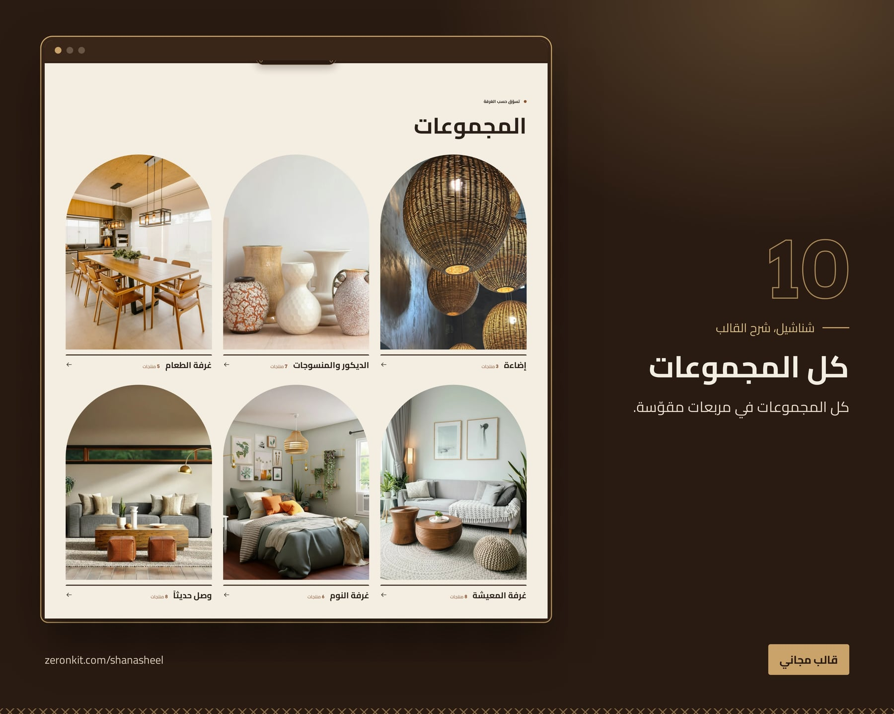](images/collections-list-ar.jpg)

[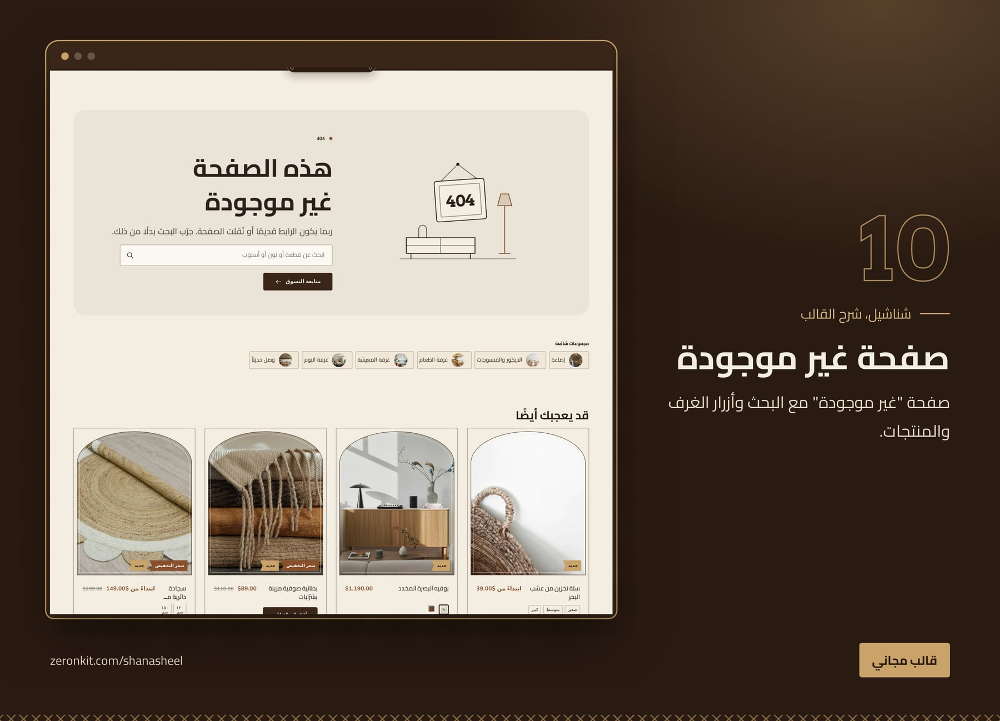](images/not-found-ar.jpg)

## 11. التذييل

اضغط `Footer` في القائمة اليسرى:

- `Layout`: أعمدة، أو العلامة مع أعمدة، أو في الوسط.
- `Contact window heading` و`Contact window text`.
- العناصر: `Menu` و`Text` و`Newsletter`.
- مفاتيح لأيقونات التواصل الاجتماعي، وزر المتابعة على Shop، واختيار البلد واللغة، وأيقونات الدفع، وروابط السياسات، واسم المتجر الكبير.

## 12. تعديل أي صفحة

قائمة الصفحات في أعلى محرر القالب تضم كل أنواع الصفحات: الرئيسية، والمنتجات، والمجموعات، والصفحات، والمدوّنات، والسلة، والبحث، وصفحة كلمة المرور، وصفحة 404.

1. اختر نوع الصفحة.
2. اختر عنصرًا حقيقيًا، مثل منتج معيّن.
3. غيّر الأقسام والعناصر على اليسار. التغيير هنا يشمل كل الصفحات التي تستخدم القالب نفسه، مثل كل المنتجات.

لتعطي بعض المنتجات أو الصفحات شكلًا مختلفًا:

1. من قائمة الصفحات افتح القالب واختر `Create template`.
2. سمِّه، مثل `product.sofa`، واضبطه.
3. في صفحة المنتج في لوحة التحكم، اجعل `Theme template` هو القالب الجديد.

للتعديلات التي لا يستطيعها المحرر استخدم `Themes` ثم `...` ثم `Edit code`. أنشئ نسخة من القالب قبل ذلك، لأن تعديل الشيفرة لا يمكن التراجع عنه بعد الحفظ.

ومن القائمة نفسها، `Edit default theme content` يتيح تغيير أي نص مدمج في القالب، مثل نصوص الأزرار، بكل اللغات.

## 13. العربية واللغات الأخرى

1. من `Settings` ثم `Languages` أضف العربية وانشرها.
2. من `Settings` ثم `Markets` فعّل اللغة في أسواقك.

ينقلب القالب من اليمين إلى اليسار وحده ويحمّل الخط العربي. نصوص القالب مثل الأزرار والتسميات ونصوص الأقسام الافتراضية موجودة بالعربية والإنجليزية.

أما محتواك (أسماء المنتجات وأوصافها والمجموعات والصفحات والمقالات) فيُترجم في تطبيق Translate & Adapt. والنصوص التي تكتبها بنفسك في إعدادات الأقسام تُترجم هناك أيضًا، تحت `Theme`.

## 14. على الهاتف

[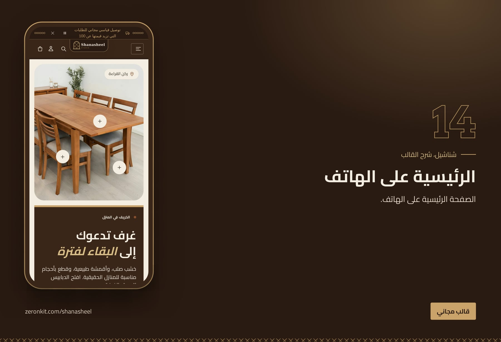](images/m-home-ar.jpg)

[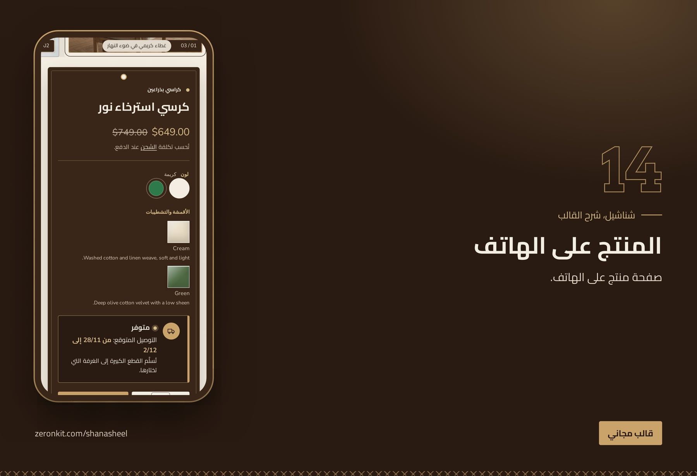](images/m-product-ar.jpg)

[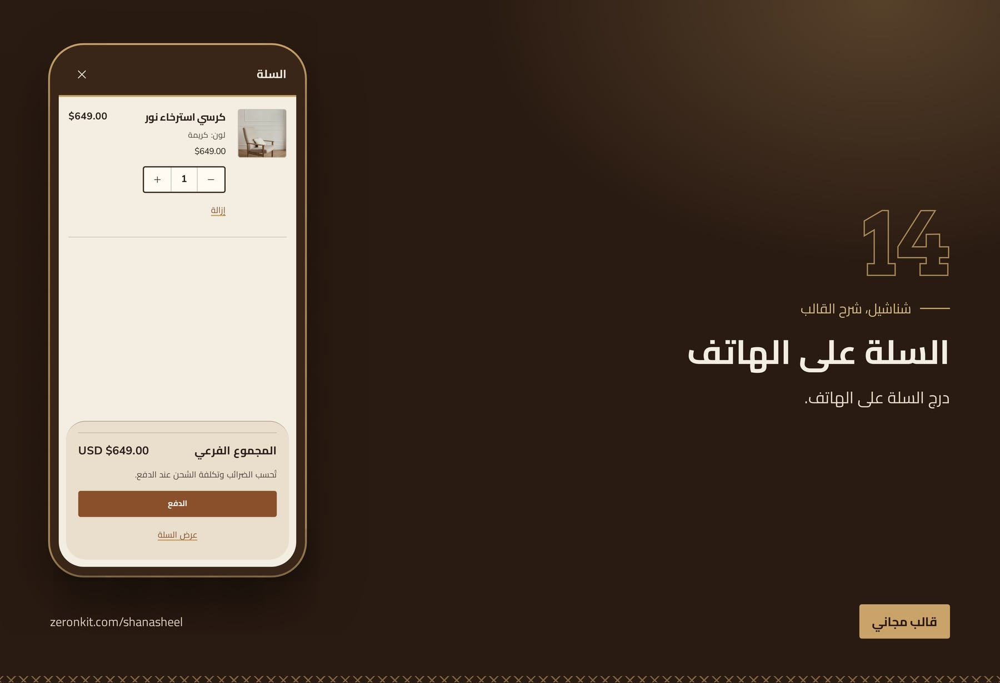](images/m-cart-ar.jpg)

لكل قسم شكل خاص على الهاتف، ولا تحتاج إلى ضبط شيء. بعض الأقسام فيها إعداد منفصل للهاتف، مثل `Columns on mobile` و`Logo width on mobile`.

## 15. حل المشاكل

**المنتجات تظهر "نفدت الكمية" لزبائن بعض الدول.** راجع `Settings` ثم `Markets`. إذا كانت الدولة في سوق منفصل ليس له كتالوج منتجات أو شحن خاص به، يعرض Shopify المنتجات هناك كأنها غير متوفرة. الحل أن تضيف هذه الدول إلى سوقك الرئيسي، مع سعر شحن لها في `Settings` ثم `Shipping and delivery`.

**المنتجات تقول "نفدت الكمية" مع أن عندك مخزونًا.** تأكد أن المخزون في موقع يشحن الطلبات الإلكترونية، من `Settings` ثم `Locations`.

**يظهر نص إنجليزي في المتجر العربي.** إذا كتبت نصًا إنجليزيًا في إعداد قسم، يظهر هذا النص بكل اللغات حتى تترجمه في Translate & Adapt. امسح الحقل لتعود إلى النص المدمج بالعربية والإنجليزية.

**لا توجد عوامل تصفية في صفحة المجموعة.** ثبّت تطبيق Search & Discovery وأضف عوامل التصفية من داخله.

**عنصر الأقمشة والتشطيبات فارغ.** تأكد أن اسم الخيار واحد من الأسماء في إعداد `Option names shown as finishes` داخل العنصر.

**تسوّق الغرفة لا يعرض دبابيس.** املأ الحقل `shanasheel.room_products` أو اختر المنتجات في العنصر.

**نموذج التواصل لا يرسل شيئًا.** راجع بريد المتجر في `Settings` ثم `General`، وافحص مجلد الرسائل غير المرغوب فيها.

## 16. الدعم

راسلنا على info@zeronkit.com. نساعد قدر المستطاع.

## 17. سجل التغييرات

1.0.0: الإصدار الأول.

