# Shanasheel theme guide

Version 1.1.0. Made by ZeronKit (https://zeronkit.com).

This guide covers the whole Shanasheel theme: what it is, how to install it, how to change its colours, fonts and sections, how to edit every page, and how to update it later. Labels in `code style` are the exact words you see in the Shopify theme editor.

## 1. What Shanasheel is

Shanasheel is a free Shopify theme for furniture, lighting, textiles and home decor stores. It works in English and Arabic, and the whole layout flips to right to left when a shopper picks Arabic.

### Why the name

A shanasheel (شناشيل) is the carved wooden bay window that hangs over the street in old Baghdad and Basra houses. The windows are made of dark wood with a lattice screen, so the people inside can see out and the light comes in soft.

The theme takes its look from those windows:

- Dark walnut panels and warm sand backgrounds, like old wood against a plaster wall.
- Brass lines and pins, like the metal fittings on the windows.
- Arched photo frames, like the window tops.
- A lattice pattern in the footer and on the contact page.
- The logo hangs from the header bar in its own tab, the way a shanasheel hangs from the wall.

### What makes it different

- Shop the room. Product pins sit on a room photo, on the home page and on every product page, with the same products listed beside the photo.
- Real furniture details. Dimensions as large figures and a table, a cm and inch switch, materials, care and assembly, all read from product metafields.
- Fabrics and finishes. Each finish shows its swatch photo and a short note, and clicking it picks that variant.
- Delivery dates. The product page works out an estimated delivery window from your stock and lead times.
- Free delivery in view. The announcement bar, the product page and the cart all read the same free delivery amount, and the cart shows how much is left to reach it.
- A Shop menu of arched doorways, one door per collection, and a search that opens like a side room.
- A cart that rises from the bottom of the screen with each piece on its own arched card, and a cart page that tells the shopper when each piece reaches their room.
- A showroom collection page with a numbered room index, a photo collage and a story tile between the products.
- A magazine style journal, a workshop door contact page, an About page that walks through the house and a FAQ page of workshop questions.
- Arabic built in, with the Cairo font loaded only for Arabic pages.

### Licence

- Shanasheel is free to use and to change on stores you own or run.
- It is not for resale or redistribution. Do not sell it, share the files, upload it to theme marketplaces or present it as your own work.
- The copyright and author notices must stay in the files.
- It comes as is, with no warranty. The full text is in the `LICENSE` file inside the download.

### What you need

1. A Shopify store on any plan that allows custom themes.
2. Products with photos.
3. For filters on collection and search pages: the free Shopify app Search & Discovery.
4. For a second language: the free Shopify app Translate & Adapt.

The theme needs no other app.

## 2. Installing, publishing and updating

### 2.1 Upload the theme

1. Download the Shanasheel zip file from https://zeronkit.com/themes/. Do not unzip it.
2. In Shopify admin, open `Online Store` and then `Themes`.
3. Click `Add theme` (on some stores it is `Import`) and choose `Upload zip file`.
4. Pick the Shanasheel zip file. After a few seconds it appears in your theme library.

### 2.2 Preview and publish

1. In the theme library, click `Customize` next to Shanasheel. The theme editor opens.
2. Look at the home page, a collection, a product and the cart. Use the page picker at the top of the editor to move between them.
3. When everything looks right, go back to `Themes`, open the `...` menu next to Shanasheel and click `Publish`.

### 2.3 Updating later

A theme uploaded from a zip file does not update by itself. When a new version comes out:

1. In `Themes`, open the `...` menu of your current Shanasheel and click `Duplicate`. The copy is your backup.
2. Upload the new zip file as in 2.1. It arrives as a new theme in the library.
3. Copy your settings. Your old settings live in the old theme. Set the new theme up in the editor, or copy the files: in the old theme open `Edit code`, copy the content of `config/settings_data.json`, `sections/header-group.json`, `sections/footer-group.json` and each file in `templates` that you changed, and paste it into the same files in the new theme.
4. Check the pages: the header, the home page, your colours, a collection, a product (also on a phone), the cart with an item in it, a search, a journal post and a normal page, in every language you sell in.
5. Publish the new theme only when every page looks right. Keep the old copy for a while in case you need something from it.

Section 17 lists what changed in each version and anything you need to do after the update.

If you use GitHub, you can also connect a copy of the theme with `Add theme`, `Connect from GitHub`. Shopify then pulls each change you push to that branch.

## 3. Getting your store content ready

The theme fills itself with your real products and collections, so it looks right from the first minute. The better your content, the better it looks.

### 3.1 Collections are rooms

Shanasheel thinks in rooms. Make one collection per room or kind of product, for example Living room, Bedroom, Dining room, Lighting, Decor and textiles. Give every collection an image. Those images appear in the room tiles, the shop menu, the room chips and the collection page collage.

### 3.2 Products

- Use at least three photos per product. The first one is the main photo, the second one shows when a shopper hovers over a card.
- Give each photo alt text. If a product has colours, end the alt text with "in" and the colour, for example "Lounge chair in green". The gallery then shows only the photos of the colour the shopper picks.
- Call the colour option `Colour` or `Color`. Call fabric or wood choices `Fabric`, `Finish`, `Material`, `Upholstery`, `Wood` or `Leather`, so the theme shows them as finishes.

### 3.3 Product metafields

Metafields are extra product fields. Add them in `Settings`, `Custom data`, `Products`. Shanasheel reads these, all in the `shanasheel` namespace:

| Metafield | Type | Where it shows |
|---|---|---|
| `shanasheel.width`, `depth`, `height`, `seat_height`, `diameter`, `length` | Dimension | Large figures and the dimensions table |
| `shanasheel.weight` | Weight | Dimensions table |
| `shanasheel.dimensions` | Multi line text, one "Label: value" per line | Extra table rows |
| `shanasheel.materials`, `shanasheel.finish` | Text | Dimensions block and the materials tab |
| `shanasheel.care`, `shanasheel.assembly` | Multi line text | Care and assembly block |
| `shanasheel.assembly_level` | Text: ready, easy or required | Assembly badge |
| `shanasheel.assembly_guide` | File or URL | Assembly guide link |
| `shanasheel.lead_time` | Text, on the product or the variant | Delivery box |
| `shanasheel.finishes` | List of metaobjects with name, image, color and note | Fabrics and finishes block |
| `shanasheel.room_image` | File (image) | Shop the room photo |
| `shanasheel.room_products` | List of products | Shop the room pins and list |

You do not need all of them. Every block hides the parts that have no data, and some fall back to headings in the product description, for example a "Dimensions" or "Care" heading.

### 3.4 Menus

In `Online Store`, `Navigation`:

- `Main menu` drives the header links and the Shop menu. In the Shop menu, every top link that has child links becomes a tab, for example "Shop by room" and "Lighting and decor". Its child links to collections become arched doors with the collection photo and the number of pieces. Top links without child links, such as About or Contact, go in the row of pages under the doors.
- `Footer menu` fills the footer columns.

### 3.5 Pages

Create these pages in `Online Store`, `Pages` so every link in the theme has somewhere to go:

- `Contact`, with the theme template `page.contact`.
- `About`, with the template `page.about` (see 10.4).
- `FAQ`, with the template `page.faq` (see 10.5).
- `Shipping and returns` and, if you sell furniture with sizes, `Measuring guide` (handle `measuring-guide`, it opens in a side drawer from the product page). These use the normal `page` template.

To pick a template, open the page in `Online Store`, `Pages` and choose it under `Theme template`.

### 3.6 Blog

Create a blog called `Journal` with a few posts. Give every post an image and one or two tags. The tags become the topic links at the top of the journal page.

Every post ends with a "Shop the pieces" row of products (see 10.2). To choose those products yourself, add a metafield definition for blog posts in `Settings`, `Custom data`, with the namespace and key `shanasheel.products` and the type list of products, then fill it on each post.

## 4. Changing colours, fonts and the overall style

Open the theme editor and click the paint brush icon on the left (`Theme settings`).

### 4.1 Ready-made style

`Style` holds choices that change the whole store at once:

- `Palette`: Linen, Walnut (dark), Clay, Moss, Stone, High contrast, Ochre or Slate (dark). Pick `Custom (use the colour schemes)` to set every colour yourself.
- `Background style`: Solid, Soft gradient, Two-tone sections or Dark mode.
- `Font pairing`: ready pairs of heading and body fonts, or `Custom` to use the font pickers.
- `Heading scale`, `Corners`, `Button style`, `Product card style` and `Spacing`.
- `Animations`: Off, Subtle or Expressive. Shoppers who ask their device for less motion never see movement.

### 4.2 How to change the colours

The theme uses six colour schemes. Each section picks one of them, so changing a scheme changes every section that uses it.

1. In `Theme settings`, open `Colors`.
2. Click a scheme, for example `Scheme 1`.
3. Change its `Background`, `Text`, `Button` and `Button label` colours. The preview updates as you go.
4. Click `Save` at the top right.

To give one section a different look, click that section in the editor and change its `Color scheme` setting. For example, the delivery steps use scheme 4 by default.

`Page color scheme` sets the page background behind all sections, and `Drawer and pop-up color scheme` sets the cart drawer and the menus.

Keep text and background contrast high so everyone can read your store.

### 4.3 Fonts

In `Typography`, pick a `Heading font` and a `Body font` from Shopify's font library, and change their sizes with the two sliders.

Arabic is handled for you. When a shopper views the store in Arabic, the theme loads the Cairo font for Arabic letters only, so English words keep your chosen font and Arabic text stays clear.

### 4.4 Other theme settings

- `Layout`: page width and corner radius.
- `Product cards`: image shape, second image on hover, sizes in stock, colour swatches and vendor. `Show New badge for` sets how many days a new product carries the New badge (30 by default). Set it to 0 and only products tagged "new" get the badge.
- `Cart`: drawer or a full cart page, an order note, currency codes and the `Free delivery threshold` (see 5.1 and 9).
- `Search`: live suggestions and your `Popular searches` (separate them with commas).
- `Brand assets`: the favicon, the logo used for sharing and gift cards, and `Store contact email`. That field is empty at first, and while it is empty no email address shows anywhere in the theme. Fill it in with the address you want shoppers to write to. It then shows in the footer contact window and on the contact page (see 10.1 and 11).
- `Social media`: links for the footer icons.
- `Theme credit`: turns the small "Theme by ZeronKit" link in the footer on or off.

## 5. The header

The header group holds the announcement bar and the header.

### 5.1 Announcement bar

Click `Announcement bar` in the left list. Add one `Message` block per message, each with its own `Text`, link and icon. `Display` can be static, a rotating fade or a moving marquee. Moving messages always have a pause button.

To show your free delivery amount, write `[threshold]` in a message, for example "Free delivery from [threshold]". The theme replaces it with the amount set in `Theme settings`, `Cart`, `Free delivery threshold`, with the currency, for example "$70 USD". If you leave the text of a message with the truck icon empty, the theme shows a ready delivery message in English or Arabic. Set the threshold to the amount of your own free shipping rate in `Settings`, `Shipping and delivery`.

On phones the icons are hidden so each message fits on one line, so keep messages short.

### 5.2 Logo

1. Click `Header`.
2. Under `Logo`, click `Select image` and upload your logo. A transparent PNG or an SVG works best.
3. Set `Logo width on desktop` and `Logo width on mobile`.

Without a logo image, the header shows `Text logo`, or the store name when that is empty.

### 5.3 Header layout and logo position

`Layout` changes the whole header shape:

- `Logo left, menu inline`
- `Logo centred, menu below`
- `Logo centred, menu split`: the default, with menu links on both sides of the hanging logo tab.
- `Minimal, menu button only`
- `Editorial masthead`
- `Side bar (desktop)`

`Logo position` moves the logo to the start, the centre or the end for the inline, centred and minimal layouts.

### 5.4 Menu, shop navigator and search

- `Menu` picks the menu for the header links.
- `Show the Shop navigator button` adds the Shop button. On phones this button is always the menu. `Navigator button label` changes its word.
- `Menu panel` sets how the Shop menu opens. `Doorways: a row of arched collection doors` is the default. The panel hangs from the header across the page. The tabs from your menu sit on top. The chosen tab fills the panel with tall arched doors, each with a walnut frame, the collection photo, its name and how many pieces it holds. A dark "View all" door ends the row. Arrows scroll the row when a tab has more doors than fit. Under a brass line, one row holds your pages and the language and country pickers. `List with image tiles` brings back the older list with photo tiles beside it.

- `Show search` adds the search icon. Search opens as a tall sand drawer from the side of the screen, a side room off the main hall. The field stays at the top. As the shopper types, it shows word suggestions, then products as a two column grid of small arched photos with name and price, then collections and pages, and a full width "See all results" bar. Before anything is typed, recent and popular searches wait at the bottom.

Shopify does not offer live suggestions for Arabic. On the Arabic store the drawer shows a "See all results" bar for the words typed, which opens the full search page. That page does find products.

- `Sticky header`: not sticky, always visible, or visible when the shopper scrolls up.
- `Transparent over the first section on the home page` lets the header sit over the hero photo until the shopper scrolls.
- `Color scheme` and `Menu and search color scheme` set the header colours.

## 6. The home page

Each part of the home page is a section. In the theme editor:

- Click a section in the left list to open its settings.
- Drag the six-dot handle to move it up or down.
- Click the eye icon to hide it without deleting it.
- Click `Add section` to add a new one, for example an image with text, a product shelf or an app.
- Inside a section, `Add block` adds items such as pins, steps or materials.

Shanasheel comes with eight home sections.

### 6.1 Room scene hero

[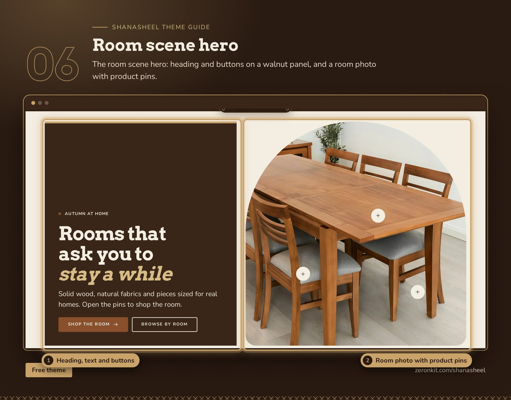](images/home-hero-en.jpg)

- `Image` sets the room photo. Without one, `Use image from collection` takes a collection image.
- `Room label`, `Eyebrow text`, `Heading` and `Text` set the words. Put a word in italics in the heading and it shows in brass.
- Two buttons, each with a label and a link.
- `Image side` and `Height`.
- Keep the heading short. On a laptop it fits in about three lines and both buttons show in the first screen. On tablets the photo is shorter so the heading and buttons stay in the first screen too.
- Each `Product pin` block places a product on the photo with `Horizontal position` and `Vertical position`. Shoppers click a pin to see the product and its price.

### 6.2 Shop by room

[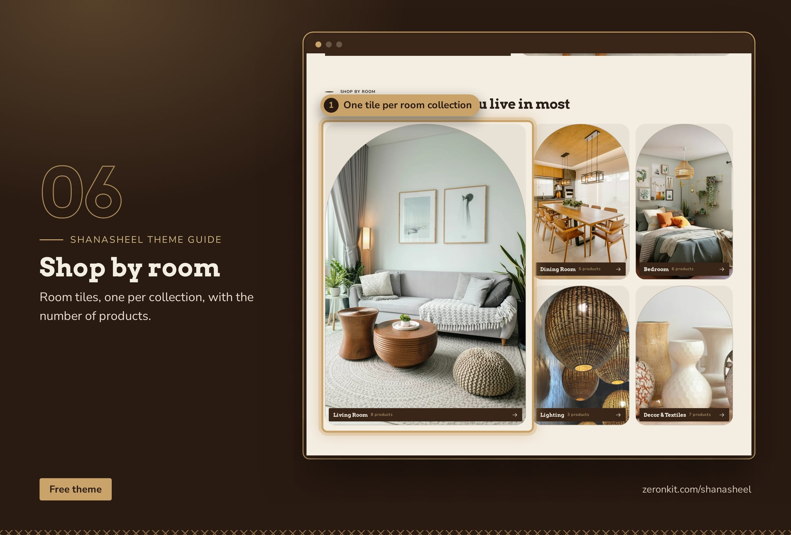](images/home-rooms-en.jpg)

Add one `Room` block per collection. The tile uses the collection image unless you choose another one. `Layout` can be a mosaic or a horizontal row.

A wide photo in a tall tile zooms in toward its subject. To choose which part shows, set the focal point on that image in Shopify (open it in `Content`, `Files` or on the collection).

### 6.3 Product shelf

[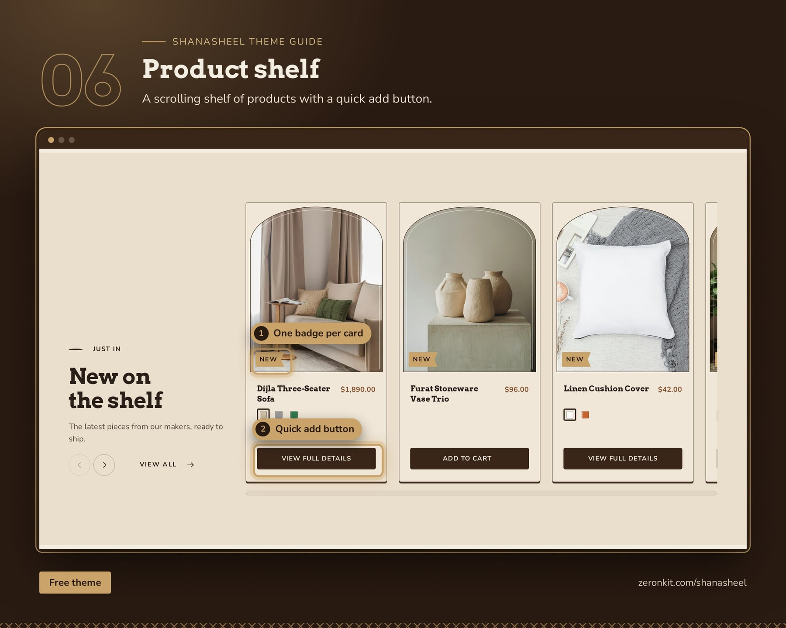](images/home-shelf-en.jpg)

Pick a `Collection` and how many products to show. Cards have a quick add button, so shoppers can buy without leaving the home page. A product with one variant gets "Add to cart", and a product with options gets "View full details". The button has the same size and position on every card in the theme.

A card carries one badge at most. Sold out comes first, then Sale, then New, so a new piece on sale shows Sale. The New badge follows `Theme settings`, `Product cards`, `Show New badge for` (see 4.4).

### 6.4 Dimensions and materials

Choose a `Product`. `Measurement` blocks add rows such as width and height, and can draw a line on the photo. `Material row` blocks list each part, its material and its finish.

### 6.5 Piece in focus

This section shows one piece the way it would stand in a room. A wide room photo runs across the page. A raised walnut card with a brass top edge sits over its lower corner. The card holds the name, the price, the options, the quantity, Add to cart and View full details, so a shopper can buy the piece without leaving the home page.

- `Product` picks the piece.
- `Room photo` sets the wide photo. Leave it empty to use the product's first photo. A real room photo looks best here.
- `Buy card corner` puts the card on the start side or the end side of the photo. Pick the side where the photo has a quiet wall or floor, so the card does not cover the piece.
- `Show collection description` shows the first lines of the product description in the card.
- Each `Fact` block adds a short fact, for example lead time, assembly or care. The facts run on one brass ruled line under the photo.

On phones the photo comes first, the card overlaps its bottom edge and the facts follow as a list.

### 6.6 Material library

[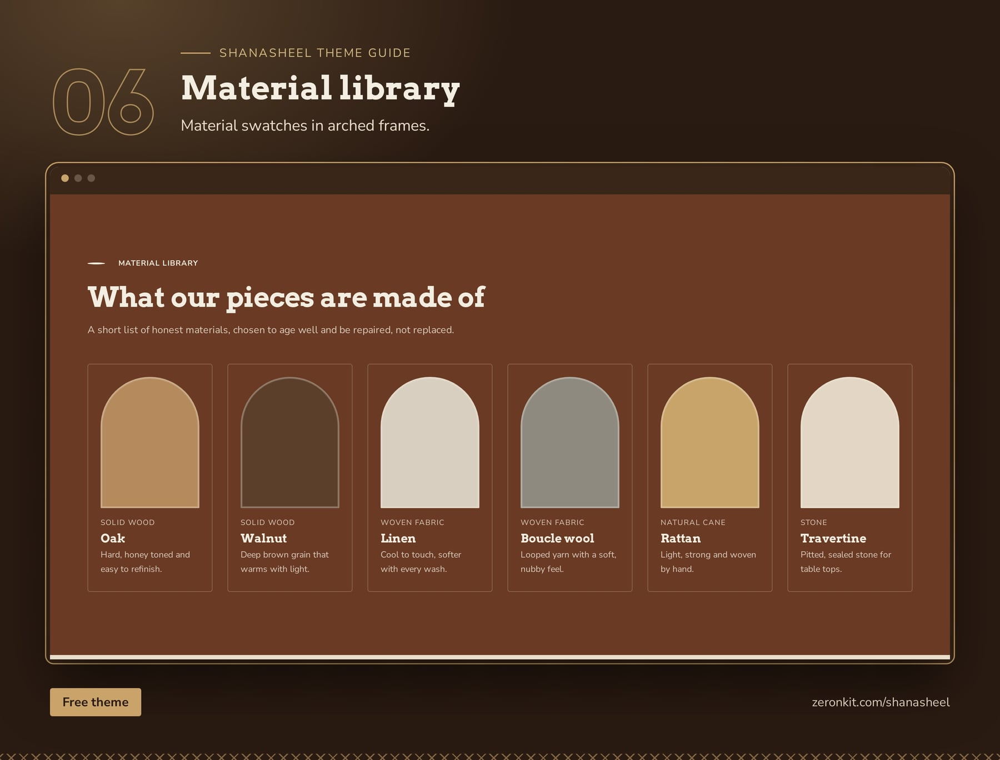](images/home-materials-en.jpg)

Each `Material` block has a swatch colour or image, a name, a type, a short text and a link. `Swatch shape` can be an arch, a circle or a square.

### 6.7 Delivery steps

Furniture buyers want to know what happens after they pay. This section walks them from the order to the day the piece stands in their room. The steps run down the page like a route, joined by a dotted brass line, with each number in a small walnut arch. A tall arched photo stands beside them, with your delivery note and a link under it.

- `Eyebrow text` and `Heading` sit above the steps. `Text` is the delivery note under the photo.
- `Image` sets the tall photo. Without one, the section uses a collection photo. A photo of a piece being carried in or set up tells the story best.
- `Button label` and `Link` set the link under the photo, for example your delivery page.
- Add one `Step` block per step, each with an `Icon`, a `Heading` and a `Text`. Four steps fit well.

On phones the photo comes first and the route follows.

### 6.8 Newsletter card

Sign-ups go to your customer list with the newsletter tag.

## 7. Collection and search pages

### 7.1 Collection page

[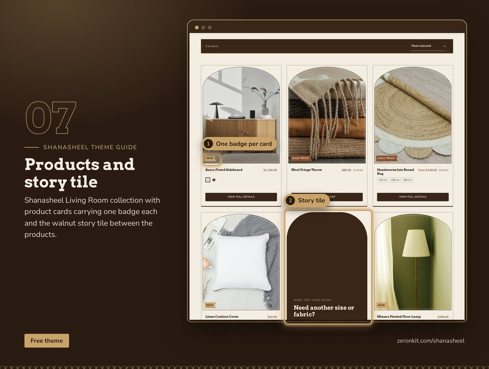](images/collection-grid-en.jpg)

Open any collection in the editor (page picker, `Collections`) and click `Collection: showroom`:

- `Show collection description`, `Show collection image`, `Show breadcrumb` and `Show room chips`.
- `Room chips menu`: pick a menu to choose which rooms appear in the index. Leave it empty to list your collections.
- `Products per page`, `Pagination` (numbered, load more or infinite scroll), `Columns on desktop` and `Columns on mobile`.
- `Let shoppers choose how many products to show` adds the per page choice.
- `Enable filtering` and `Enable sorting`. Filters come from the Search & Discovery app.
- `Show a story tile between products` adds a walnut tile between the products, with its own `Eyebrow`, `Title`, `Text`, `Button label` and `Link`. `Place it after product` sets its position.

On a collection with fewer than 12 pieces, the Filter button and the per page choice stay hidden whatever the settings say, because a short list is easier to scan than to filter. Sorting stays. On bigger collections, a filter group with only one choice (for example Availability with only "In stock") is left out.

### 7.2 Search page

[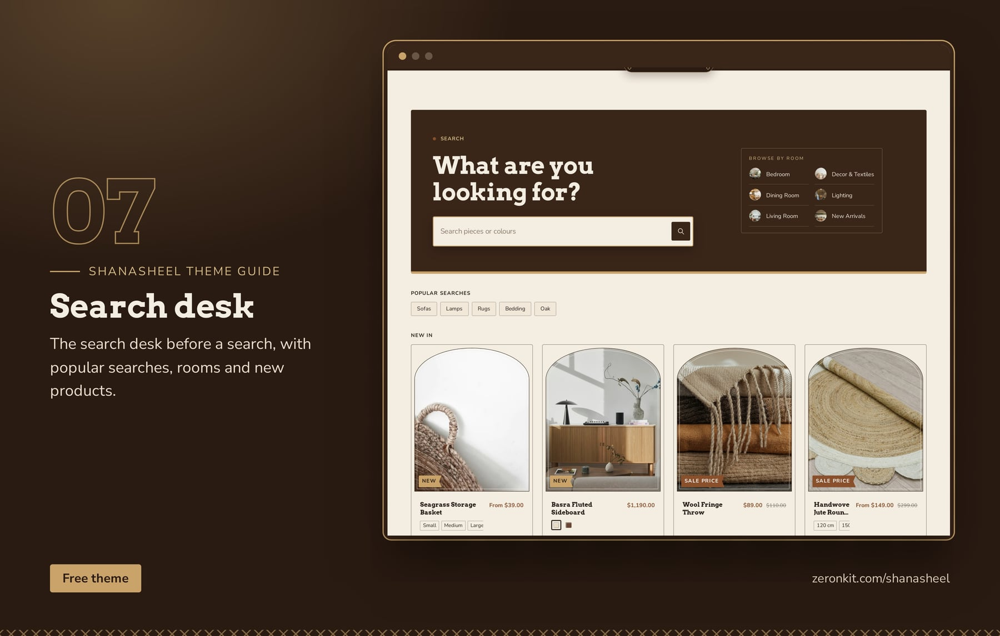](images/search-page-en.jpg)

[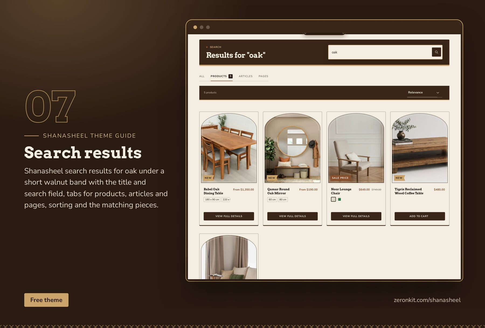](images/search-results-en.jpg)

After a search, the results open under a short walnut band with the title on one side and the search field on the other, so the first results show in the first screen. The search desk before a search stays as it is. The popular search buttons are large enough to tap easily on phones.

The search page has the same filter and sort bar as collections, and it follows the same rule: under 12 results, no Filter button and no per page choice. `Suggested collection when nothing is found` sets what shows when a search has no results. Popular searches come from `Theme settings`, `Search`.

## 8. The product page

[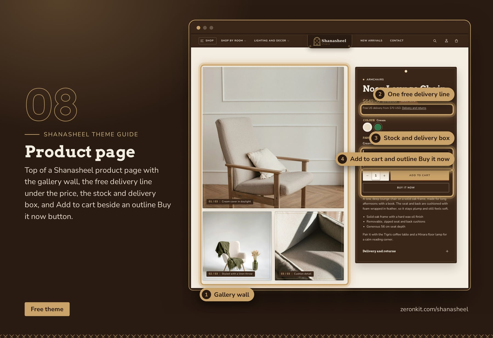](images/product-top-en.jpg)

Open a product in the editor and click `Product information`. The section has:

- `Gallery layout`: mosaic or single column.
- `Gallery position on desktop` and `Image shape`.
- `Buy panel style`: raised panel or plain.
- `Keep product details in view while scrolling`. On desktop the buy panel starts level with the first photo, and the shorter of the two columns (the gallery or the buy panel) stays in view beside the longer one, so no empty column shows. This happens on every product page.
- `Show only the selected colour's images` (see 3.2).

Every gallery photo has the same frame and one label in its corner with the photo number and its caption, for example "01 / 03 | Cream cover in daylight".

The buy panel is made of blocks. Drag them to change their order, or remove the ones you do not need:

- `Title`, `Price`, `Variant picker` (buttons or a dropdown) and `Text`. When a variant has a compare at price, the `Price` block shows a "Save 13%" badge beside the price, in the same notched rust tag as the Sale badge on the cards.
- Under the price there is one delivery line, for example "Free US delivery from $70 USD. Delivery and returns". It reads the same `Free delivery threshold` as the announcement bar and the cart, and its link opens your shipping policy. Write that policy in `Settings`, `Policies`. Set the threshold to 0 and the line goes away.
- `Fabrics and finishes`: the finish swatches with their notes. It can link to a free swatch page. When the `Variant picker` already shows the finishes as swatches, this block shows only its heading and the note of the selected finish, and the note changes with the shopper's choice.
- `Delivery and lead time`: the box that says if the item is in stock and when it should arrive. Set the day ranges for in stock and made to order items, or use the `shanasheel.lead_time` metafield.
- `Buy buttons`: quantity, Add to cart, the Buy it now button and pickup availability. Add to cart is the one filled brass button. Buy it now is an outline button beside it, so the shopper's eye goes to Add to cart first. `Show accelerated checkout buttons` turns Buy it now off.
- `Description`, `Collapsible tab`, `Complementary products` and `Custom Liquid`. The `Delivery and returns` tab holds the delivery details once and does not repeat the delivery box.

Gift card products skip what does not apply to them: no delivery line, no delivery box, no pickup line and no Buy it now.

On phones, once the main button has scrolled off the screen, a bar slides up at the bottom with the product name, the price and "Add to cart". It adds the variant the shopper picked, shows "Sold out" when that variant is not available, and hides again near the footer. There is nothing to set.

### 8.1 The details band

Under the gallery is a band for longer details. The `Dimensions and materials` and `Care and assembly` blocks sit there by default. Each has a `Placement` setting to move it into the buy panel instead.

### 8.2 Shop the room

[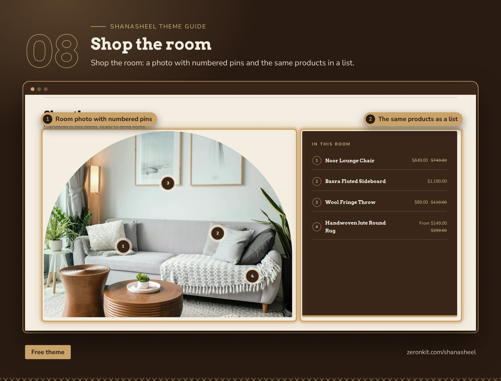](images/product-room-en.jpg)

The `Shop the room` block shows a room photo with up to four numbered pins and a list of the same products. It takes its photo and products from the block settings first, then from the `shanasheel.room_image` and `shanasheel.room_products` metafields. With metafields set, every product gets its own room without touching the editor.

### 8.3 Related products

Shopify picks these products. You can change them in the Search & Discovery app. `Fallback collection` fills the row while Shopify has no recommendations yet.

## 9. Cart

`Theme settings`, `Cart`, `Cart type` chooses between the drawer and a full page. With the drawer, the cart opens each time a shopper adds a piece, and "View cart" leads to the cart page.

### 9.1 The cart drawer: a room card

[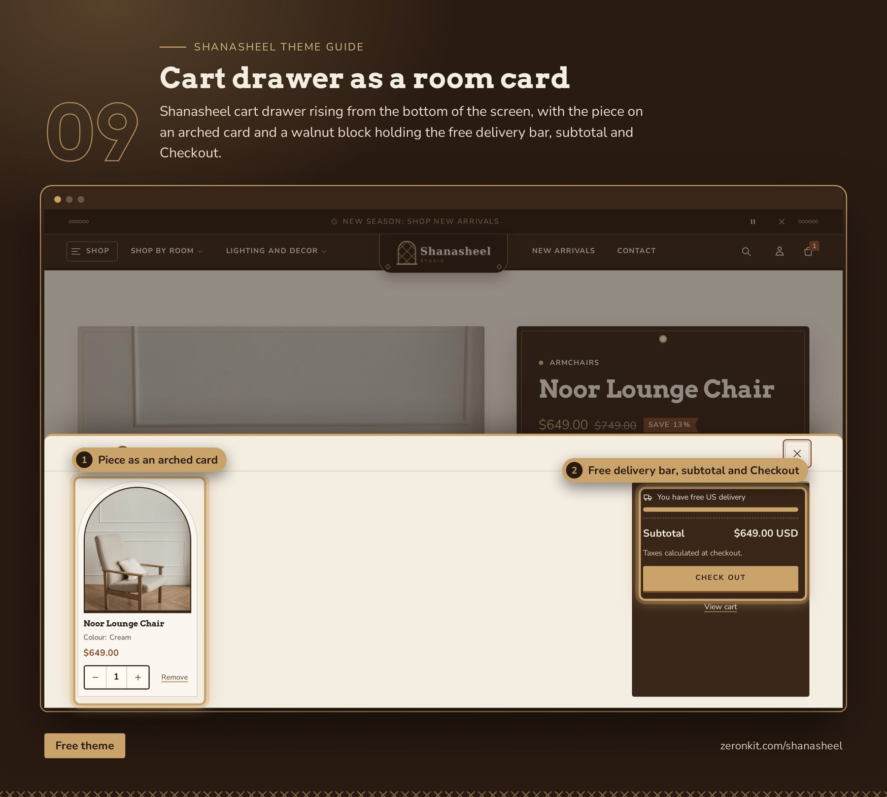](images/cart-drawer-en.jpg)

The drawer rises from the bottom of the screen as a wide sand sheet with a brass top edge. The pieces stand side by side as arched cards: the photo, the name, the options, the price, the quantity and Remove. If the pieces do not all fit, the shopper scrolls the row sideways with the arrows or the keyboard. A walnut block at the end of the row holds the free delivery bar, the subtotal, a short taxes note, Checkout and "View cart".

On phones the drawer fills the screen. The pieces become a list, and the free delivery bar, the subtotal and Checkout stay in a bar at the bottom.

### 9.2 The cart page: delivery to your room

Each piece gets a full width card with a large arched photo, its options and a delivery line with a small truck. The delivery line is the `shanasheel.lead_time` metafield of the variant or the product, for example "Made by hand to order: ships in 4 to 6 weeks". Without it, a piece in stock says "In stock, ready to send". Fill in the lead time on made to order pieces, so shoppers know before they pay.

Under the cards, a walnut band holds the free delivery bar, the subtotal, Checkout and three delivery promises. The band stays at the bottom of the window while the shopper scrolls. On phones it is a slim bar, and a "Details" button opens the promises and the order note.

In the `Cart` section on the cart page:

- `Show delivery notes` and `Delivery note 1`, `Delivery note 2` and `Delivery note 3` set the three promises. Leave the notes empty to use the built-in English and Arabic texts.
- Under `Empty cart`, `Heading` and `Text` set what an empty cart says. Leave them blank to use the built-in texts. `Show rooms` shows your room tiles, and `Show products` with `Collection` adds a row of products.

The order note shows in the band only when `Theme settings`, `Cart`, `Enable order note` is on.

### 9.3 The free delivery bar

Both the drawer and the page show a free delivery bar, for example "$31.00 away from free US delivery", then "You have free US delivery" once the order reaches the amount. The bar reads `Theme settings`, `Cart`, `Free delivery threshold`, the same amount as the announcement bar and the line under the product price. Set it to the amount of your free shipping rate in `Settings`, `Shipping and delivery`, or to 0 to hide the bar. It also stays hidden when the cart is empty or the shopper pays in another currency.

The built-in texts mention the US. If your free delivery covers another country, change them in `Themes`, `...`, `Edit default theme content` (search for "free US delivery").

The line under the bar speaks only about taxes. Shipping costs show at checkout, as usual in Shopify.

Each line shows its price once. When the quantity is more than 1, the price of one item shows under the name, for example "$39.00 each".

## 10. Contact page and other pages

### 10.1 Contact

[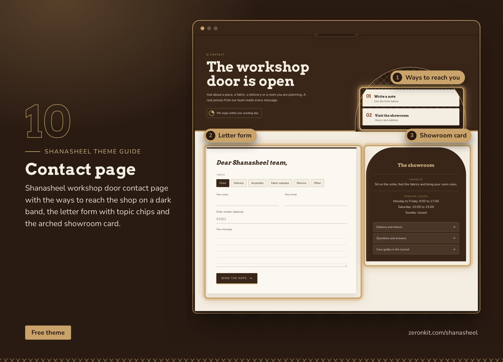](images/contact-en.jpg)

The contact page uses the `page.contact` template and the `Contact: workshop door` section:

- A dark band with the heading, a reply promise and the ways to reach you: write, email and visit.
- A letter form with topic chips, name, email, order number and message.
- An arched showroom card with your address, opening hours, email and quick links. Add one `Quick link` block per link.

Every text has an English and an Arabic default. Type your own text in a field only when you want to replace the default.

The page shows the email way and the email line on the card only if it has an address. The page takes it from the section's `Email address` field, or else from `Theme settings`, `Brand assets`, `Store contact email`. With both empty, the page shows two ways, numbered 01 and 02, and the form still works.

Messages from the form go to your store email, set in `Settings`, `General`. Shopify also prints that address in its automatic privacy policy, so set it to an address you are happy to show.

### 10.2 Journal and posts

The journal page shows the newest post as a cover story and the rest as numbered rows. Post pages can show the author, the reading time, a large first letter and links to the previous and next post.

Shopify cannot translate tags. The theme carries Arabic names for common journal tags, such as Guides (أدلة), Care, Wood, Lighting, Textiles, Ideas and Living room, and shows them on Arabic pages. Other tags show as you wrote them.

Each post ends with a sign-off, for example "Written by Shanasheel Studio Team, November 24, 2026", and a "Shop the pieces" row of products. In the `Blog post` section, `Show "Shop the pieces"` turns the row on or off, `Heading` replaces its title and `Products to show` sets how many products appear (2 to 6). The products come from the post's `shanasheel.products` metafield (see 3.6), then from products whose tags match the post's tags, then from products tagged "bestseller". If nothing matches, the row stays hidden.

### 10.3 Normal pages

Pages such as shipping and returns use the `Page` section. The title sits in a light sand arch with a brass rule, and on desktop it stays in view while the chapters scroll. Each heading inside the page text becomes a numbered chapter.

### 10.4 About: a walk through the house

[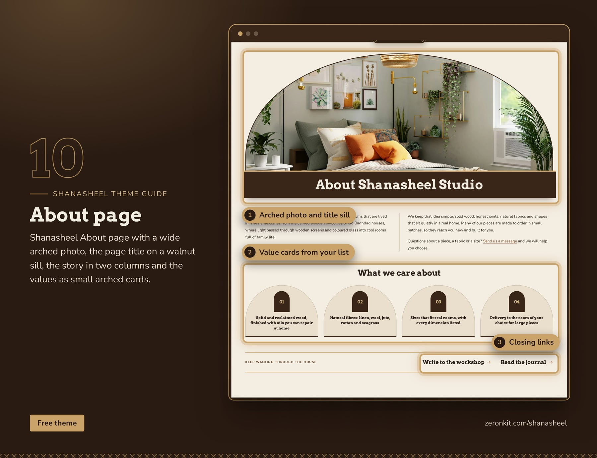](images/about-en.jpg)

Give your About page the template `page.about` (see 3.5). The `About: the house` section opens with a wide photo inside an arch and the page title on a walnut sill under it. Your page text follows in two columns on desktop, like a magazine. Then come small arched cards for what you care about, and two links at the end, to Contact and to the Journal.

You write all of this in the page itself, in `Online Store`, `Pages`:

- Write your story as normal text, with headings.
- Under one heading, for example "What we care about", write a short list. With `Values from the page text` on, the theme turns that first list into the arched value cards and takes it out of the text, so nothing shows twice.

In the section you can also set the `Image` (without one, a collection photo is used), an `Eyebrow text`, a `Values heading`, and `Show links to Contact and the Journal`. If you prefer to type the cards in the editor, add `Value` blocks, each with a `Heading`, a `Text` and an `Image`. The blocks then replace the list.

### 10.5 FAQ: workshop questions

[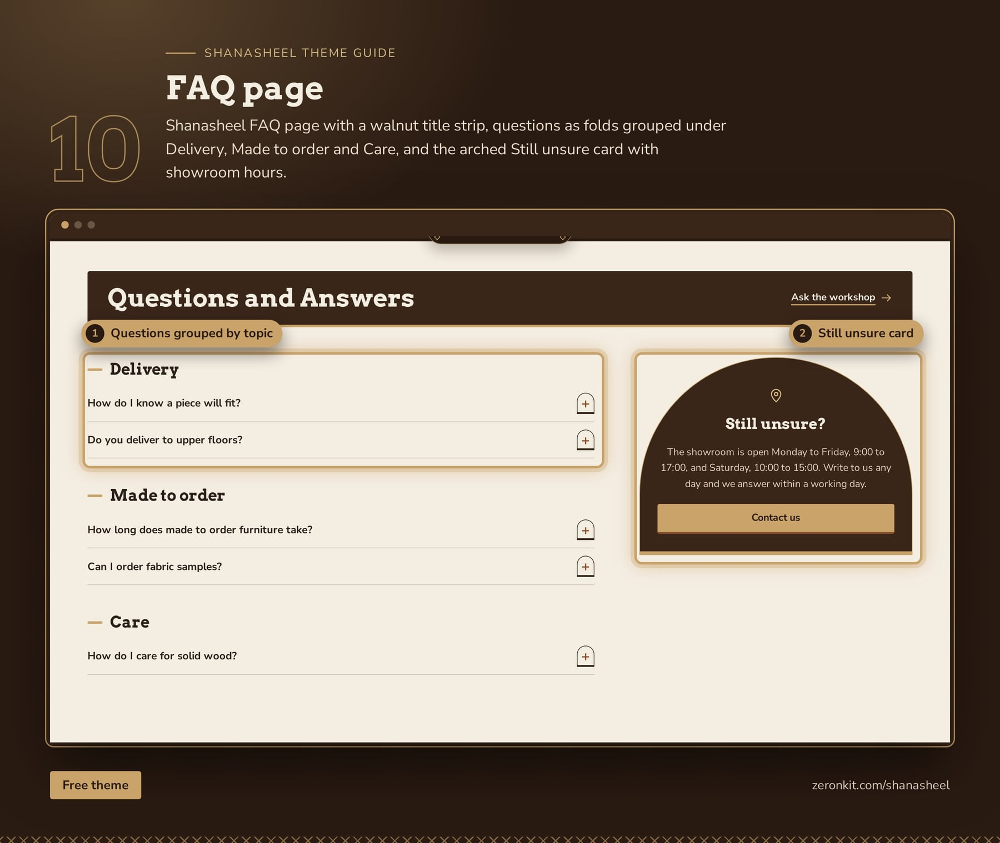](images/faq-en.jpg)

Give your FAQ page the template `page.faq`. The `Questions: workshop` section has a walnut title strip with a link at the end ("Ask the workshop", set with `Button label` and `Link`). Under it, the questions open and close like folds, grouped by topic. Beside them, an arched "Still unsure?" card stays in view with your showroom hours and a Contact button.

- Add one `Question` block per question, with its `Topic`, `Question` and `Answer`. Questions with the same topic are grouped under that heading, in the order of the blocks.
- Under `Still unsure card`, set the card's `Heading`, `Text` and `Button label`.

Without any `Question` block, the page shows your page text as it is. The question texts you type in the editor are translated in Translate & Adapt, under `Theme`.

### 10.6 Collections list, 404 and the password page

[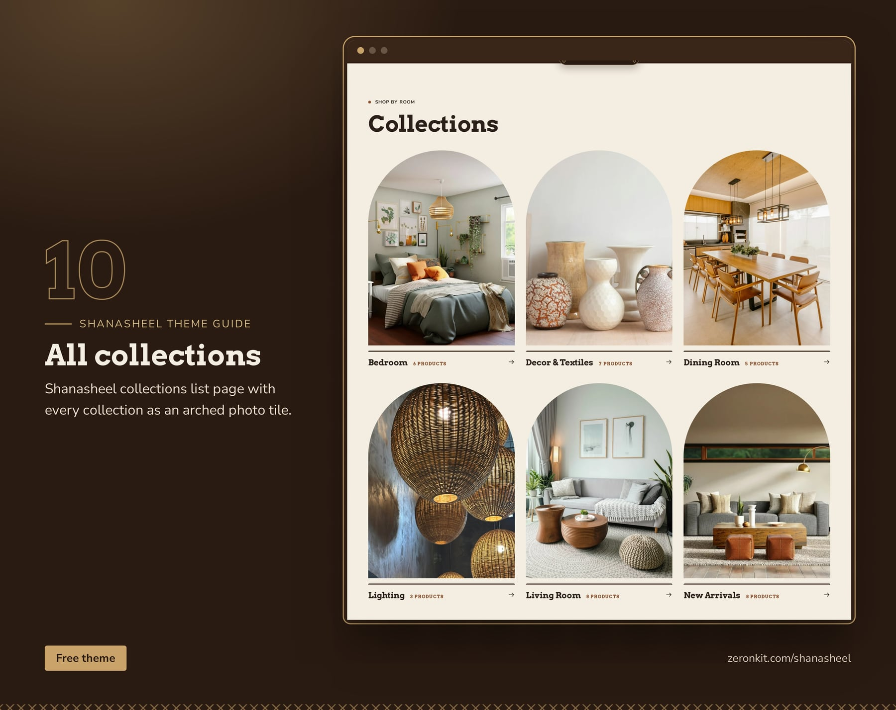](images/collections-list-en.jpg)

The 404 page shows an empty room: an arched lattice window, a picture frame hanging crooked with "404", a sideboard and a lamp. The title, a short text, the search field and "Continue shopping" stand on the walnut floor. Under the drawing, your collections appear as small arched doorways. `Room chips menu` picks which collections show, and `Heading` replaces the title.

The password page, which shoppers see while the store is closed, looks like the workshop door. A tall arched photo fills one half of the screen. The shop name plaque, your message, the password field and a newsletter field fill the other half. In the editor, open the page picker, choose `Password`, and set its `Image` and `Show newsletter sign-up`. On phones the photo becomes a band at the top.

## 11. The footer

[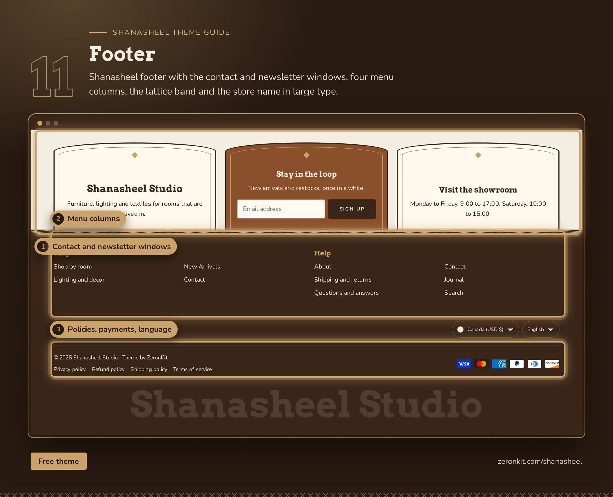](images/footer-en.jpg)

Click `Footer` in the left list:

- `Layout`: columns, brand and columns, or centred.
- `Contact window heading` and `Contact window text`. Put your showroom hours or address here. Do not type an email address in this text. Fill in `Theme settings`, `Brand assets`, `Store contact email` and the window adds a "Write to us" line with that address by itself.
- Blocks: `Menu`, `Text` and `Newsletter`.
- Switches for social icons, Follow on Shop, country and language selectors, payment icons, policy links and the large store name.

On desktop the menu columns spread across the full width. On phones they stack in one column.

## 12. Editing any page

The page picker at the top of the theme editor lists every kind of page: home, products, collections, pages, blogs, cart, search, password and 404.

1. Pick the kind of page.
2. Pick a real item, for example one product.
3. Change sections and blocks on the left. A change here affects every page that uses the same template, for example every product.

To give some products or pages a different layout:

1. In the page picker, open the template and choose `Create template`.
2. Name it, for example `product.sofa`, and set it up.
3. In the product admin, set `Theme template` to the new template.

For changes the editor cannot make, use `Themes`, `...`, `Edit code`. Duplicate the theme first, because code edits have no undo after you save.

`Edit default theme content` in the same menu lets you change any built-in text, such as button labels, in every language.

## 13. Arabic and other languages

1. In `Settings`, `Languages`, add Arabic and publish it.
2. In `Settings`, `Markets`, turn the language on for your markets.

The theme flips to right to left by itself and loads the Arabic font. Theme texts such as buttons, labels and the default section texts already come in English and Arabic.

Your own content (product names, descriptions, collections, pages and posts) needs translating in the Translate & Adapt app. Texts that you type into section settings, such as the FAQ questions, also get translated there, under `Theme`.

Shopify sets two limits here. Journal tags cannot be translated, so the theme shows Arabic names for the common ones (see 10.2). Live search suggestions are not offered for Arabic, so the Arabic search drawer leads to the full search page (see 5.4).

## 14. On phones

[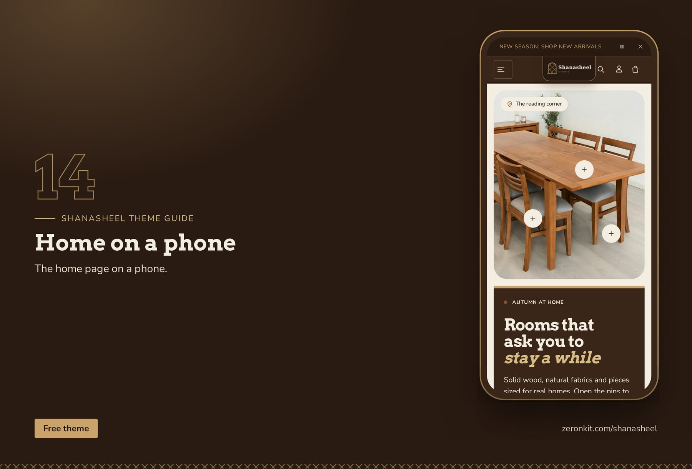](images/m-home-en.jpg)

[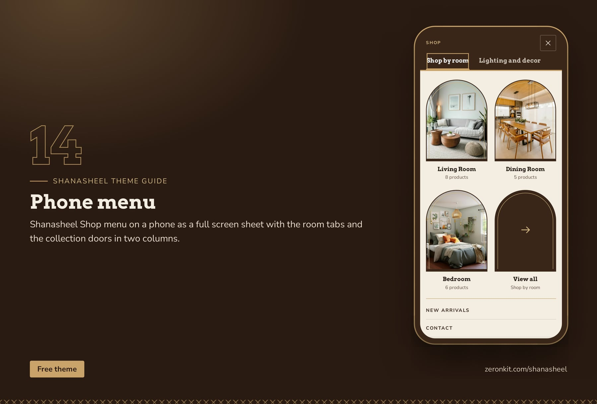](images/m-menu-en.jpg)

[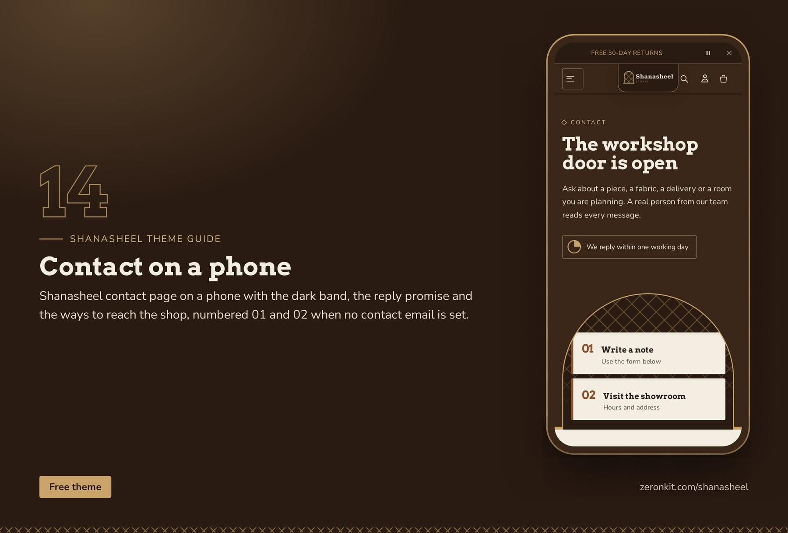](images/m-contact-en.jpg)

Every section has its own phone layout. You do not need to set anything. Some sections have a separate setting for phones, such as `Columns on mobile` and `Logo width on mobile`.

On phones every button and link is at least 44 pixels so it is easy to tap, card names and links inside page text included, and no text is smaller than 12 pixels. The Shop menu becomes a full screen sheet with the doors in two columns, and the cart fills the screen with Checkout always at the bottom. On product pages the gallery sits inside the page margin with the next photo peeking in, and the "Add to cart" bar appears at the bottom once the main button has scrolled away (see 8).

## 15. Troubleshooting

**Products show as sold out for shoppers in some countries.** Check `Settings`, `Markets`. If a country is in a separate market without its own product catalogue or shipping, Shopify shows products as unavailable there. Adding those countries to your main market, with a shipping rate in `Settings`, `Shipping and delivery`, fixes it.

**Products say sold out although you have stock.** Check that the stock is at a location that ships online orders, in `Settings`, `Locations`.

**English text shows on the Arabic store.** If you typed English into a section setting, that text shows in every language until you translate it in Translate & Adapt. Clear the field to go back to the built-in English and Arabic text.

**No filters on the collection page.** Install Search & Discovery and add filters there.

**The finishes block is empty.** Check that the option is called one of the names in the block's `Option names shown as finishes` setting.

**Shop the room shows no pins.** Fill the `shanasheel.room_products` metafield or choose products in the block.

**The free delivery bar does not show in the cart.** Check that `Theme settings`, `Cart`, `Free delivery threshold` is more than 0, that the cart has items and that the shopper pays in your store currency.

**The cart says "free US delivery" but you deliver free somewhere else.** Change the texts in `Themes`, `...`, `Edit default theme content` (search for "free US delivery"), or set `Free delivery threshold` to 0 to hide the bar.

**"Shop the pieces" shows the wrong products or none.** Give the post tags that match your product tags, tag a few products "bestseller", or fill the post's `shanasheel.products` metafield (see 3.6).

**Every card says New.** New shows for products created within `Theme settings`, `Product cards`, `Show New badge for` days. A store that added all its products at once sees New everywhere for a month. Lower the days, or set 0 and tag only your real new pieces "new".

**The Filter button is missing on a collection.** Collections and searches with fewer than 12 products hide the Filter button and the per page choice on purpose. Both come back once the list has 12 products or more.

**No email shows in the footer or on the contact page.** Fill in `Theme settings`, `Brand assets`, `Store contact email`.

**The Arabic search drawer shows no products while typing.** Shopify does not offer live suggestions for Arabic. The "See all results" bar opens the full search page, which finds the products.

**The About or FAQ page looks like a plain page.** Open the page in `Online Store`, `Pages` and set `Theme template` to `about` or `faq`.

**The contact form sends nothing.** Check the store email in `Settings`, `General`, and look in your spam folder.

## 16. Support

Email info@zeronkit.com. Help is best effort.

## 17. Changelog

Newest version first. To update from an earlier version, follow 2.3.

### 1.1.0 (25 November 2026)

This release comes from a full review of the theme on desktop, tablet and phone, in English and Arabic. No setting was renamed, so your content and your choices in the editor keep working. Two settings were removed: `Photos to show` in the home `Piece in focus` section and `Show products` on the 404 page (see "Updating from 1.0.0").

**Added**

- **Free delivery threshold.** A new setting, `Theme settings`, `Cart`, `Free delivery threshold` (default 70, in your store currency). Any announcement message can contain `[threshold]`, which shows that amount with its currency, for example "Free US delivery from $70 USD". If you leave a message with the truck icon empty, the theme writes a translated delivery message for you.

  Why: the 1.0.0 message said "Free standard delivery over 100" with no currency, so shoppers could not tell what it meant (readability, consistency).

  What to do: set the threshold to the amount of your own free shipping rate in `Settings`, `Shipping and delivery`, or to 0 if you do not offer free delivery. Put `[threshold]` in your delivery message.
- **Free delivery progress bar in the cart.** The cart drawer and the cart page show how much is left until free delivery, for example "$31.00 away from free US delivery", and "You have free US delivery" once the order reaches the amount. It uses the same `Free delivery threshold`.

  Why: shoppers see right away how close they are to free delivery (buying flow).

  What to do: nothing beyond setting the threshold. Set it to 0 to hide the bar. The built-in texts say "US delivery". If your free delivery covers another country, change them in `Themes`, `...`, `Edit default theme content` (search for "free US delivery" and "free delivery").
- **Add to cart bar on phones.** On a phone product page, a bar with the product name, the price and an `Add to cart` button appears at the bottom of the screen once the main button has scrolled away. It adds the variant the shopper picked and shows "Sold out" when that variant is not available.

  Why: on long product pages the buy button disappeared after the first screen (phone use, buying flow).

  What to do: nothing. It works on every product page.
- **Sale badge on the product page.** When a variant has a compare at price, a "Save 13%" badge (Arabic "وفّر 13٪") shows beside the price. The phone bar shows the sale price with the regular price crossed out.

  Why: a sale was easy to miss on the product page (buying flow).

  What to do: nothing. Fill in `Compare-at price` on the product as usual.
- **Article sign-off and "Shop the pieces".** Every journal post ends with "Written by" the author and the date, then a row of products. The products come from the article metafield `shanasheel.products` when it is set, otherwise from products whose tags match the post's tags, otherwise from products tagged "bestseller". If none match, the row stays hidden. The `Blog post` section has `Show "Shop the pieces"`, `Heading` and `Products to show`.

  Why: a reader who likes a story can buy the pieces in it without searching (buying flow).

  What to do: optional. Tag a few products "bestseller" or give your posts tags that match your product tags. To pick the products yourself, create a metafield definition for blog posts in `Settings`, `Custom data`, with namespace and key `shanasheel.products` and the type list of products, then fill it on each post. Turn the block off with `Show "Shop the pieces"` if you do not want it.

- **Store contact email.** A new setting, `Theme settings`, `Brand assets`, `Store contact email`, empty by default. When you fill it in, the address shows in the footer contact window under "Write to us" and on the contact page. When it is empty, no email line shows and the contact form stays.

  Why: the 1.0.0 demo content showed the theme maker's address as if it were the store's (trust).

  What to do: write your own shop address in the setting. If your footer contact text or your pages still mention another address, change them.
- **Meta descriptions everywhere.** Every page now has a meta description: your own SEO text first, then the page's own text (product, collection, article or page), then the shop description, then a short theme line for the home page, the collections list, the journal, search, cart, policies and the 404 page. Product pages also get BreadcrumbList data for search engines.

  Why: the home page, the collections list, the journal, search, cart, policies and the 404 page had no description (search engines).

  What to do: optional. Write a description in `Online Store`, `Preferences` and in the SEO part of your products and collections. The theme fills the gaps.
- **Journal tags in other languages.** Common journal tags (Guides, Care, Wood, Lighting, Textiles, Ideas, Living room and a few more) now show in Arabic on Arabic pages. Other tags show as written.

  Why: Shopify cannot translate tags, so English tags showed on Arabic pages (Arabic).

  What to do: to rename a tag, use `Themes`, `...`, `Edit default theme content` and search for the tag name.

- **About and FAQ page templates.** Two new page templates with their own sections. `page.about` (section `About: the house`) opens with a wide arched photo and the page title on a walnut sill, sets your page text in two magazine columns on desktop, turns the first list after a heading into a row of small arched value cards, and ends with links to Contact and the Journal. `page.faq` (section `Questions: workshop`) has a walnut title strip with an "Ask the workshop" link, the questions as folds grouped by topic, and a sticky arched "Still unsure?" card with your showroom hours and a Contact button.

  Why: the About and FAQ pages used the same plain page layout, and a FAQ read as one long text (readability).

  What to do: in `Online Store`, `Pages`, open your About page and choose the template `about`, then open your FAQ page and choose `faq`. Add your questions as blocks in the FAQ section (topic, question, answer) and write your hours in the card text. Without question blocks the FAQ shows your page text as it is.

**Changed**

- **Product gallery.** Every image now has the same frame, and the image number and caption sit together in one label ("01 / 03 | Cream cover in daylight") in the same corner of every image.

  Why: in 1.0.0 the first image had a different frame from the others and the number and caption were two separate labels (consistency).

  What to do: nothing.
- **Product page columns.** The buy panel now starts level with the first image. On desktop the shorter column (the gallery or the panel) moves with the page and then stays in view beside the longer one, so there is never an empty column.

  Why: the panel started lower than the gallery and long pages left a large empty gap (readability, buying flow).

  What to do: nothing. This now happens on every product page, whatever `Keep product details in view while scrolling` is set to.
- **Fabrics and finishes.** When the variant buttons already show the finishes as swatches, the `Fabrics and finishes` block shows only its heading and the note of the selected finish, and the note follows the shopper's choice.

  Why: the same choices were shown twice, one above the other (consistency, readability).

  What to do: nothing.
- **Phone and tablet gallery.** The gallery now sits inside the page margin and the next image peeks in from the side.

  Why: the first image touched the screen edge, and shoppers did not see that there were more images (phone use).

  What to do: nothing.
- **Home page hero.** The heading is smaller and the text panel wider, so the heading fits on fewer lines and both buttons are visible in the first screen on a laptop. On tablets the photo is shorter so the heading and buttons fit in the first screen.

  Why: the buttons were below the first screen on common laptop and tablet sizes (readability, buying flow).

  What to do: nothing. If you wrote a long heading, check it in the editor.
- **Spacing.** The gap between the hero and the next section and the space above the footer now use the same spacing as every other section. Arched cards no longer have empty space at the bottom.

  Why: some gaps were twice as large as others (consistency).

  What to do: nothing.
- **Footer.** Menu columns now spread across the full width on desktop (four columns). Phones keep one column.

  Why: the links sat in two crowded columns with empty space beside them (readability).

  What to do: nothing.
- **Room tiles.** A wide photo inside a tall room tile now zooms toward its subject instead of showing mostly wall.

  Why: landscape photos looked empty in the arched tiles (readability).

  What to do: if a tile does not show the right part of the photo, set the focal point on that image in Shopify (open the image in `Content`, `Files` or on the collection and choose the focal point).
- **Product card buttons.** Every card button now has the same height, text size and distance from the card edges, on every page.

  Why: buttons had different sizes and one touched the card edge (consistency, phone use).

  What to do: nothing.
- **Search results.** With results, the page opens with a short band that has the title and the search field on one row, so the first results appear in the first screen. The empty search page did not change.

  Why: the first result was below the first screen on laptops and phones (buying flow).

  What to do: nothing.
- **Popular search buttons.** They are now 44 pixels high on phones with slightly smaller text.

  Why: they were hard to tap (phone use).

  What to do: nothing.
- **Normal page title.** The page title now sits in a light sand arch instead of a dark walnut one. It is shorter, the title starts near the top, and it stays in view on desktop while the page scrolls.

  Why: the dark arch was tall and left an empty band above the title (readability).

  What to do: nothing.
- **Text sizes and tap targets.** On phones, every visible text is at least 12 pixels and every button or link is at least 44 pixels tall or wide. On desktop, small labels (header links, eyebrows, counts, field labels, table headings, breadcrumbs) are at least 13 pixels and the footer text is 14 pixels.

  Why: some labels were too small to read and some links too small to tap (readability, phone use).

  What to do: nothing.
- **Announcement bar on phones.** The text now fits on one line, the icons are hidden on phones, and the pause and close buttons are larger.

  Why: the delivery message wrapped onto two lines and pushed the page down (phone use).

  What to do: keep each message short.
- **Cart lines.** The line price now shows once, on the side. Under the product name you only see the price of one item ("$39.00 each") when the quantity is more than 1.

  Why: the same price appeared twice on every line (readability).

  What to do: nothing.
- **Images for screen readers.** Decorative copies of images (card hover images, thumbnails, collage frames) now have empty alt text, and real photos keep their description. A card's second image now loads as soon as the pointer, a tap or the keyboard reaches the card.

  Why: screen readers read every photo twice, and some hover images were still blank on the first hover (consistency).

  What to do: keep writing alt text for your product photos.

- **Buy it now.** It is now an outline button on the product panel. Only Add to cart is filled.

  Why: two filled buttons competed for attention (buying flow).

  What to do: nothing.
- **One delivery message on the product page.** The line under the price now says "Free US delivery from $70 USD" from the same `Free delivery threshold` as the announcement and the cart bar, with a link to your delivery and returns policy. The "Shipping calculated at checkout" line is gone, and the `Delivery and returns` fold no longer repeats the delivery box. In the cart, the line under the bar now speaks only about taxes. Gift card products show no delivery line, no delivery box and no Buy it now.

  Why: the page said "Shipping calculated at checkout" right beside a free delivery offer, and the same delivery facts appeared three times (consistency, trust).

  What to do: keep the threshold equal to your real free shipping rate. Set it to 0 if you do not offer free delivery, then the old line comes back.
- **Badges.** A product card shows one badge: Sold out, then Sale, then New. New shows for products tagged "new", or created within the days set in `Theme settings`, `Product cards` (default now 30, 0 uses the tag only). The "Save" badge on the product page now has the same notched tag shape as the card badge.

  Why: cards could show Sale and New at the same time (consistency).

  What to do: tag products "new" if you want the badge on older pieces.
- **Small lists.** Collections and search results with fewer than 12 products no longer show the Filter button or the per page choice. A filter group with only one choice is left out.

  Why: filters on a list of five products only added clicks (readability).

  What to do: nothing.
- **Cart photos.** Product photos in the cart page and the cart drawer are now 120 pixels wide on every screen.

  Why: at 78 pixels on phones the pieces were hard to recognise (buying flow).

  What to do: nothing.
- **Phones.** Card names, footer credit links, links under the product price and in the delivery fold, the cart Remove link and the contact page fields are now 44 pixels tall. The search field placeholder is shorter ("Search pieces or colours") so it fits on phones in English and Arabic.

  Why: many links on phones were under 44 pixels, and the search placeholder was cut off (phone use).

  What to do: nothing.
- **Photo descriptions.** A real photo without its own alt text now uses the product, collection or article title (or the hero heading). Decorative copies keep an empty alt text.

  Why: screen readers heard nothing for these photos (accessibility).

  What to do: alt text you write yourself always wins.

- **Shop menu: doorways.** The menu now hangs from the header across the page width. The top items with sub menus are tabs, and their collections stand in one row of tall arched doorways with the photo, the name and the number of products, plus a "View all" door. Under a brass line, one row holds your pages (New arrivals, Journal, About, FAQ, Contact) and the language and currency pickers. On phones it is a full screen sheet with the tabs on top and the doors in two columns. Arrow keys move between the tabs. `Header`, `Menu panel` switches back to the list with image tiles.

  Why: every page starts here, and the menu should look like this shop (consistency).

  What to do: nothing. Collections show as doors when the menu link points to a collection with products.
- **Search: a side room.** Search opens as a tall drawer from the side of the screen. The field sits at the top, live results show suggestions, the products as a two column grid of small arched photos with name and price, collections and pages as links, and a full width "See all results" bar. Recent and popular searches wait at the bottom before the shopper types.

  Why: the search panel covered the whole top of the page and products showed as small rows (readability).

  What to do: nothing.
- **Cart drawer: a room card.** The cart now rises from the bottom of the screen as a wide sheet. The pieces stand side by side as arched cards (photo, name, options, quantity, price, Remove) in a row that scrolls sideways with arrows or the keyboard, and a walnut block at the end holds the free delivery bar, the subtotal, Checkout and "View cart". On phones it fills the screen, the pieces are a list and the subtotal and Checkout stay in a bar at the bottom.

  Why: a side drawer hid most of the page and showed one piece at a time on short screens (buying flow).

  What to do: nothing.
- **Cart page: delivery to your room.** Each piece is a full width card with a large arched photo, its options and a delivery line (the product's lead time, or "In stock, ready to send"), and the quantity and price at the end. The summary is a walnut band under the pieces that stays at the bottom of the window while you scroll: free delivery bar, subtotal, Checkout and the three delivery promises. On phones the band is a slim bar and "Details" opens the order note and the promises. An empty cart shows the room tiles from the home page.

  Why: the summary box beside the lines was easy to lose on long carts (buying flow).

  What to do: the delivery line reads the product metafield `shanasheel.lead_time` (the same one the product page uses).
- **404 page: the empty room.** One wide drawing of a room (an arched lattice window, a crooked frame with 404, a sideboard and a lamp) with the title, the text and the search field standing on the walnut floor. Under it your collections show as small arched doorways. The product row was removed.

  Why: a lost shopper needs the search and the rooms first (buying flow).

  What to do: nothing. `Rooms menu` still chooses the collections.
- **Password page: the workshop door.** A split screen: a tall arched photo on one side, and the shop name plaque, your message, the password fold and the newsletter field on the other. The page now uses the theme's Arabic font. On phones the photo is a band at the top.

  Why: the narrow centred column looked like a plain form (readability).

  What to do: optional. Choose a photo in the `Password` section. Without one, a collection photo is used.
- **Home: piece in focus.** One wide room photo of the piece across the page with a raised buy card over its lower corner (name, price, options, quantity, Add to cart, View full details). The short facts run on a brass ruled line under the photo. On phones the card overlaps the bottom of the photo and the facts follow as a list. New settings: `Room photo` and `Buy card corner`.

  Why: the photo and buy box side by side looked like every other product block (consistency).

  What to do: optional. Choose a wide room photo in the section. Without one, the first product photo is used. The old `Photos to show` setting was removed.
- **Home: workshop to home.** The delivery steps now run down the page as a route joined by a dotted brass line, each number in a small arch, beside a tall arched photo with your delivery note and link under it. On phones the photo comes first. New setting: `Image`.

  Why: four equal columns made the steps hard to follow on tablets (readability).

  What to do: optional. Choose a photo, for example a room being set up. Without one, a collection photo is used.

**Fixed**

- The breadcrumb on collection pages on phones: the slash now lines up with the links.
- Product grids on tablets: size chips are hidden below 990 pixels wide (as on phones) and the title and price are stacked, so product names are no longer cut to a few letters.
- The empty cart page in Arabic showed "Your cart is empty" in English. Both texts now come from the theme language files.

  What to do: if you copy your settings from 1.0.0 and the `Cart` section on the cart page still holds the old English heading and text, clear the two fields so the translated texts show.
- On product pages, the buy panel was pushed about 90 pixels down by a leftover offset. It now starts level with the gallery.

- In Arabic, live search suggestions are not offered by Shopify, and the search panel stayed empty. It now shows a "See all results" link for the words typed, which opens the full search page.

**Updating from 1.0.0**

A theme uploaded from a zip file does not update by itself. Your 1.0.0 store keeps working. Update when you are ready:

1. In `Online Store`, `Themes`, open the `...` menu of your current Shanasheel and click `Duplicate`. The copy is your backup.
2. Download Shanasheel 1.1.0 and upload the zip with `Add theme`, `Upload zip file`. It arrives as a new, unpublished theme.
3. Copy your settings. You can set the new theme up in the editor the same way as the old one, or copy the files: in the old theme open `Edit code`, copy the content of `config/settings_data.json`, `sections/header-group.json`, `sections/footer-group.json` and each file in `templates` that you changed, and paste it into the same files in the new theme. Version 1.1.0 renamed no setting, so these files fit. Two settings were removed: `Photos to show` in the home `Piece in focus` section and `Show products` in the 404 section. If you paste an old `templates/index.json` or `templates/404.json`, delete the lines `"media_limit"` and `"show_products"` if the editor complains.
4. In the new theme, set `Theme settings`, `Cart`, `Free delivery threshold`, and change your delivery message in the `Announcement bar` to use `[threshold]`. Write your shop address in `Theme settings`, `Brand assets`, `Store contact email`, and remove any other address from the footer contact text.
5. In `Online Store`, `Pages`, give your About page the template `about` and your FAQ page the template `faq`, and add your questions to the FAQ section.
6. Check the pages: the home page, the menu, the search panel, a collection, a product (also on a phone), the cart drawer and the cart page with items in them, a search, a journal post, About, FAQ and the 404 page, in every language you sell in.
7. Publish the new theme only when every page looks right. Keep the old copy for a while.

Note: the theme info in the 1.0.0 download said 1.1.0 by mistake. To tell the two apart, use the theme names in your library, or look for the `Free delivery threshold` setting, which only 1.1.0 has.

### 1.0.0 (25 November 2026)

First release.

---
