# Shanasheel theme guide

Version 1.0.0. Made by ZeronKit (https://zeronkit.com).

This guide covers the whole Shanasheel theme: what it is, how to install it, how to change its colours, fonts and sections, how to edit every page, and how to update it later. Labels in `code style` are the exact words you see in the Shopify theme editor.

## 1. What Shanasheel is

Shanasheel is a free Shopify theme for furniture, lighting, textiles and home decor stores. It works in English and Arabic, and the whole layout flips to right to left when a shopper picks Arabic.

[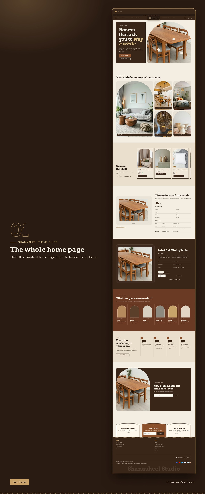](images/home-overview-en.jpg)

### Why the name

A shanasheel (شناشيل) is the carved wooden bay window that hangs over the street in old Baghdad and Basra houses. The windows are made of dark wood with a lattice screen, so the people inside can see out and the light comes in soft.

The theme takes its look from those windows:

- Dark walnut panels and warm sand backgrounds, like old wood against a plaster wall.
- Brass lines and pins, like the metal fittings on the windows.
- Arched photo frames, like the window tops.
- A lattice pattern in the footer and on the contact page.
- The logo hangs from the header bar in its own tab, the way a shanasheel hangs from the wall.

### What makes it different

- Shop the room. Product pins sit on a room photo, on the home page and on every product page, with the same products listed beside the photo.
- Real furniture details. Dimensions as large figures and a table, a cm and inch switch, materials, care and assembly, all read from product metafields.
- Fabrics and finishes. Each finish shows its swatch photo and a short note, and clicking it picks that variant.
- Delivery dates. The product page works out an estimated delivery window from your stock and lead times.
- A showroom collection page with a numbered room index, a photo collage and a story tile between the products.
- A magazine style journal, a workshop door contact page and a sand search desk.
- Arabic built in, with the Cairo font loaded only for Arabic pages.

### Licence

- Shanasheel is free to use and to change on stores you own or run.
- It is not for resale or redistribution. Do not sell it, share the files, upload it to theme marketplaces or present it as your own work.
- The copyright and author notices must stay in the files.
- It comes as is, with no warranty. The full text is in the `LICENSE` file inside the download.

### What you need

1. A Shopify store on any plan that allows custom themes.
2. Products with photos.
3. For filters on collection and search pages: the free Shopify app Search & Discovery.
4. For a second language: the free Shopify app Translate & Adapt.

The theme needs no other app.

## 2. Installing, publishing and updating

### 2.1 Upload the theme

1. Download the Shanasheel zip file from https://zeronkit.com/themes/. Do not unzip it.
2. In Shopify admin, open `Online Store` and then `Themes`.
3. Click `Add theme` (on some stores it is `Import`) and choose `Upload zip file`.
4. Pick the Shanasheel zip file. After a few seconds it appears in your theme library.

### 2.2 Preview and publish

1. In the theme library, click `Customize` next to Shanasheel. The theme editor opens.
2. Look at the home page, a collection, a product and the cart. Use the page picker at the top of the editor to move between them.
3. When everything looks right, go back to `Themes`, open the `...` menu next to Shanasheel and click `Publish`.

### 2.3 Updating later

A theme uploaded from a zip file does not update by itself. When a new version comes out:

1. In `Themes`, open the `...` menu of your current Shanasheel and click `Duplicate`. The copy is your backup.
2. Upload the new zip file as in 2.1. It arrives as a new theme in the library.
3. Open the new theme in the editor and set it up. Your old settings live in the old theme, so check the header, the home page and your colours.
4. Publish the new theme only when every page looks right. Keep the old copy for a while in case you need something from it.

If you use GitHub, you can also connect a copy of the theme with `Add theme`, `Connect from GitHub`. Shopify then pulls each change you push to that branch.

## 3. Getting your store content ready

The theme fills itself with your real products and collections, so it looks right from the first minute. The better your content, the better it looks.

### 3.1 Collections are rooms

Shanasheel thinks in rooms. Make one collection per room or kind of product, for example Living room, Bedroom, Dining room, Lighting, Decor and textiles. Give every collection an image. Those images appear in the room tiles, the shop menu, the room chips and the collection page collage.

### 3.2 Products

- Use at least three photos per product. The first one is the main photo, the second one shows when a shopper hovers over a card.
- Give each photo alt text. If a product has colours, end the alt text with "in" and the colour, for example "Lounge chair in green". The gallery then shows only the photos of the colour the shopper picks.
- Call the colour option `Colour` or `Color`. Call fabric or wood choices `Fabric`, `Finish`, `Material`, `Upholstery`, `Wood` or `Leather`, so the theme shows them as finishes.

### 3.3 Product metafields

Metafields are extra product fields. Add them in `Settings`, `Custom data`, `Products`. Shanasheel reads these, all in the `shanasheel` namespace:

| Metafield | Type | Where it shows |
|---|---|---|
| `shanasheel.width`, `depth`, `height`, `seat_height`, `diameter`, `length` | Dimension | Large figures and the dimensions table |
| `shanasheel.weight` | Weight | Dimensions table |
| `shanasheel.dimensions` | Multi line text, one "Label: value" per line | Extra table rows |
| `shanasheel.materials`, `shanasheel.finish` | Text | Dimensions block and the materials tab |
| `shanasheel.care`, `shanasheel.assembly` | Multi line text | Care and assembly block |
| `shanasheel.assembly_level` | Text: ready, easy or required | Assembly badge |
| `shanasheel.assembly_guide` | File or URL | Assembly guide link |
| `shanasheel.lead_time` | Text, on the product or the variant | Delivery box |
| `shanasheel.finishes` | List of metaobjects with name, image, color and note | Fabrics and finishes block |
| `shanasheel.room_image` | File (image) | Shop the room photo |
| `shanasheel.room_products` | List of products | Shop the room pins and list |

You do not need all of them. Every block hides the parts that have no data, and some fall back to headings in the product description, for example a "Dimensions" or "Care" heading.

### 3.4 Menus

In `Online Store`, `Navigation`:

- `Main menu` drives the header links and the shop menu. A link with child links opens as a panel, and links to collections show the collection photo.
- `Footer menu` fills the footer columns.

### 3.5 Pages

Create these pages in `Online Store`, `Pages` so every link in the theme has somewhere to go:

- `Contact`, with the theme template `page.contact`.
- `Shipping and returns`, `FAQ` and, if you sell furniture with sizes, `Measuring guide` (handle `measuring-guide`, it opens in a side drawer from the product page).

### 3.6 Blog

Create a blog called `Journal` with a few posts. Give every post an image and one or two tags. The tags become the topic links at the top of the journal page.

## 4. Changing colours, fonts and the overall style

Open the theme editor and click the paint brush icon on the left (`Theme settings`).

### 4.1 Ready-made style

`Style` holds choices that change the whole store at once:

- `Palette`: Linen, Walnut (dark), Clay, Moss, Stone, High contrast, Ochre or Slate (dark). Pick `Custom (use the colour schemes)` to set every colour yourself.
- `Background style`: Solid, Soft gradient, Two-tone sections or Dark mode.
- `Font pairing`: ready pairs of heading and body fonts, or `Custom` to use the font pickers.
- `Heading scale`, `Corners`, `Button style`, `Product card style` and `Spacing`.
- `Animations`: Off, Subtle or Expressive. Shoppers who ask their device for less motion never see movement.

### 4.2 How to change the colours

The theme uses six colour schemes. Each section picks one of them, so changing a scheme changes every section that uses it.

1. In `Theme settings`, open `Colors`.
2. Click a scheme, for example `Scheme 1`.
3. Change its `Background`, `Text`, `Button` and `Button label` colours. The preview updates as you go.
4. Click `Save` at the top right.

To give one section a different look, click that section in the editor and change its `Color scheme` setting. For example, the delivery steps use scheme 4 by default.

`Page color scheme` sets the page background behind all sections, and `Drawer and pop-up color scheme` sets the cart drawer and the menus.

Keep text and background contrast high so everyone can read your store.

### 4.3 Fonts

In `Typography`, pick a `Heading font` and a `Body font` from Shopify's font library, and change their sizes with the two sliders.

Arabic is handled for you. When a shopper views the store in Arabic, the theme loads the Cairo font for Arabic letters only, so English words keep your chosen font and Arabic text stays clear.

### 4.4 Other theme settings

- `Layout`: page width and corner radius.
- `Product cards`: image shape, second image on hover, sizes in stock, colour swatches, vendor and the "New" badge.
- `Cart`: drawer or a full cart page, an order note and currency codes.
- `Search`: live suggestions and your `Popular searches` (separate them with commas).
- `Brand assets`: the favicon and the logo used for sharing and gift cards.
- `Social media`: links for the footer icons.
- `Theme credit`: turns the small "Theme by ZeronKit" link in the footer on or off.

## 5. The header

The header group holds the announcement bar and the header.

[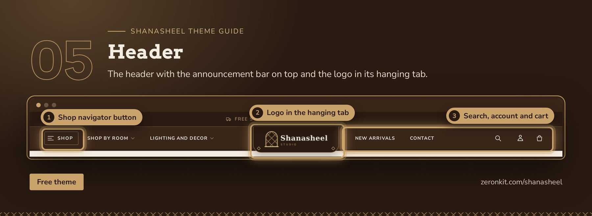](images/header-en.jpg)

### 5.1 Announcement bar

Click `Announcement bar` in the left list. Add one `Message` block per message, each with its own text, link and icon. `Display` can be static, a rotating fade or a moving marquee. Moving messages always have a pause button.

### 5.2 Logo

1. Click `Header`.
2. Under `Logo`, click `Select image` and upload your logo. A transparent PNG or an SVG works best.
3. Set `Logo width on desktop` and `Logo width on mobile`.

Without a logo image, the header shows `Text logo`, or the store name when that is empty.

### 5.3 Header layout and logo position

`Layout` changes the whole header shape:

- `Logo left, menu inline`
- `Logo centred, menu below`
- `Logo centred, menu split`: the default, with menu links on both sides of the hanging logo tab.
- `Minimal, menu button only`
- `Editorial masthead`
- `Side bar (desktop)`

`Logo position` moves the logo to the start, the centre or the end for the inline, centred and minimal layouts.

### 5.4 Menu, shop navigator and search

- `Menu` picks the menu for the header links.
- `Show the Shop navigator button` adds the Shop button that opens the menu with collection photos. On phones this is always the menu.

[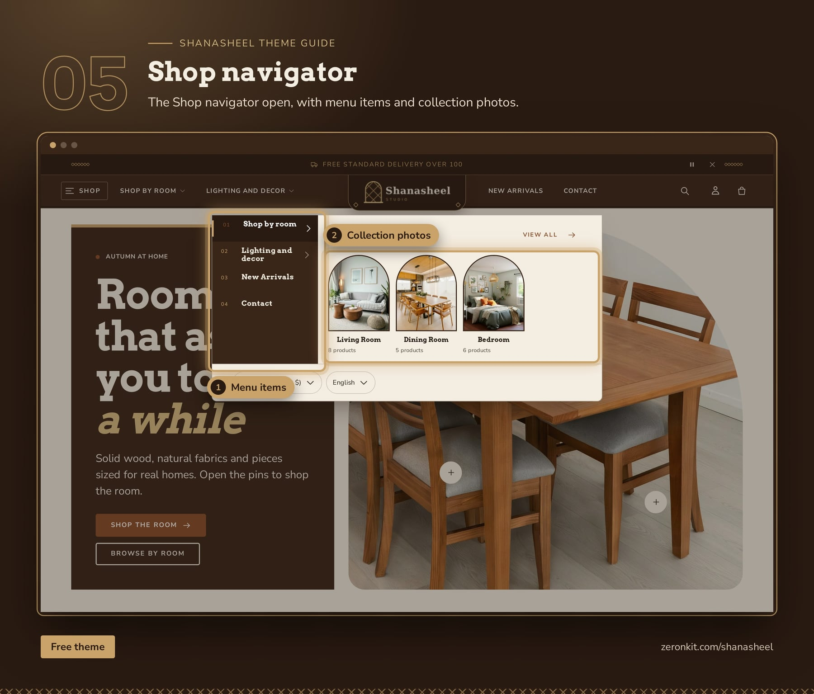](images/navigator-en.jpg)

- `Show search` adds the search icon. It opens a band at the top of the page with a large search box, popular searches and room links.

[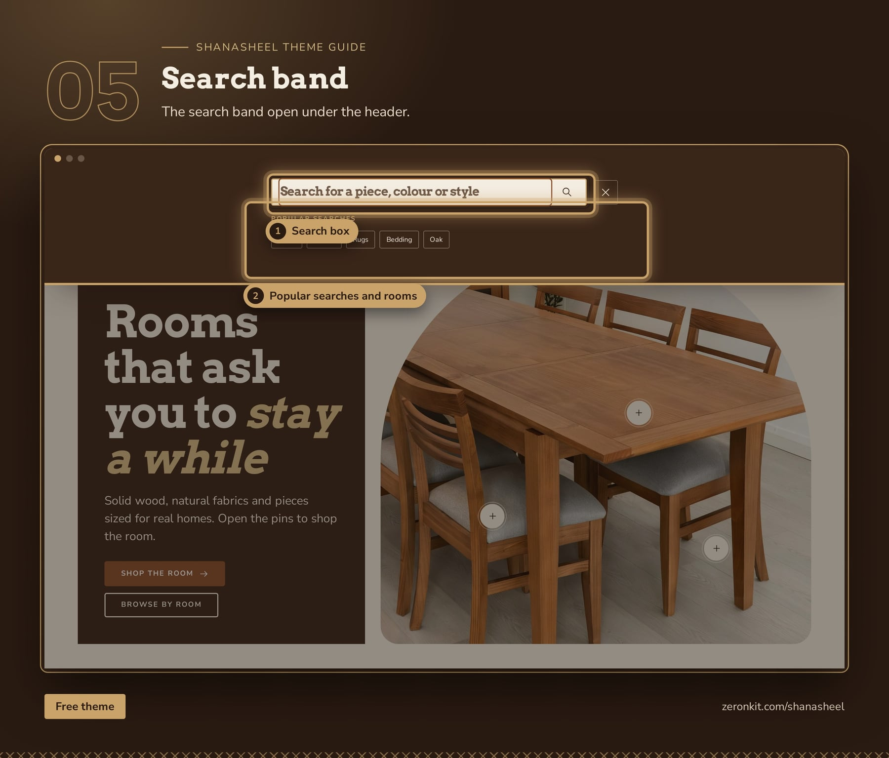](images/search-overlay-en.jpg)

- `Sticky header`: not sticky, always visible, or visible when the shopper scrolls up.
- `Transparent over the first section on the home page` lets the header sit over the hero photo until the shopper scrolls.
- `Color scheme` and `Menu and search color scheme` set the header colours.

## 6. The home page

Each part of the home page is a section. In the theme editor:

- Click a section in the left list to open its settings.
- Drag the six-dot handle to move it up or down.
- Click the eye icon to hide it without deleting it.
- Click `Add section` to add a new one, for example an image with text, a product shelf or an app.
- Inside a section, `Add block` adds items such as pins, steps or materials.

Shanasheel comes with eight home sections.

### 6.1 Room scene hero

- `Image` sets the room photo. Without one, `Use image from collection` takes a collection image.
- `Room label`, `Eyebrow text`, `Heading` and `Text` set the words. Put a word in italics in the heading and it shows in brass.
- Two buttons, each with a label and a link.
- `Image side` and `Height`.
- Each `Product pin` block places a product on the photo with `Horizontal position` and `Vertical position`. Shoppers click a pin to see the product and its price.

### 6.2 Shop by room

Add one `Room` block per collection. The tile uses the collection image unless you choose another one. `Layout` can be a mosaic or a horizontal row.

### 6.3 Product shelf

Pick a `Collection` and how many products to show. Cards have a quick add button, so shoppers can buy without leaving the home page.

### 6.4 Dimensions and materials

[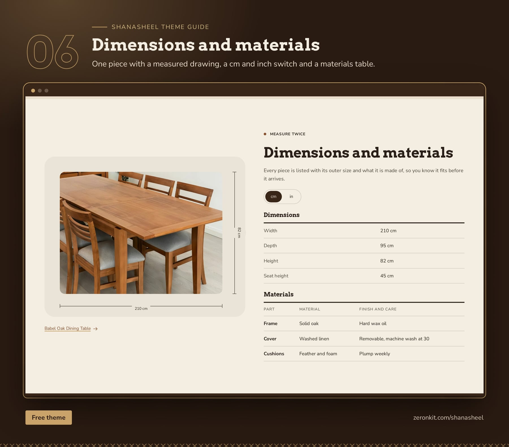](images/home-dimensions-en.jpg)

Choose a `Product`. `Measurement` blocks add rows such as width and height, and can draw a line on the photo. `Material row` blocks list each part, its material and its finish.

### 6.5 Piece in focus

[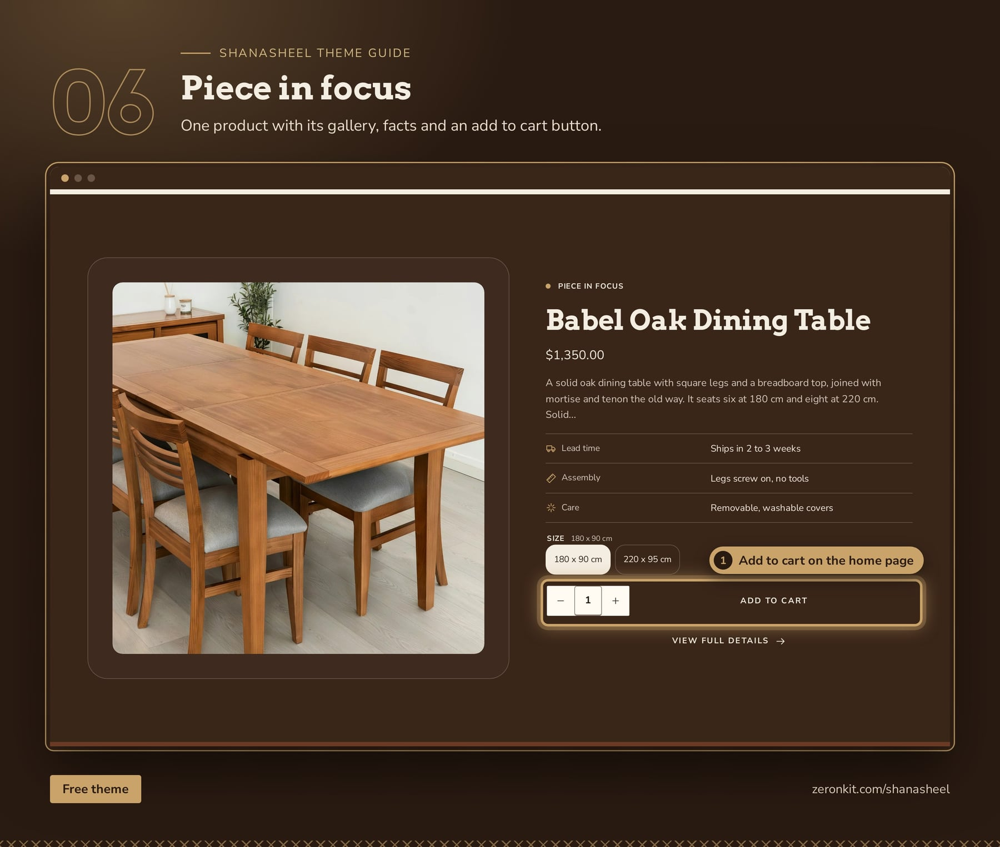](images/home-spotlight-en.jpg)

Shows one product with its photos, price, options and buy button. `Fact` blocks add short lines such as lead time or assembly.

### 6.6 Material library

Each `Material` block has a swatch colour or image, a name, a type, a short text and a link. `Swatch shape` can be an arch, a circle or a square.

### 6.7 Delivery steps

[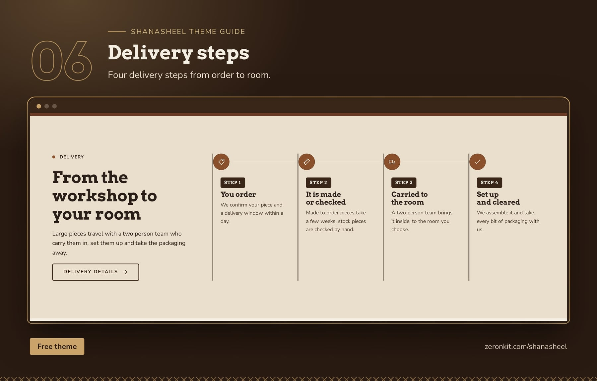](images/home-delivery-en.jpg)

A heading, a text and a button, then one `Step` block per step with an icon, a title and a short text.

### 6.8 Newsletter card

[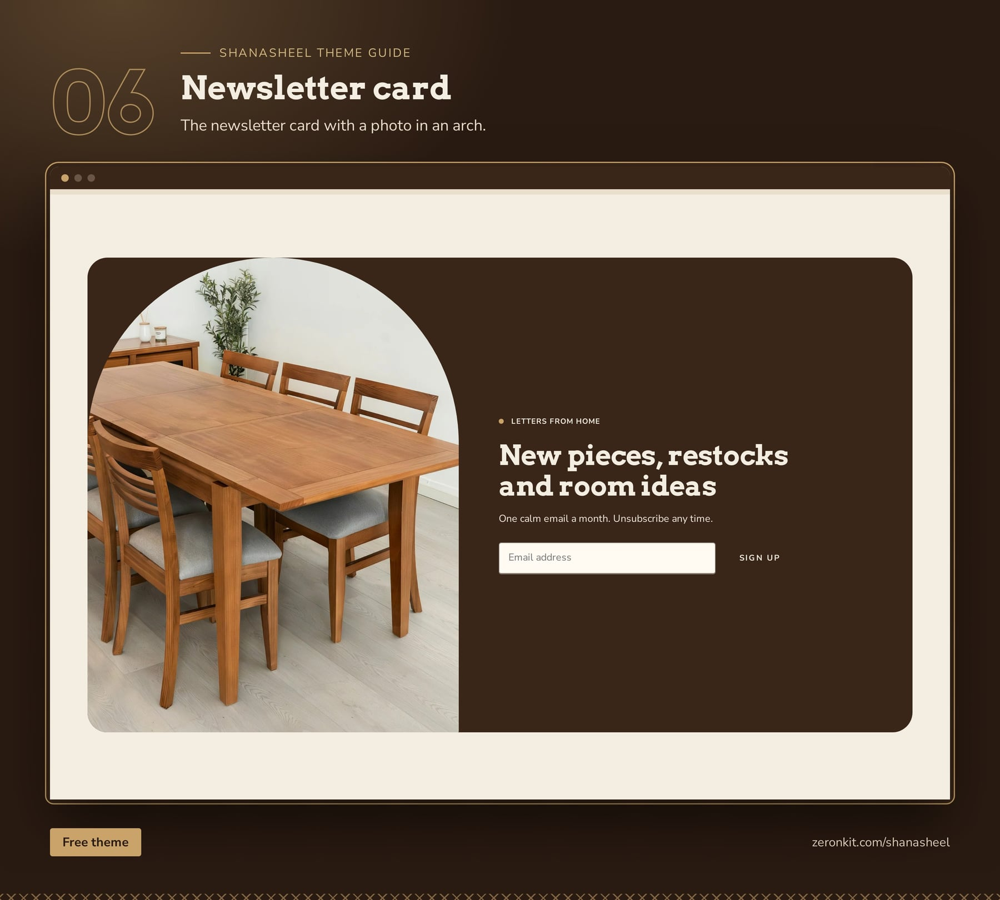](images/home-newsletter-en.jpg)

Sign-ups go to your customer list with the newsletter tag.

## 7. Collection and search pages

### 7.1 Collection page

[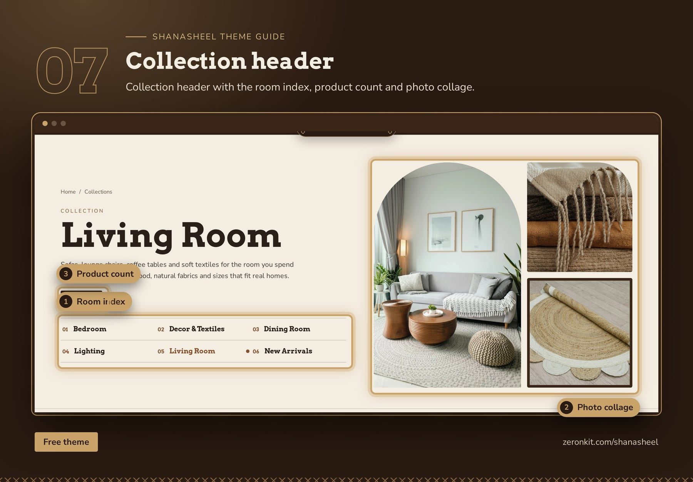](images/collection-head-en.jpg)

Open any collection in the editor (page picker, `Collections`) and click `Collection: showroom`:

- `Show collection description`, `Show collection image`, `Show breadcrumb` and `Show room chips`.
- `Room chips menu`: pick a menu to choose which rooms appear in the index. Leave it empty to list your collections.
- `Products per page`, `Pagination` (numbered, load more or infinite scroll), `Columns on desktop` and `Columns on mobile`.
- `Enable filtering` and `Enable sorting`. Filters come from the Search & Discovery app.
- `Story tile`: a walnut tile placed between the products, with its own text, button and link. `Place it after product` sets its position.

### 7.2 Search page

The search page has the same filter and sort bar as collections. `Suggested collection when nothing is found` sets what shows when a search has no results. Popular searches come from `Theme settings`, `Search`.

## 8. The product page

Open a product in the editor and click `Product information`. The section has:

- `Gallery layout`: mosaic or single column.
- `Gallery position on desktop` and `Image shape`.
- `Buy panel style`: raised panel or plain.
- `Keep product details in view while scrolling`.
- `Show only the selected colour's images` (see 3.2).

The buy panel is made of blocks. Drag them to change their order, or remove the ones you do not need:

- `Title`, `Price`, `Variant picker` (buttons or a dropdown) and `Text`.
- `Fabrics and finishes`: the finish swatches with their notes. It can link to a free swatch page.
- `Delivery and lead time`: the box that says if the item is in stock and when it should arrive. Set the day ranges for in stock and made to order items, or use the `shanasheel.lead_time` metafield.
- `Buy buttons`: quantity, add to cart, the Buy it now button and pickup availability.
- `Description`, `Collapsible tab`, `Complementary products` and `Custom Liquid`.

### 8.1 The details band

[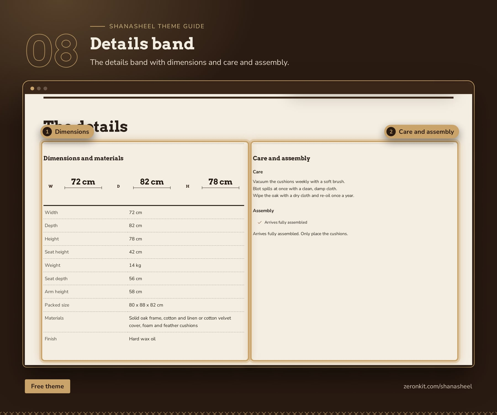](images/product-details-en.jpg)

Under the gallery is a band for longer details. The `Dimensions and materials` and `Care and assembly` blocks sit there by default. Each has a `Placement` setting to move it into the buy panel instead.

### 8.2 Shop the room

The `Shop the room` block shows a room photo with up to four numbered pins and a list of the same products. It takes its photo and products from the block settings first, then from the `shanasheel.room_image` and `shanasheel.room_products` metafields. With metafields set, every product gets its own room without touching the editor.

### 8.3 Related products

[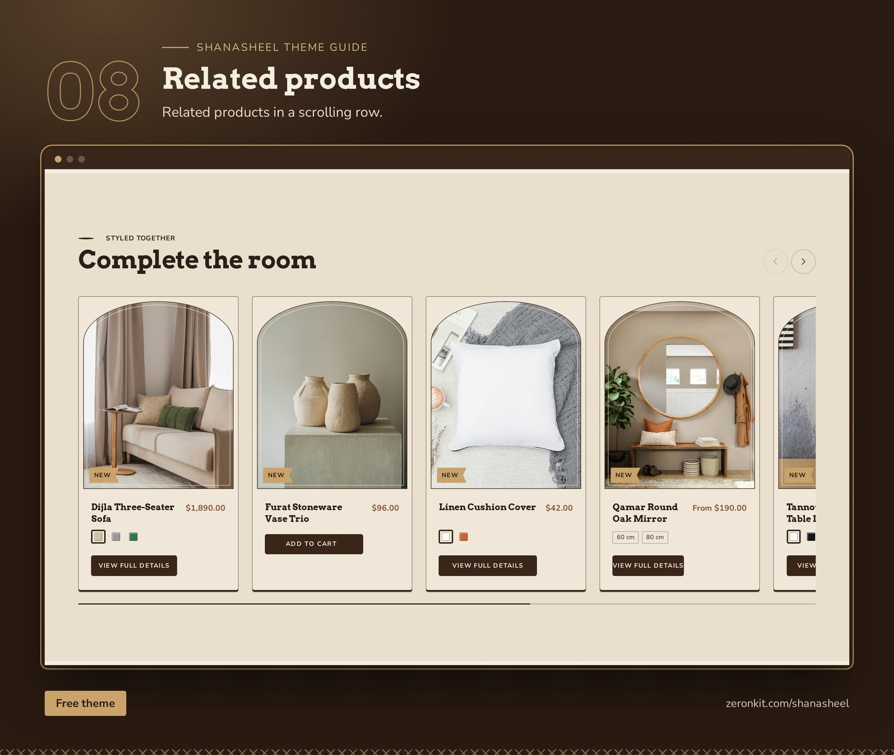](images/product-related-en.jpg)

Shopify picks these products. You can change them in the Search & Discovery app. `Fallback collection` fills the row while Shopify has no recommendations yet.

## 9. Cart

[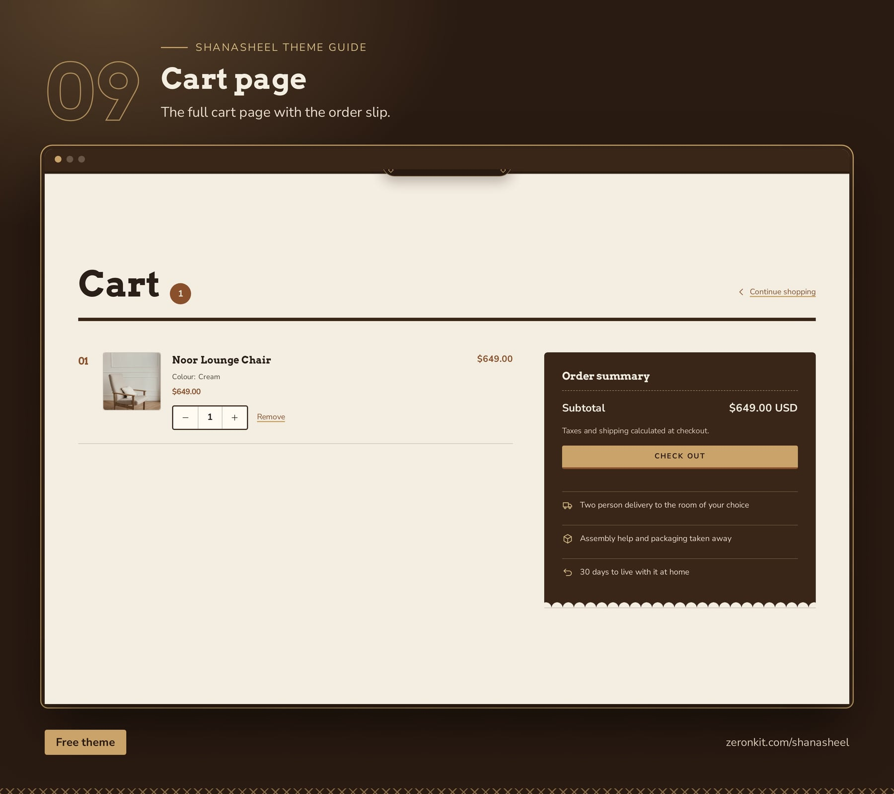](images/cart-page-en.jpg)

`Theme settings`, `Cart`, `Cart type` chooses between the drawer and a full page. On the cart page (`Cart` section) you can turn on three delivery notes under the order total, and set what shows when the cart is empty.

## 10. Contact page and other pages

### 10.1 Contact

The contact page uses the `page.contact` template and the `Contact: workshop door` section:

- A dark band with the heading, a reply promise and three ways to reach you: write, email and visit.
- A letter form with topic chips, name, email, order number and message.
- An arched showroom card with your address, opening hours, email and quick links. Add one `Quick link` block per link.

Every text has an English and an Arabic default. Type your own text in a field only when you want to replace the default.

Messages go to your store email, set in `Settings`, `General`.

### 10.2 Journal and posts

[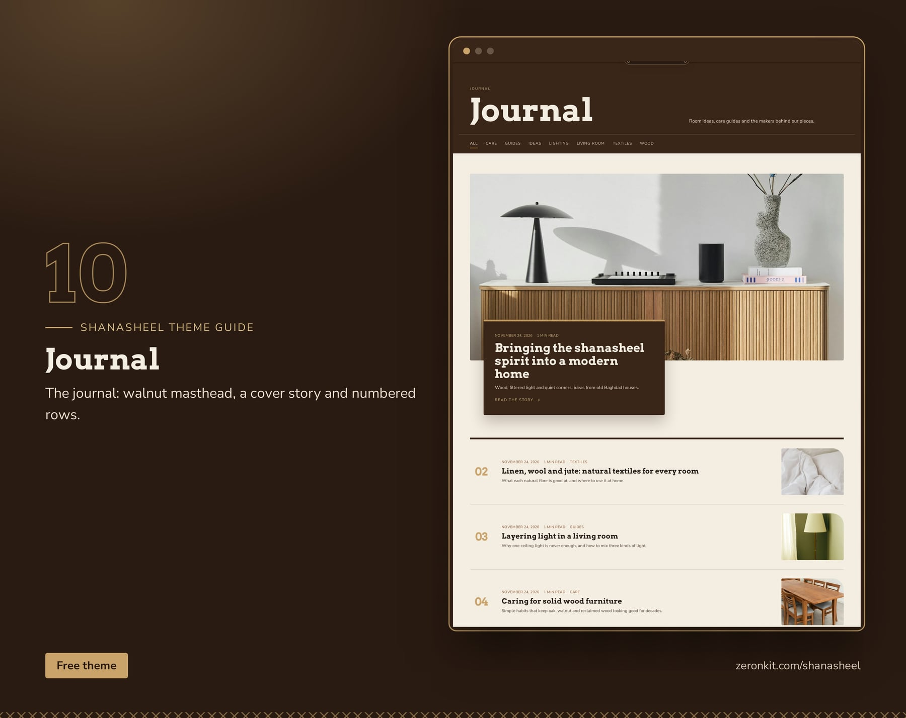](images/journal-en.jpg)

[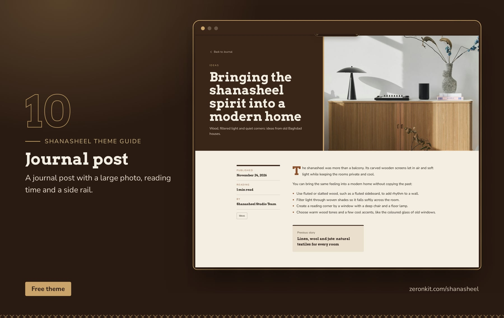](images/article-en.jpg)

The journal page shows the newest post as a cover story and the rest as numbered rows. Post pages can show the author, the reading time, a large first letter and links to the previous and next post.

### 10.3 Normal pages

[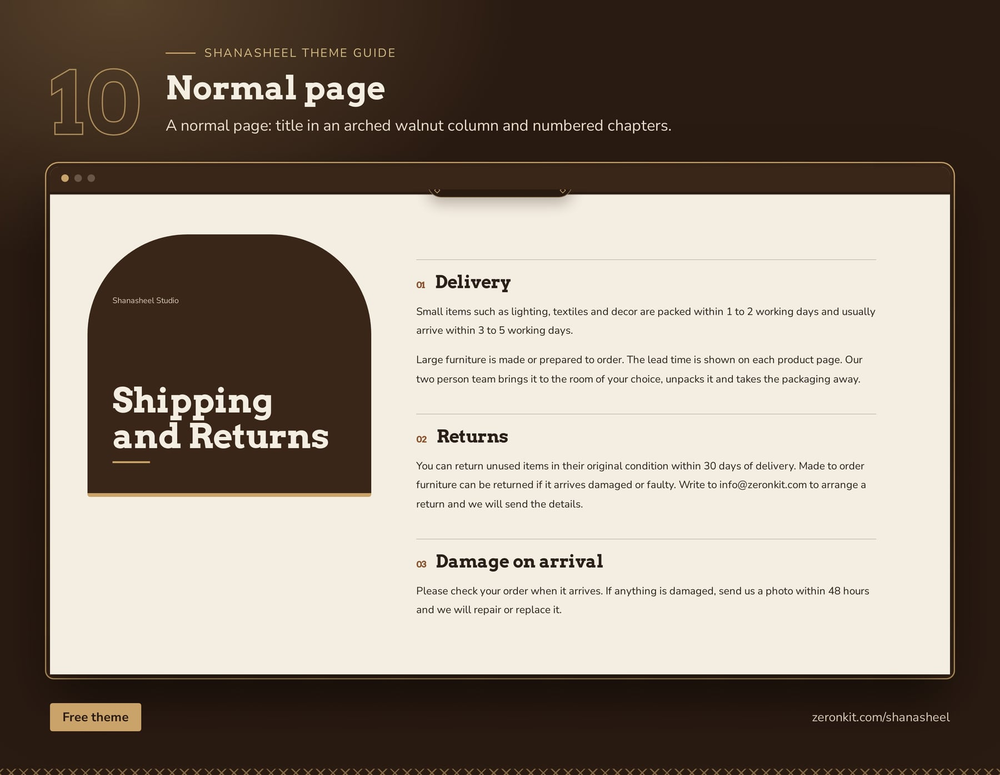](images/page-en.jpg)

Pages such as shipping or FAQ use the `Page` section. Each heading inside the page text becomes a numbered chapter.

### 10.4 Collections list and 404

[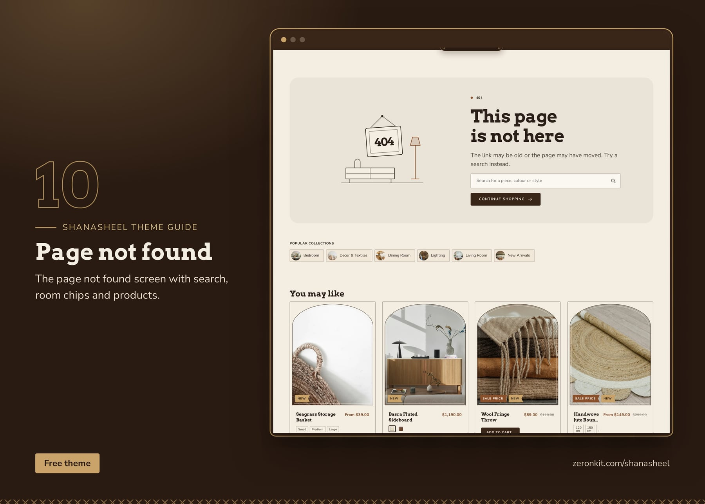](images/not-found-en.jpg)

## 11. The footer

Click `Footer` in the left list:

- `Layout`: columns, brand and columns, or centred.
- `Contact window heading` and `Contact window text`.
- Blocks: `Menu`, `Text` and `Newsletter`.
- Switches for social icons, Follow on Shop, country and language selectors, payment icons, policy links and the large store name.

## 12. Editing any page

The page picker at the top of the theme editor lists every kind of page: home, products, collections, pages, blogs, cart, search, password and 404.

1. Pick the kind of page.
2. Pick a real item, for example one product.
3. Change sections and blocks on the left. A change here affects every page that uses the same template, for example every product.

To give some products or pages a different layout:

1. In the page picker, open the template and choose `Create template`.
2. Name it, for example `product.sofa`, and set it up.
3. In the product admin, set `Theme template` to the new template.

For changes the editor cannot make, use `Themes`, `...`, `Edit code`. Duplicate the theme first, because code edits have no undo after you save.

`Edit default theme content` in the same menu lets you change any built-in text, such as button labels, in every language.

## 13. Arabic and other languages

1. In `Settings`, `Languages`, add Arabic and publish it.
2. In `Settings`, `Markets`, turn the language on for your markets.

The theme flips to right to left by itself and loads the Arabic font. Theme texts such as buttons, labels and the default section texts already come in English and Arabic.

Your own content (product names, descriptions, collections, pages and posts) needs translating in the Translate & Adapt app. Texts that you type into section settings also get translated there, under `Theme`.

## 14. On phones

[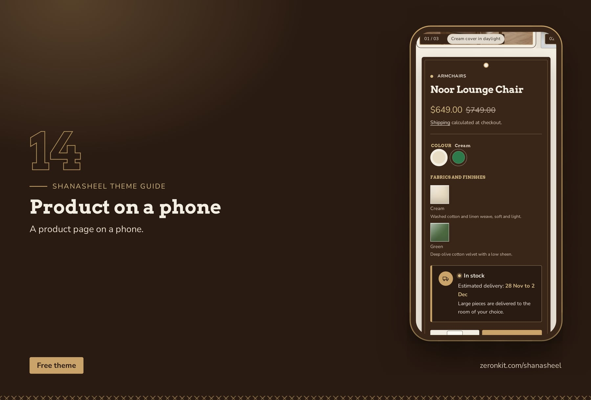](images/m-product-en.jpg)

[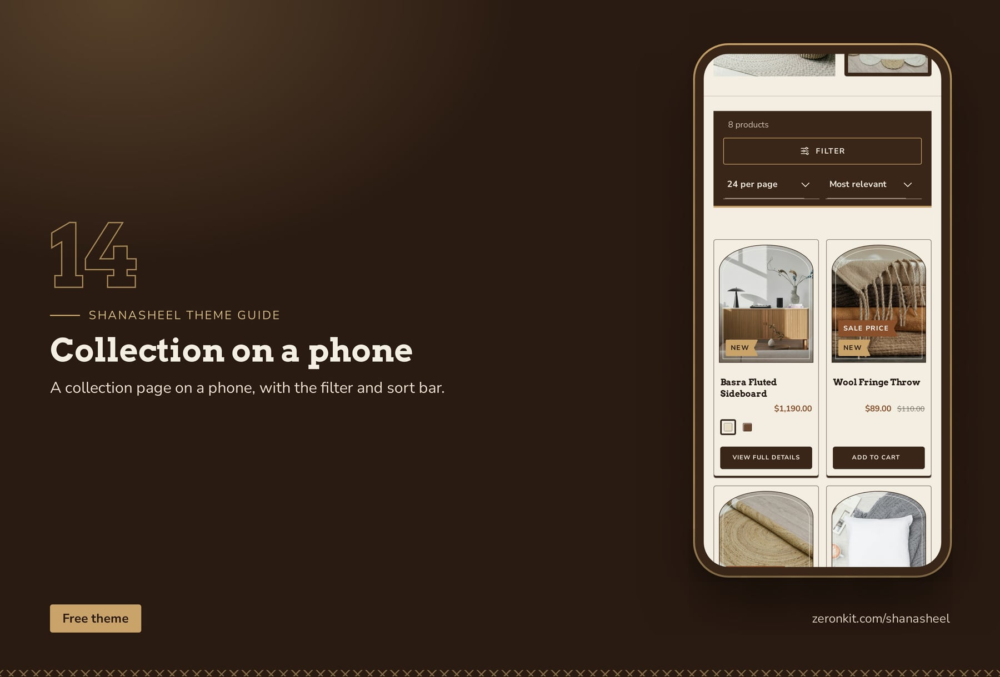](images/m-collection-en.jpg)

[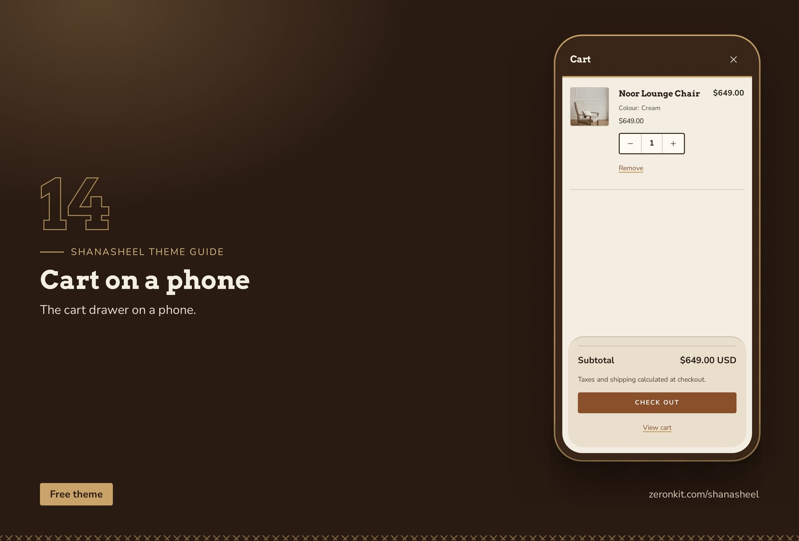](images/m-cart-en.jpg)

Every section has its own phone layout. You do not need to set anything. Some sections have a separate setting for phones, such as `Columns on mobile` and `Logo width on mobile`.

## 15. Troubleshooting

**Products show as sold out for shoppers in some countries.** Check `Settings`, `Markets`. If a country is in a separate market without its own product catalogue or shipping, Shopify shows products as unavailable there. Adding those countries to your main market, with a shipping rate in `Settings`, `Shipping and delivery`, fixes it.

**Products say sold out although you have stock.** Check that the stock is at a location that ships online orders, in `Settings`, `Locations`.

**English text shows on the Arabic store.** If you typed English into a section setting, that text shows in every language until you translate it in Translate & Adapt. Clear the field to go back to the built-in English and Arabic text.

**No filters on the collection page.** Install Search & Discovery and add filters there.

**The finishes block is empty.** Check that the option is called one of the names in the block's `Option names shown as finishes` setting.

**Shop the room shows no pins.** Fill the `shanasheel.room_products` metafield or choose products in the block.

**The contact form sends nothing.** Check the store email in `Settings`, `General`, and look in your spam folder.

## 16. Support

Email info@zeronkit.com. Help is best effort.

## 17. Changelog

1.0.0: first release.
